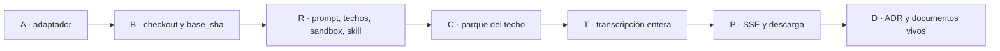

Última modificación: 2026-10-24 | Creado: 2026-10-24

# Plan: Claude revisa con la skill

El *qué y por qué* vive en [`spec.md`](spec.md); las tareas, en [`todo.md`](todo.md).
Este plan fija el orden y por qué el orden es ese.

## Overview

El adaptador va primero: es puro y destapa el contrato de `mode:agent` sin
imagen ni CLI. El checkout va después, porque sin `base_sha` el prompt no
tiene contra qué diferir. La invocación (prompt, techos, sandbox, skill en la
imagen) cuelga de ese checkout. El parque del techo cuelga de que el runner
sepa distinguir el techo de una caída corta. La transcripción y el panel van
los últimos: leen un fichero que el runner ya escribe. La documentación viva
cierra, con el comportamiento ya probado.

1. **Adaptador (A).** Objeto `mode:agent` → lista de hallazgos, o fallo.
2. **Checkout (B).** `base_sha` entra en el puerto y el árbol queda con los dos
   extremos, sin remoto.
3. **Invocación (R).** Prompt de la skill, herramientas, techos, sandbox y
   skill en la imagen.
4. **Techo (C).** Agotar turnos o tiempo de pared parkea. No reencola.
5. **Transcripción y panel (T, P).** Fichero entero, SSE y descarga.
6. **Documentación (D).** ADR, operación, desarrollo, glosario y `.env.example`.

## Decisiones de implementación

- **El adaptador no vive en el grafo.** Una función en un módulo nuevo, llamada
  desde `ensure_claude_artifact` antes de `save`. El grafo sigue leyendo la
  lista ya validada. `ClaudeArtifactReviewer` no aprende `mode:agent`.
- **`status` de review terminada es `complete`.** Cualquier otro (`failed`,
  `skipped`, `degraded`, ausente) no guarda artefacto. Una lista vacía solo
  vale con `complete` y cero hallazgos de origen. Si todos los hallazgos se
  descartan al validar, es salida inválida aunque `status` sea `complete`.
- **`id` es el `#` de la skill, como texto.** `pre_existing_findings` entran
  con `pre_existing: true`. `findings` no se filtra por `actionable_findings`.
  `failure_scenario` ausente en un P0–P2 sin verificar se copia de
  `why_it_matters`. Sin ambos, ese hallazgo no entra y el descarte se cuenta
  en el log del worker.
- **Sin base, el runner responde antes del CLI.** `CheckoutError`, que ya es
  transitorio: el job reintenta hasta `MAX_REVIEW_ATTEMPTS` y entonces va a la
  DLQ. No es el parque del techo.
- **La ref local del head se llama `review` y la de la base, `base`.** El
  prompt pasa el SHA en `base:<sha>`, no el nombre de la rama del PR. Se traen
  los dos SHA. Si `merge-base` no sale, el árbol sigue pudiendo
  `git diff base`.
- **El techo es binario.** El `TimeoutExpired` de nuestro `wait`, o un CLI que
  sale por haber llegado a `--max-turns`, es `ClaudeCeiling` (error
  permanente). El runner lo responde con `504`. El cliente deja de tratar ese
  `504` como `ClaudeTimeout`. Una caída de conexión, un `502` o un JSON
  inválido antes de ese techo siguen reintentándose. No hay umbral del tipo
  «llevaba ya el 80 %».
- **`ceiling` es un motivo de parque nuevo.** No lo suelta el login (eso solo
  suelta `session`) ni el enfriamiento del cupo. Avisa una vez, como los otros
  motivos de `park_claude_job`. La transcripción de esa pasada no se borra.
- **La skill se copia en la imagen, no se lee del PR.** Origen:
  `image/claude/skills/ce-code-review`, volcada a `CLAUDE_CONFIG_DIR` al
  arrancar el runner si ahí falta `SKILL.md`. El directorio de config sigue
  fuera del checkout. El prompt incluye la prohibición explícita de peer
  externo; no se añade otra credencial de modelo.
- **El sandbox es un `settings.json` de ese config dir.** `sandbox.enabled`,
  lista estricta con solo `api.anthropic.com`, sin comandos fuera del
  sandbox, escritura del checkout denegada y `/tmp` permitido. `failIfUnavailable`
  en verdadero, y `enableWeakerNestedSandbox` también: en Docker un `/proc`
  nuevo no monta. El arranque del runner exige `bwrap` y `socat` en el `PATH`,
  igual que ya exige el binario `claude`.
- **La transcripción sustituye el log recortado.** Misma pareja de ficheros de
  actividad, clave `repo + pr_id + head_sha` entero, sin corte a 500 ni a
  20 000. El panel no llama a un puerto nuevo del runner: hace cola sobre el
  fichero del volumen `claude_session`. El SSE manda lo ya escrito y espera
  crecimiento hasta `finished_at`. La descarga es ese fichero, con sesión.

### Qué no se hace

- No se copia la consola en memoria del sandbox.
- No se parsea el markdown ni se llama a un segundo modelo.
- No se abre un comodín de red ni el hosting del Git.
- No se mueve L0 ni el grafo de `claude`.

## Orden y dependencias

A no espera a git ni a Docker: si el fixture de `mode:agent` no mapea, el
resto no tiene salida que guardar. C va después de R porque el `504` nace en
el runner. P no se pinta hasta que T escribe el fichero sin recortar.

## Checkpoints

- **A-K (tras A):** un `complete` con un hallazgo se valida; `failed` y «todo
  descartado» no. `make test T=tests/test_claude_artifact.py` en verde.
- **B-K (tras B):** el árbol de prueba está en el `head_sha`, con la ref
  `base`, sin remotos. Sin `base_sha` no hay CLI.
  `make test T=tests/test_claude_runner.py` en verde.
- **R-K (tras R):** el argv lleva el prompt de la skill, `--setting-sources
  user`, 200 y 3600. El `settings.json` exige el sandbox. Sin `bwrap` el
  proceso no arranca. `make test T=tests/test_claude_runner.py` en verde.
- **C-K (tras C1 y C2):** un `504` parkea con `ceiling` y no reencola. Un
  `502` sigue reintentándose. `make test T=tests/test_worker.py` en verde.
- **P-K (tras P):** el SSE recibe una línea a mitad de ejecución y la descarga
  contiene el fichero entero, secreto redactado.
  `make test T=tests/test_web_ui.py` en verde.
- **D-K (tras D):** `make ci` en verde. `operacion.md` describe los techos, el
  sandbox y la descarga sin copiar el contrato del adaptador.

## Riesgos

| Riesgo | Qué lo contiene |
|---|---|
| El objeto real de la skill trae un campo que el fixture no tenía | A ignora campos de más y falla cerrado si falta uno que el contrato exige |
| `git diff base` con dos commits poco profundos no tiene ancestro común | B acepta ese diff de árboles; no exige `merge-base` para arrancar |
| La imagen no tiene bubblewrap y el CLI arranca igual | R3 y el arranque abortan si faltan `bwrap` o `socat` |
| Un `504` antiguo, el de «se cayó el HTTP», se confunde con el techo | C reserva el `504` al techo del subproceso; la conexión caída sigue en `502` |
| La ficha sigue leyendo el corte de 20 000 | P deja de usar ese texto como conversación |
