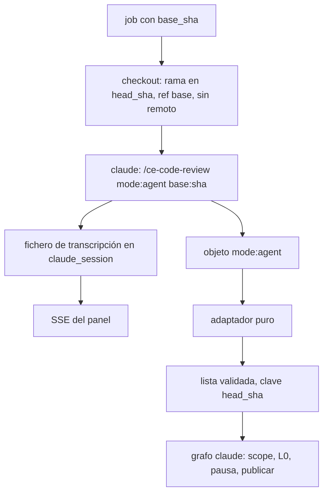

Última modificación: 2026-10-24 | Creado: 2026-10-24

# Claude revisa con la skill y el panel sigue la conversación

> **Estado:** implementada

---

## 1. Objetivo

La calidad de la review manda. El motor `claude` hoy lanza el CLI con una frase
que pide un array JSON y le deja `Read`, `Grep` y `Glob`. Eso no es la review
que se hace en local con la skill `ce-code-review`: no hay personas, ni filtro
de cita, ni merge, ni validador.

Se quiere:

1. Que el CLI ejecute la skill (`/ce-code-review mode:agent`) sobre el árbol del
   `head_sha`, con la base del PR al lado, y que saque el diff él mismo.
2. Que un adaptador puro traduzca el JSON de `mode:agent` al contrato de
   hallazgos antes del grafo. El núcleo sigue viendo hallazgos ya validados.
3. Que la conversación entera de esa ejecución quede guardada y se pueda seguir
   en directo desde el panel, y leerla después de terminada.

Quién lo usa: quien ya opera el motor `claude`. El panel lo consulta quien tiene
sesión (`lector` u `operador`), igual que la ficha de hoy.

## 2. No-objetivos

- **Sustituir el motor `llm`.** Personas, L2, presupuesto y pausa de ese motor no
  cambian.
- **Que la skill publique, empuje o aplique arreglos.** `mode:agent` es solo
  informe. No se pasa `apply:local`. El grafo sigue eligiendo qué se publica.
- **Parsear el markdown** de la skill, ni pedir a un modelo que lo reescriba.
- **Meter la skill en un nodo del grafo.** Un reintento de nodo no vuelve a
  lanzar el CLI. El artefacto validado sigue siendo la frontera
  ([025](../archivo/025-revisor-claude-cli/spec.md)).
- **El peer de otro modelo.** No se envía el diff fuera. Las personas y el
  validador locales de la skill sí corren. Un peer externo, si se quiere, es
  otra decisión.
- **Forzar la profundidad `full`.** Manda la compuerta de la skill.
- **Reescribir** [ADR-0002](../../adr/0002-contrato-de-ce-code-review-sin-su-runtime.md)
  **ni** [ADR-0028](../../adr/0028-cli-claude-fuera-del-worker.md). Hace falta un
  ADR nuevo: el núcleo sigue validando `contracts/findings-schema.json`, y el
  CLI sigue fuera del worker. Cambia qué prompt y qué herramientas usa el
  runner, y que la conversación se conserva.
- **La consola del sandbox.** Sigue en memoria del `sandbox-runner` y se pierde
  al reiniciar. Esta conversación no copia ese modelo.

## 3. Decisiones

1. **La skill es el revisor.** El prompt del subproceso es
   `/ce-code-review mode:agent base:<base_sha>`. `base_sha` es el que el worker
   ya resuelve. Sin base no se arranca el CLI: una review del árbol entero no es
   una review del PR.
2. **El checkout deja los dos extremos y luego quita el remoto.** El `head_sha`
   queda en una rama local. El `base_sha` queda como ref local. La historia
   tiene que alcanzar para `git diff` de la base contra el árbol de trabajo. El
   nombre de la rama del PR no se usa para elegir el commit: el job sigue
   clavado al `head_sha`.
3. **La skill vive en la config del runner, no en la del PR.** `CLAUDE_CONFIG_DIR`
   sigue fuera del checkout. El subproceso arranca con `--setting-sources user`,
   así que no carga hooks, `.mcp.json` ni `.claude/` del árbol revisado.
4. **Herramientas para que la skill termine, no un shell abierto.** Hacen falta
   lectura del árbol, git de lectura, los scripts de la skill y escritura del
   directorio de la corrida (la skill lo deja bajo `/tmp`). Siguen denegadas la
   edición del checkout, `WebFetch`, `WebSearch` y el modo que pregunta.
   `Bash` entero no se deniega: en `dontAsk` eso quita también el git de
   lectura. Tampoco se permite `Bash` sin restricción.
5. **`Bash` no arranca sin el sandbox de red del CLI.** Las reglas de texto no
   son el cierre: una orden puede colarse con otra ruta o dentro de `sh -c`, y
   el proceso lleva el token de sesión. El sandbox del CLI (bubblewrap en la
   imagen, más `socat` para el proxy) aísla la red del shell. La lista estricta
   es `api.anthropic.com`. El fetch del checkout ya ha terminado y el remoto ya
   no está, así que el shell no necesita el VCS. Si el sandbox no puede
   activarse, el CLI no arranca. Un host que haga falta para hablar con
   Anthropic se añade por nombre tras una ejecución real; no entra un comodín
   ni un dominio de telemetría por adelantado. El checkout no es escribible
   desde el shell; `/tmp` sí, para el directorio de la corrida.
6. **El adaptador es una función pura en el worker, antes del grafo.** Entrada:
   el objeto de `mode:agent` (el stdout, que es el mismo cuerpo que
   `review.json`). Salida: una lista que pasa `validate_finding`, o un fallo.
   Mapea `findings` y `pre_existing_findings` (estos con `pre_existing: true`).
   No se queda solo con `actionable_findings`: la pausa sigue eligiendo qué se
   publica. El `id` sale del `#` estable. `failure_scenario`, si falta en un
   P0–P2 sin verificar, se copia de `why_it_matters`; si ese texto también
   falta, el hallazgo se descarta y se cuenta. No hay segunda llamada al
   modelo.
7. **Un estado que no es una review completa no es «cero hallazgos».** `failed`,
   `skipped`, `degraded` o un JSON que no es ese objeto no se guardan como
   artefacto válido. El job se reintenta, como hoy un stdout inválido, salvo
   que la pasada haya agotado los turnos o el tiempo de pared (decisión 11).
8. **La transcripción se guarda entera.** Cada evento `stream-json` se redacta
   y se añade, sin recortar la línea ni el fichero, en el volumen
   `claude_session`, que el runner y el panel ya comparten. La clave es
   `repo + pr_id + head_sha`. No hay tope de bytes que tire el medio ni marque
   el fichero como truncado. Cortar el directo no borra la conversación. Un
   reinicio del runner tampoco, mientras el volumen siga.
9. **En vivo, y el fichero se descarga.** El panel abre un SSE sobre ese
   fichero: manda lo ya escrito y después cada línea nueva, y cierra al
   terminar. La ficha muestra texto de Claude, herramientas y su resultado; un
   evento que no se reconoce se ve en crudo. La conversación completa es el
   fichero, descargable por una sesión del panel. El resumen de 500 caracteres
   y el corte a 20 000 del log actual dejan de ser la vista de la review.
10. **L0 no se mueve.** Una cita fuera del diff no se publica en línea. La
    profundidad y el fan-out los decide la skill.
11. **Los topes son del subproceso `claude`, no del grafo.** `CLAUDE_MAX_TURNS`
    pasa a 200 y `CLAUDE_TIMEOUT_S` a 3600. Son techos: una review corta no los
    gasta. Cubren un fan-out con varias personas, el merge y el validador. El
    grafo no tiene presupuesto de tokens en este motor, y sus reintentos de
    nodo no relanzan el CLI. El worker espera esa llamada; un PR puede ocupar
    la cola hasta una hora. Agotar los turnos o el tiempo de pared no se
    reintenta: el mismo PR volvería a gastar el fan-out y chocaría con el
    mismo techo. Se parkea, como el cupo, sin publicar y sin guardar un
    artefacto válido. La transcripción de esa ejecución se queda. Un proceso
    que cae antes de acercarse al techo sigue siendo reintentable. El timeout
    HTTP del worker sigue por encima del tiempo de pared.

## 4. Diseño

**Checkout.** El runner recibe `base_sha`. Trae ese commit y el `head_sha` antes
de quitar el remoto. Si el `merge-base` no resuelve, el árbol igual puede
diferirse contra la ref `base`. Si el fetch de la base falla, el CLI no
arranca.

**Invocación.** El argv sigue llevando `--max-turns`, `--permission-mode
dontAsk` y `--output-format stream-json`. Se añade `--setting-sources user`. El
prompt posicional es el de la decisión 1. Los techos son 200 turnos y 3600 s
(decisión 11). La config de usuario del runner activa el sandbox con lista
estricta y sin arranque si no hay sandbox (decisión 5). El timeout HTTP del
worker sigue por encima de esos 3600 s.

**Adaptador.** No interpreta markdown. Un elemento que no cumple el contrato se
queda fuera de la lista y el descarte queda contado en el registro de la
review. Si la lista resultante está vacía porque todo se descartó, eso no es
una review sin hallazgos: es salida inválida. Una lista vacía solo es válida
cuando `status` es el de una review terminada y la skill devolvió cero
hallazgos.

**Transcripción.** El fichero crece con la ejecución y no se trunca. Cada línea
se redacta con los mismos secretos que ya no pueden salir del runner (token de
VCS, token del runner, token de sesión). El panel no abre un puerto nuevo del
runner: lee el volumen que ya monta. La sesión de Claude sigue sin entrar en
Redis, en el estado del grafo ni en Teams.

**Panel.** La sección Claude sigue el SSE mientras la ejecución vive. El mismo
fichero se descarga entero, con sesión. Sirve a cualquier sesión del panel.
No es un canal anónimo.

## 5. Riesgos

| # | Riesgo | Qué se hace |
|---|---|---|
| R1 | La skill cambia el JSON de `mode:agent` y el adaptador deja de mapear. | El adaptador se prueba con un fixture del objeto. Un campo nuevo se ignora. Un campo que el contrato exige y no se puede rellenar descarta ese hallazgo, no publica la review como vacía. |
| R2 | El fan-out agota el cupo o los techos de 200 turnos y 3600 s. | El cupo y el techo se parquean y no publican «0 hallazgos». No hay segunda pasada. Mientras corre, el worker no coge otro job. |
| R3 | Una orden de `Bash` se cuela pese a las reglas de texto y saca el token de sesión. | El sandbox de red es requisito. Sin bubblewrap o sin `socat`, el CLI no arranca. La lista no incluye el hosting del Git. |
| R4 | El código del PR, o un hook que se colara, lee `CLAUDE_CODE_OAUTH_TOKEN`. | `--setting-sources user` no carga la config del PR. El token no se escribe en la transcripción: se redacta antes de persistir y antes del SSE. |
| R5 | La transcripción crece con la review y ocupa el volumen `claude_session`. | No se recorta. El disco del volumen es el límite físico. Llenarlo es un fallo de la escritura, no una transcripción a medias que se presenta como completa. |
| R6 | Dos repos con el mismo `pr_id` y el mismo SHA corto comparten el log de hoy (`pr-sha` de 16 caracteres). | La clave nueva incluye el `repo` y el `head_sha` completo. |

## 6. Criterios de hecho

1. Con `REVIEW_ENGINE=claude`, el argv del CLI contiene
   `/ce-code-review mode:agent base:` más el `base_sha`, `--setting-sources user`
   y no contiene la frase «Revisa el árbol de trabajo».
2. Un checkout de prueba queda en el `head_sha`, con la ref de la base, sin
   remotos y sin el token en `.git/config`. Sin `base_sha`, el CLI no arranca.
3. Un objeto `mode:agent` con `status` de review terminada y un hallazgo
   completo se guarda como lista válida. `failed`, `skipped`, `degraded`, un
   objeto que no es ese JSON y una lista cuyos hallazgos se descartaron todos
   no se guardan y no cuentan como review sin hallazgos.
4. Un P0 sin `failure_scenario` y con `why_it_matters` pasa el adaptador. Sin
   ambos, ese hallazgo no entra y el hecho queda contado.
5. Durante una ejecución, el SSE de la ficha recibe una línea que el CLI acaba
   de escribir, sin esperar a que el proceso termine. El fichero descargable
   contiene todos los eventos, sin corte a 500 caracteres ni a 20 000.
6. Un secreto de prueba presente en un evento no aparece en el fichero ni en el
   SSE.
7. El grafo de `claude` no llama a la skill. L0 sigue tirando una cita fuera
   del diff. `make docs-check` pasa.
8. La config del runner exige el sandbox, con lista estricta que contiene
   `api.anthropic.com` y no el hosting del Git. Si el sandbox no está
   disponible, el CLI no arranca. Los techos efectivos son 200 turnos y
   3600 s. Agotarlos parkea el job y no lo reencola. La transcripción de esa
   pasada sigue descargable.

## 7. Preguntas abiertas

Ninguna.
