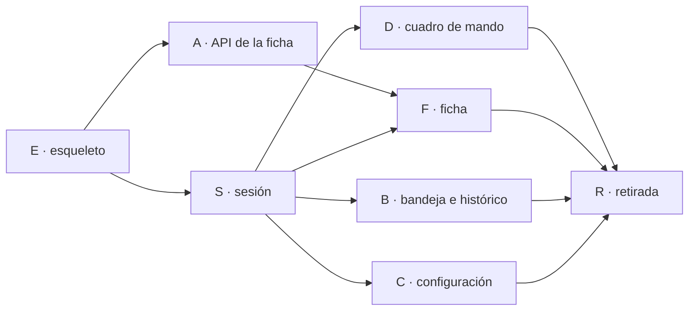

Última modificación: 2026-10-24 | Creado: 2026-10-24

# Plan: Panel en React

El *qué y por qué* vive en [`spec.md`](spec.md); las tareas, en [`todo.md`](todo.md).
Este plan fija el orden y por qué el orden es ese.

## Overview

Ocho bloques. **La API va antes que la SPA**: si el navegador no tiene de dónde
leer, cada pantalla inventa su propio *fetch* y el contrato se decide en el cliente.
El armazón va antes que las pantallas porque seis pantallas sobre un layout que
luego cambia son seis revisiones del layout.

1. **Esqueleto (E).** `frontend/` con Vite, TS estricto y el armazón de CoreUI
   recortado. Sin sesión y sin datos todavía: se ve la cáscara.
2. **Sesión (S).** Login, cookie `HttpOnly`, guardia de rutas y `GET /api/session`.
   Sin esto, cualquier pantalla es una fuga.
3. **API de la ficha (A).** `GET /api/reviews/{review_key}` y `pins` en
   `/api/config`. Servidor, con tests, sin React.
4. **Cuadro de mando (D).** La pantalla que responde «¿qué pasa ahora?».
5. **Ficha (F).** Recorrido, log, comandos, decisión, consola y razonamiento.
6. **Bandeja e histórico (B).** Las dos listas.
7. **Configuración (C).** Los 26 diales con Restaurar.
8. **Retirada (R).** Se borra `ui.py` y el interruptor; CI y documentos vivos al día.

## Decisiones de implementación

- **Un solo proceso en producción.** `web` sirve `index.html` y `/api`, sin
  segundo servicio. La etapa de Node del `Dockerfile` es solo de build: la imagen
  final no lleva Node (P14 de la spec).
- **El *fallback* de la SPA no captura `/api/*` ni `/healthz`.** Se monta como
  ruta comodín al final y comprueba el prefijo. Es la diferencia entre un `404`
  honesto y un HTML con `200` que hace creer que un endpoint existe.
- **`BrowserRouter`, no `HashRouter`.** El `base: './'` de la plantilla también
  cambia a `/`. Lo que se copia de CoreUI se adapta, no se hereda a ciegas.
- **La sesión se pregunta, no se lee.** `HttpOnly` impide leer la cookie y así el
  rol no vive en dos sitios que se pueden desincronizar. `GET /api/session` es la
  única fuente.
- **El token del login no viaja en la URL ni en localStorage.** `POST` con JSON y
  `Set-Cookie`; el campo se limpia al enviar.
- **Los comandos siguen siendo `fetch` JSON del mismo origen.** El rol que enseña
  los botones es cosmético: el `403` del servidor es la verdad.
- **El interruptor `PANEL_UI` existe para poder volver atrás por ruta, no para
  vivir.** Por eso el bloque R es obligatorio para cerrar: un interruptor sin fecha
  de borrado son dos implementaciones que envejecen a distinta velocidad.
- **Los tests de componente no sustituyen a los de la API.** El contrato se prueba
  en Python; el componente se prueba con datos falsos. Un test de componente que
  mockea `fetch` no demuestra que el endpoint exista.

### Qué no se hace

- No se añade un endpoint por pantalla: la ficha es **un** recurso agregado.
- No se reescribe `PanelReadModel`.
- No se mete Redux para el estado del servidor: sigue solo con `sidebarShow`.
- No se añaden gráficos. El recorrido es una lista con marcas de tiempo.
- No se migra el histórico a paginación por servidor (Q5).

## Orden y dependencias

A y S pueden ir en paralelo: no comparten ficheros. F necesita las dos porque sin
sesión no hay ficha y sin el endpoint agregado la ficha haría seis peticiones.

## Checkpoints

- **E-K:** `frontend/` compila (`npm run build`), `tsc --noEmit` en verde y
  `/login` se pinta con el armazón. `make ci` sigue verde: Python no ha cambiado.
- **S-K:** sin cookie, cualquier ruta lleva a `/login`; con el secreto correcto
  entra y `GET /api/session` devuelve usuario y rol; con uno incorrecto, `401` y no
  se escribe nada. Un `lector` no ve controles.
- **A-K:** `GET /api/reviews/{review_key}` devuelve traza, `notes` y `journal`;
  `GET /api/config` trae `pins`. `404` para una clave sin nada. Tests en Python.
- **D-K:** el cuadro de mando pinta las cuatro cifras y las cinco secciones con
  datos reales; lanzar y cancelar funcionan contra la API.
- **F-K:** la ficha pinta recorrido, log, comandos y decisión; la consola y el
  razonamiento se ven en vivo cuando existen.
- **B-K:** la bandeja responde una pausa y el histórico filtra.
- **C-K:** los 26 diales, con ayuda y Restaurar; guardar publica y un conflicto
  `409` se explica en pantalla.
- **R-K:** `ui.py` borrado, `PANEL_UI` inexistente, las seis rutas siguen
  respondiendo, `GET /api/inexistente` da `404` y `make ci` está en verde.

## Riesgos

| Riesgo | Qué lo contiene |
|---|---|
| El armazón de CoreUI arrastra demo y el bundle engorda | E borra las views de demo en el primer commit; el checkpoint comprueba el tamaño |
| El `HashRouter` se cuela y rompe los enlaces publicados | P4 y el test de rutas de R-K |
| La ficha se convierte en seis peticiones y parpadea | A entrega el recurso agregado antes que F |
| Las dos UIs divergen durante la migración | R es bloque de cierre, no opcional |
| El login se prueba solo con mocks | S-K se prueba contra el `web` real con `TestClient` |
