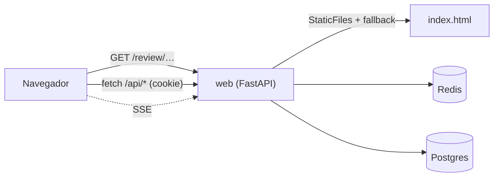

Última modificación: 2026-10-24 | Creado: 2026-10-24

# Panel en React

> **Estado:** borrador
>
> **Entrega objetivo:** el panel de operación deja de ser HTML servido en el
> servidor y pasa a ser una aplicación React que consume la misma API JSON. Se
> entra con una página de login, se ve el estado del sistema de un vistazo y cada
> acción (lanzar, cancelar, decidir, publicar diales) se hace desde una pantalla
> usable en móvil. Los enlaces ya publicados en pull requests siguen abriendo la
> misma ficha.

---

## 1. Objetivo

El panel ([019](../archivo/019-panel-de-operacion/spec.md), [ADR-0020](../../adr/0020-panel-como-servicio-aparte.md))
funciona y tiene contrato probado, pero su interfaz es HTML embebido en
`src/agent_review/web/ui.py`: 1 883 líneas de f-strings con CSS y JavaScript
dentro de un módulo Python. Cada cambio visual es un cambio de servidor, no hay
componentes, el estado se repinta a mano con `document.getElementById` y no existe
login (la cookie `panel_session` se pega en la consola del navegador, como explica
`scripts/ensure_dev_secrets.py`).

Se quiere:

1. **Una aplicación React** construida sobre
   [`coreui-free-react-admin-template`](https://github.com/coreui/coreui-free-react-admin-template)
   5.7 —Vite 8, React 19 y `sass` de dart—, recortada a lo que el panel usa, servida
   por el mismo proceso `web`.
2. **Login de verdad.** Una página que valida `PANEL_SESSION_SECRET` y deja una
   cookie `HttpOnly`. Quien no entra, no ve nada.
3. **Un cuadro de mando** que responda «¿qué pasa ahora?» en la primera pantalla:
   cola, en vuelo con su nodo y su gasto, pausas que esperan a una persona,
   descartes y presupuesto, cada uno con su acción al lado.
4. **Paridad funcional exacta** con lo que hay hoy: nada que se pueda hacer en el
   panel actual desaparece ni cambia de contrato.
5. **La API como único contrato** entre servidor y navegador. El servidor deja de
   saber cómo se pinta una review.

## 2. No-objetivos

- **Usuarios, contraseñas ni roles por base de datos.** El login sigue siendo el
  secreto de despliegue: `PANEL_SESSION_SECRET` autentica y `PANEL_SESSION_USER` /
  `PANEL_SESSION_ROLE` dicen quién es y qué puede. Una autenticación multiusuario
  es otra iniciativa y necesita persistencia de identidades.
- **Cambiar la semántica del panel.** Sigue siendo CQRS-lite: lee Redis y el
  checkpointer, y encola comandos. La SPA **no** gana escrituras nuevas sobre el
  estado del grafo ([ADR-0020](../../adr/0020-panel-como-servicio-aparte.md)).
- **Servir por CDN ni llamar a servicios de terceros.** El panel enseña diffs,
  logs y transcripciones de PRs ajenos; todo asset sale del propio origen
  ([018 §3.5](../018-trazas-de-la-review/spec.md)). Sin Google Fonts, sin
  `<script src="https://…">`, sin telemetría.
- **Reescribir el read model.** `PanelReadModel` (`read_model.py`) no cambia: la
  SPA pinta lo que ya hay. Solo se añaden las lecturas que hoy se hacen dentro del
  HTML y no están expuestas en JSON (§5.3).
- **Realtime por WebSocket.** El flujo sigue siendo unidireccional y SSE ya
  resuelve consola, razonamiento y transcripción de Claude.
- **Un sistema de diseño propio desde cero.** Se parte de CoreUI (§3.1), se recorta
  su demo y se ajusta el tema; no se reinventa.
- **PWA, offline ni modo claro.** El panel es una herramienta de operación: se
  sirve en tema oscuro y no se ofrece selector de tema.

## 3. Contexto y evidencia

### 3.1 Elección de la plantilla

Se evaluaron dos plantillas y se midieron en este entorno (Node 22.23.3, npm 10.9.9),
no de memoria:

| | Corona 1.1.0 (2019) | CoreUI 5.7.0 |
|---|---|---|
| React | 16 | **19.3** |
| Build | `react-scripts` 3 | **Vite 8** |
| Sass | `node-sass` 4 (libsass, Python 2) | **`sass` 1.105 (dart-sass)** |
| `npm install` | `ERESOLVE` (`react-dnd@9.5.1` contra `react-dnd-multi-backend@3.2.2`, que exige `< 9`) | **304 paquetes en 4 s, sin flags** |
| `npm install --legacy-peer-deps` | `node-sass` → `node-gyp@3.8.0` invoca `python` con sintaxis de Python 2: `SyntaxError` | — |
| `npm run build` | no se alcanza | **3,2 s, verde** |

Corona no es instalable sin reparar su cadena de build: no es una plantilla, es un
ejercicio de arqueología. **Se descarta**, y la medición queda aquí para que nadie
lo reintente.

CoreUI se adopta porque compila hoy, trae layout, sidebar colapsable, navbar y una
página de login, y expone el tema oscuro como modo de primera clase
(`useColorModes`). Su CSS completo ocupa 309 KB (41,8 KB gzip).

### 3.2 Qué se recorta de CoreUI

La plantilla es una demo de componentes; el panel usa una parte.

| Pieza | Destino |
|---|---|
| `DefaultLayout`, `AppSidebar`, `AppHeader`, `AppFooter`, `_nav` | Se conservan como armazón |
| `views/authentication/login` | Se conserva como base del login (un solo campo: el token) |
| `views/dashboard`, `widgets`, `charts`, `forms`, `components`, `icons`, `error-pages` y sus assets (808 KB) | Fuera: son demos. Se usan como referencia visual |
| `@coreui/react-chartjs`, `chart.js`, `@coreui/chartjs` | Fuera: el panel no dibuja gráficos de líneas |
| Redux (`store.js`) con `sidebarShow` | Se conserva: el sidebar lo necesita y ya está montado |
| `HashRouter` | **Se sustituye por `BrowserRouter`**: las rutas publicadas son `/review/…` (§3.5) |
| `base: './'` del `vite.config.mjs` | Se cambia a `/`: el panel no se sirve desde un subdirectorio |
| JavaScript sin tipos | Se convierte a **TypeScript estricto** en lo que se conserva |
| Selector de tema (claro / oscuro / auto) | Fuera: el panel es oscuro |

### 3.3 Lo que hay que conservar: inventario de pantallas

| Ruta | Hoy | Qué pinta |
|---|---|---|
| `/` | `_global_page` | Lanzar review; cola; en vuelo (nodo + presupuesto); pausas humanas; pausas de fix; descartes; presupuesto |
| `/review/{review_key}` | `_detail_page`, `_log_page`, `_discard_page` | Recorrido de nodos o pasos del CLI de Claude; log (`notes` + journal); comandos; formulario de decisión; consola del sandbox por SSE; razonamiento por SSE; actividad de Claude por SSE y descarga |
| `/bandeja` | `bandeja_page` | Preguntas abiertas, respuesta por hallazgo o en lote, aviso del sistema |
| `/history` | `_history_page` | Reviews terminadas con filtros `repo` / `pr_id` |
| `/config` | `_config_page` | 26 diales en 5 secciones, ayuda, **Restaurar** por control, **Guardar** con revisión, candado, revisiones fijadas |
| `/claude` | `claude_session_page` | Formulario del token de Claude (`operador`) |
| `/login` | no existe | Nueva: valida el secreto y deja la cookie |

### 3.4 Lo que la API no expone y la SPA necesita

| Dato | Dónde vive hoy | Consecuencia |
|---|---|---|
| `notes()` + `journal()` | Solo en `_review_log`, dentro del HTML | Sin endpoint, la SPA no puede pintar el **Log** |
| Revisiones fijadas de las reviews en curso | `_dial_pins`, calculado en el HTML | Sin endpoint no se puede distinguir «guardado» de «en uso» |
| Usuario y rol de la sesión | Se pinta en el HTML; `ROLE_COOKIE` no se emite nunca | La SPA no sabe si enseñar botones |
| Aviso de la bandeja (tarjetas, Teams) | Se sondea en JS embebido | Ya existe `GET /api/bandeja`; se reutiliza |

### 3.5 Rutas ya publicadas

`PANEL_PUBLIC_URL` viaja en los avisos de Teams y el enlace de la ficha se publica
en la tarjeta y en los logs de operación. Hay enlaces en comentarios de pull
requests vivos. **Cambiar una sola ruta rompe esos enlaces**, así que las rutas de
§3.3 son parte del contrato, no un detalle de la SPA.

`review_key` contiene `/` y `:` (`cqm/emotivoo-v2:42:<sha>:<pipeline>`). Hoy lo
resuelve `:path` de FastAPI; en el cliente es un splat (`/review/*`), no un
segmento.

### 3.6 Cómo se sirve hoy

`web/main.py` monta dos routers que devuelven `HTMLResponse`, con el CSS y el JS
embebidos en constantes de Python. No hay `StaticFiles`, ni build, ni `package.json`.

## 4. Decisiones

| # | Decisión | Motivo |
|---|---|---|
| P1 | **CoreUI 5.7 + Vite 8 + React 19 + TypeScript estricto** en `frontend/` | Es la plantilla medida que instala y compila hoy (§3.1). Corona se descarta con la medición delante |
| P2 | Se conserva el **armazón de CoreUI** (layout, sidebar, navbar, login, Bootstrap 5 vía `--cui-*`) y se recorta su demo (§3.2) | Se hereda un sistema visual mantenido en lugar de reparar uno de 2019. La licencia es MIT: el aviso se conserva en `frontend/NOTICE` |
| P3 | **Bootstrap 5 a través de CoreUI** (`@coreui/coreui` + `@coreui/react`); sin CSS propio más allá de los overrides del panel | Tablas, formularios, modales y toasts ya existen y están probados; escribirlos a mano sería código que nadie mantiene |
| P4 | **Las seis rutas de §3.3 no cambian** | Hay enlaces publicados (§3.5). La SPA usa `BrowserRouter` —**no** el `HashRouter` de la plantilla— y un catch-all que sirve `index.html`, con `review_key` capturada por splat |
| P5 | El proceso `web` sirve el build con `StaticFiles` + *fallback* de `index.html`, **sin** capturar `/api/*` ni `/healthz` | Un `GET /api/inexistente` tiene que seguir siendo `404`, no un HTML con `200` |
| P6 | **Login con cookie `HttpOnly`**: `POST /api/session` valida el secreto y responde `200` con la cookie; `DELETE /api/session` la borra | Quita el pegado manual de cookie, que es hoy el peor escalón de entrada. `SameSite=Lax` porque el panel no se embebe |
| P7 | La SPA no lee la cookie: pregunta `GET /api/session` → `{user, role}` | `HttpOnly` impide leerla desde JS y así el rol no se duplica en dos sitios. `ROLE_COOKIE`, que nunca se emitió, desaparece |
| P8 | **Un solo endpoint de ficha**: `GET /api/reviews/{review_key}` devuelve traza, pausa, `notes`, `journal`, si hay consola y si hay razonamiento | La ficha hace hoy seis peticiones para pintarse. Un recurso agregado evita cascadas y deja el contrato en un sitio |
| P9 | `GET /api/config` añade `pins` (revisiones fijadas por review en curso) | Cierra la única lectura que hoy solo existe dentro del HTML |
| P10 | **TanStack Query** para el estado de servidor; Redux queda solo con `sidebarShow`, como ya lo trae la plantilla | El estado es del servidor: caché, invalidación tras un comando y reintentos son exactamente el problema. Redux ahí sería una segunda copia de la verdad, pero el sidebar ya está montado con él |
| P11 | Los comandos se ejecutan con `fetch` JSON y `credentials: "same-origin"`, y se confirman con un *toast* + invalidación de la caché | Es lo que ya exige `require_command_session` (cookie ⇒ JSON del mismo origen). No se relaja la defensa CSRF |
| P12 | **Strangler con interruptor temporal**: `PANEL_UI` (`react` \| `ssr`, por defecto `react` al cerrar la migración) durante los bloques de trabajo; `ui.py` se borra en el último | Permite migrar pantalla a pantalla sin big-bang y volver atrás si una ruta falla. Un interruptor permanente serían dos implementaciones: por eso tiene fecha de borrado |
| P13 | Cero `dangerouslySetInnerHTML`. Los logs y transcripciones se pintan como texto | React escapa por defecto; el panel enseña datos de terceros (§2) |
| P14 | El build de la SPA entra en la imagen `web` con una etapa de Node; en local, `make panel-dev` levanta Vite con proxy a `web` | El despliegue no gana un servicio: el `web` sigue siendo el único proceso |
| P15 | Tests de UI con **Vitest + Testing Library**; los tests de HTML de `tests/test_web_ui.py` se retiran al retirar el SSR | Los tests actuales afirman sobre cadenas HTML; con la SPA, el contrato que se prueba es la API más el componente |
| P16 | **Tema oscuro fijo**, sin selector `light`/`auto` | Es una herramienta de operación que se mira de noche; un selector es una opción que nadie cambia y una combinación visual que habría que probar |

### 4.1 Riesgo de la plantilla: el arnés de CoreUI no es el del panel

CoreUI trae decisiones que en un panel publicado no valen tal cual. Se cambian al
adoptarla, no después:

| Lo que trae | Qué se hace |
|---|---|
| `HashRouter` | `BrowserRouter` (§4, P4) |
| `base: './'` | `base: '/'` |
| `eslint` + `prettier` con su configuración | Se alinea con el repo; no se añade un segundo estilo |
| Demo de componentes, gráficos y assets (808 KB) | Se borra en el primer bloque de trabajo |
| `useColorModes` y su selector | Fuera: tema oscuro fijo (P16) |
| Textos en inglés | Todo en español, como el resto del panel |

## 5. Diseño o contrato

### 5.1 Estructura

```
frontend/
  package.json            # coreui 5.7, vite 8, react 19, @tanstack/react-query, vitest
  vite.config.ts          # base "/", proxy a web en dev
  tsconfig.json           # strict
  index.html
  NOTICE                  # MIT de CoreUI
  src/
    main.tsx
    App.tsx               # router + sesión
    router.tsx            # las seis rutas de §3.3 más /login
    api/                  # cliente tipado de la API JSON
    session/              # login, logout, rol
    components/           # armazón de CoreUI recortado + los del panel
    pages/                # Dashboard, ReviewDetail, Bandeja, History, Config, Login
    scss/                 # overrides del tema oscuro sobre CoreUI
```

El build (`frontend/dist`) se sirve desde `src/agent_review/web/static/` dentro de
la imagen. `frontend/dist` y `node_modules` **no** se versionan; sí
`package-lock.json`.

### 5.2 Arranque



En desarrollo, Vite sirve `index.html` y hace *proxy* de `/api` a
`localhost:8090`, de modo que la cookie es del mismo origen también allí.

### 5.3 API: lo que se añade

Ninguna ruta existente cambia de forma ni de código de respuesta salvo lo anotado.

| Método | Ruta | Auth | Contrato |
|---|---|---|---|
| `GET` | `/api/session` | Cookie o cabecera | `200 {user, role}`; `401` sin sesión |
| `POST` | `/api/session` | — | Cuerpo `{"token": "…"}`. Valida como `verify_session`. `200 {user, role}` + `Set-Cookie: panel_session=…; HttpOnly; SameSite=Lax; Path=/`. `401` si el token no vale. `400` si el cuerpo no encaja |
| `DELETE` | `/api/session` | Sesión | `204` y borra la cookie |
| `GET` | `/api/reviews/{review_key}` | Sesión | `{review_key, trace, paused, notes[], journal[], console_available, reasoning_available, claude}`. `404` si ni traza ni log ni descarte |

Mutaciones en `GET /api/config`: se añade `pins: [{review_key, revision}]`. El
resto de campos no cambia.

`POST /api/session` es la **única** ruta que acepta un token en el cuerpo. No
devuelve el token ni lo registra en el log.

### 5.4 Pantallas

| Pantalla | Firma visual |
|---|---|
| **Login** | Una sola tarjeta centrada, sin sidebar ni menú: no hay nada que navegar sin sesión. Un campo de token y un botón |
| **Cuadro de mando** | Cuatro cifras arriba que responden «¿qué pasa ahora?» (en cola, en vuelo, esperando persona, descartes) y debajo el trabajo: lanzar, cola, en vuelo, pausas, descartes. Cada fila lleva su acción a la derecha |
| **Ficha de review** | Dos columnas: a la izquierda el recorrido (línea de nodos con su duración) o los pasos del CLI; a la derecha log, comandos y consola. En móvil, una columna y el recorrido primero |
| **Bandeja** | Tarjetas, una por pausa; cada hallazgo con su acción y su nota. La tarjeta aparece en la lista de pendientes del sidebar |
| **Histórico** | Tabla densa con cifras tabulares y filtros en la cabecera |
| **Configuración** | Una sección por grupo; cada control con su ayuda y su **Restaurar**; la barra de guardado se queda pegada abajo mientras haya cambios |

El elemento firma es el **recorrido**: la secuencia real de nodos con su duración,
dibujada con la paleta del tema. Es lo que distingue este panel de un CRUD, y por
eso **no** se resuelve con un gráfico de la plantilla: es una lista ordenada con
marca de tiempo, no una serie temporal.

### 5.5 Sesión y CSRF

- La cookie es `HttpOnly`, `SameSite=Lax`, `Path=/` y `Secure` cuando el panel se
  sirve por HTTPS (`PANEL_PUBLIC_URL` empieza por `https`).
- Los comandos siguen exigiendo `Content-Type: application/json` del mismo origen
  (`require_command_session`, sin cambios).
- `DELETE /api/session` y `POST /api/session` son idempotentes respecto a la
  cookie: repetirlos no deja estado raro.
- El rol se relee en cada `GET /api/session`; degradar a alguien es reiniciar el
  `web` con otro `PANEL_SESSION_ROLE`, como hoy.

### 5.6 Lo que se borra al cerrar

- `src/agent_review/web/ui.py` y las constantes `_CSS`, `_COMMAND_SCRIPT`,
  `_BANDEJA_SCRIPT`, `_CONFIG_SCRIPT`, `_CLAUDE_SCRIPT`, `_CONSOLE_SCRIPT`,
  `_REASONING_SCRIPT`.
- `ROLE_COOKIE`, que nunca se emitió.
- Los tests que afirman sobre HTML: `tests/test_web_ui.py` se sustituye por tests
  de la API nueva y de los componentes.
- `PANEL_UI`, el interruptor de P12.

### 5.7 Límites de implementación

- **Siempre:** cada endpoint nuevo con su test en el mismo cambio; `make docs-check`
  al tocar documentación; el inventario de §3.3 como lista de paridad.
- **Preguntar antes:** una dependencia de runtime nueva que no esté en P1/P10;
  añadir un servicio a compose; cambiar una ruta pública.
- **Nunca:** `dangerouslySetInnerHTML`; cargar un asset de otro origen; relajar
  `require_command_session`; devolver el token de sesión en un cuerpo; dejar las dos
  UIs vivas al cerrar la iniciativa.

### 5.8 Comandos

```
make panel-dev            # Vite en :5173 con proxy a web en :8090
make frontend-check       # tsc + eslint + vitest
make frontend-build       # build de producción
make ci                   # incluye frontend-check cuando existe frontend/
```

## 6. Riesgos

| # | Riesgo | Qué lo contiene |
|---|---|---|
| R1 | Un enlace ya publicado deja de abrir la ficha | P4: las rutas son contrato; un test comprueba que cada ruta de §3.3 devuelve el `index.html` y que la ficha resuelve una `review_key` con `/` y `:` |
| R2 | Durante la migración, dos UIs divergen y una miente | P12: el interruptor es temporal y el cierre exige borrar la vieja. El `todo.md` tiene una tarea de borrado como última condición |
| R3 | El *fallback* de la SPA se come un `404` de la API | P5: el catch-all no captura `/api/*` ni `/healthz`, con test |
| R4 | El login se convierte en un oráculo de fuerza bruta del secreto | El secreto es de alta entropía (`token_hex(32)`); se registra el fallo sin el valor. Si se quiere límite de intentos, va en una tarea aparte (§8) |
| R5 | El bundle arrastra código de demo de la plantilla | §3.2 fija qué se recorta; el build falla si `@coreui/react-chartjs`, `chart.js` o `@coreui/icons` de demo vuelven a entrar |
| R6 | La CSP del panel se rompe con el bundle | Los assets son del mismo origen y no hay `eval` en el build de producción |
| R7 | Los tests de UI se pierden en la mudanza y quedan zonas sin cubrir | El inventario de §3.3 es la lista de paridad: cada fila tiene al menos un test |
| R8 | El `web` deja de arrancar en quien no tenga Node | La etapa de Node es solo de build: la imagen final no lleva Node. En local, `make panel` sigue funcionando sin `frontend/` construido solo si existe `dist`; si no, `make panel-dev` |

## 7. Criterios de hecho

1. Las seis rutas de §3.3 responden y hacen lo mismo que hoy: cada fila del
   inventario tiene su prueba.
2. Sin sesión, cualquier ruta devuelve la pantalla de login; `GET /api/session` da
   `401` y ningún endpoint de datos filtra información.
3. `POST /api/session` con el secreto correcto deja una cookie `HttpOnly` y la SPA
   entra sin pegar nada en la consola. Con un token incorrecto, `401` y nada se
   escribe.
4. Un `lector` no ve ningún control de comando ni de guardado, y la API le sigue
   devolviendo `403`.
5. `GET /api/reviews/{review_key}` devuelve traza, `notes`, `journal`, pausa y
   disponibilidad de consola y razonamiento; el **Log** de la ficha se pinta con
   esos datos.
6. `/config` conserva: secciones, ayuda, **Restaurar** por control, **Guardar** con
   revisión, conflicto `409`, candado, y `pins`.
7. `GET /api/inexistente` sigue siendo `404` y no devuelve `index.html`.
8. No hay `dangerouslySetInnerHTML` ni un asset de otro origen en el bundle.
9. `make ci` en verde, con `frontend-check` incluido, y `make docs-check` en verde.
10. `ui.py` ya no existe y `PANEL_UI` no aparece en el código.

## 8. Preguntas abiertas

- **Q1 — ¿Se aprueba TypeScript estricto?** CoreUI viene en JavaScript sin tipos. Se
  propone convertirlo en lo que se conserva (layout, sidebar, login y los componentes
  del panel). La alternativa es JS + JSDoc, más rápido de arrancar y más débil justo
  donde el panel trata contratos: `review_key`, revisiones y roles.
- **Q2 — ¿Se aprueba TanStack Query como dependencia de runtime (P10)?** La
  alternativa es un `useEffect` + `fetch` propio, que reimplementa caché,
  invalidación y carreras en cada pantalla.
- **Q3 — ¿Entra Playwright en CI?** Hoy no hay e2e. Un e2e contra el `web` real
  probaría de verdad la sesión con cookie y el SSE; cuesta un navegador en CI. Se
  propone una tarea posterior, no el primer bloque.
- **Q4 — Límite de intentos en el login (R4).** Se propone dejarlo fuera de esta
  entrega y abrir tarea si el panel se expone fuera de la red interna, que es el
  caso hoy.
- **Q5 — ¿El histórico paginado?** Hoy `GET /api/history` tiene `limit` hasta 500 y
  la tabla pinta lo que llega. La SPA puede paginar en cliente sin cambiar la API;
  si se quiere paginación real, es un cambio de contrato.
- **Q6 — ¿Se mantiene `GET /config` como página HTML en algún caso?** El plan es
  no: la página desaparece y `GET /api/config` es el contrato.
