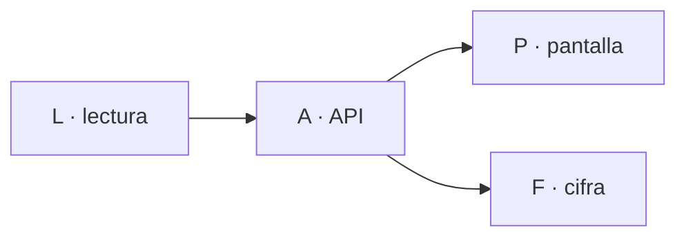

Última modificación: 2026-10-29 | Creado: 2026-10-29

# Plan: el panel enseña los aparcados

El *qué y por qué* vive en [`spec.md`](spec.md); las tareas, en [`todo.md`](todo.md).

## Overview

Tres bloques y el orden no se puede invertir: **primero el motivo en la cola**,
después la lectura, y al final la pantalla. Sin el motivo, `PanelState` no tendría
nada que agrupar y la sección no sabría qué acción ofrecer.

1. **L (lectura).** El puerto de cola expone `(motivo, request)` y el read model
   lo traduce a `ParkedItem`.
2. **A (API).** `PanelState` gana `parked` y con él `GET /api/state`.
3. **P (pantalla).** La sección del cuadro de mando y la cifra.

## Decisiones de implementación

- **`parked()` no cambia de firma.** Añadir un método nuevo al puerto es más
  barato que romper a los llamadores y convivir con dos comportamientos.
- **El motivo se valida contra `PARK_REASONS`.** Es la misma lista que usa el
  worker para escribir; una tercera lista en el panel sería una copia que se
  desincroniza.
- **`Literal` y no `str` en el modelo.** Un motivo desconocido tiene que ser un
  fallo de parseo, no un valor que llegue a la pantalla y no sepa qué decir.
- **La sección va siempre, vacía incluida.** Igual que presupuesto y descartes.
- **La cifra de «en cola» cuenta los aparcados** y lo dice en el detalle: es la
  diferencia entre «no hay nada» y «hay dos parados esperando un token».

## Orden y dependencias

## Checkpoints

- **L-K:** `parked_entries()` devuelve el motivo y el request; un payload
  ilegible se descarta con aviso; `PanelState.parked` lo refleja. Tests con
  `fakeredis`.
- **A-K:** `GET /api/state` trae `parked` con los seis campos; sin parking, `[]`;
  con Redis caído, `[]` y sin `500`.
- **P-K:** el cuadro de mando pinta la sección con su recuento, la cifra de cola
  cuenta los aparcados, y cada motivo enseña su acción.

## Riesgos

| Riesgo | Qué lo contiene |
|---|---|
| La sección se pinta como si fuera una cola que va a arrancar sola | El texto de cada motivo dice qué lo desatasca; `session` enlaza a `/claude` |
| Duplicar la lista de motivos y quedarse corto | Se importa `PARK_REASONS` del worker, no se copia |
| Un Redis lento bloquea `/api/state` | `_guard`, como el resto de secciones |
