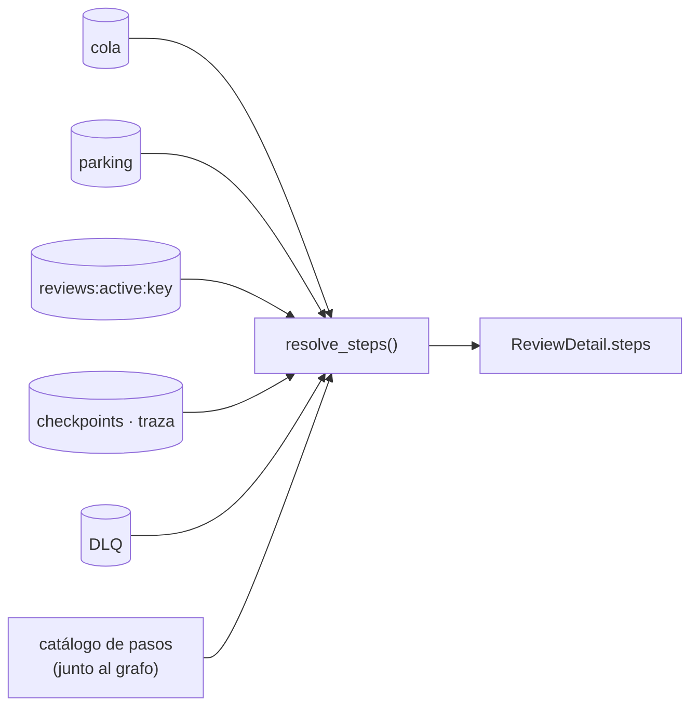

Última modificación: 2026-10-29 | Creado: 2026-10-29

# Progreso en vivo del panel

> **Estado:** borrador
>
> **Entrega objetivo:** quien lanza una review la ve avanzar sin recargar el
> navegador: el cuadro de mando y la ficha se refrescan solos, la ficha enseña
> los pasos que faltan, el que corre ahora y lo que hizo cada uno, y el panel en
> vivo se puede ver a pantalla completa.

---

## 1. Objetivo

Hoy el panel ([029](../029-panel-en-react/spec.md)) responde «¿qué pasa ahora?»
solo en el momento de cargar la página:

- **Nada se refresca solo.** `main.tsx` decidió no tener `refetchInterval`: el
  estado se relee al volver a la ventana o al ejecutar un comando. Tras lanzar
  una review, el job pasa de la cola a «en vuelo» y de ahí a terminado sin que la
  pantalla se entere. Hay que pulsar F5.
- **La ficha de una review recién lanzada puede no existir.** Con
  `REVIEW_ENGINE=claude`, la pasada del CLI corre **antes del grafo**
  ([ADR-0033](../../adr/0033-skill-fuera-del-nucleo.md)). Mientras dura (hasta una
  hora) no hay hilo en el checkpointer, y `GET /api/reviews/{key}` responde `404`
  si aún no hay notas ni journal.
- **La ficha solo ve lo cerrado.** `TracePanel` pinta los nodos que ya dejaron
  checkpoint. No sabe qué nodo corre ahora (eso está en
  `reviews:active:<review_key>`, que solo lee el cuadro de mando), ni qué pasos
  quedan, ni qué hizo cada uno más allá de los canales que escribió.
- **«En vuelo» enseña una hora, no un tiempo.** «desde 29/10 10:58» obliga a
  restar de cabeza para saber si una review va lenta.
- **El panel en vivo es pequeño.** La actividad del CLI y la consola tienen un
  máximo de 22 rem de alto en la columna derecha. En una pasada larga se lee
  mal.

Se quiere:

1. **El cuadro de mando y la ficha se actualizan solos** mientras la pestaña está
   visible.
2. **Un diagrama vertical de pasos** en la ficha, con todos los pasos que la
   review va a dar. Cada uno lleva su estado (pendiente, en curso con spinner,
   hecho, pausado, fallido u omitido) y un texto a la derecha: qué está haciendo
   mientras corre y qué hizo al terminar.
3. **El panel en vivo se puede maximizar** sin perder lo que ya llegó por el
   stream.
4. **«En vuelo» enseña el tiempo de ejecución**, que avanza solo.

## 2. No-objetivos

- **No se pasa a WebSocket ni a un SSE de estado.** El polling acotado basta para
  cifras que cambian en segundos. Los canales en vivo (consola, razonamiento,
  CLI) siguen siendo los SSE que ya hay.
- **No se cambia el grafo ni el worker.** Lo que se pinta se lee de lo que ya se
  escribe: checkpoints, `reviews:active:*`, cola, parking y DLQ.
- **No se interpreta la transcripción del CLI para el diagrama.** El paso
  «Revisar con Claude» dice que está revisando y cuánto lleva. Lo que hace dentro
  se lee en el panel de actividad, que ya existe.
- **No se añade un ajuste de intervalo en `/config`.** El intervalo es una
  constante del frontend (ver Q2).

## 3. Contexto y evidencia

| Pieza | Hoy |
|---|---|
| `frontend/src/main.tsx` | `refetchOnWindowFocus: true`, `staleTime: 5_000`, sin `refetchInterval` (decisión explícita en el comentario) |
| `useReviewDetail` | Igual: solo relee al volver a la ventana |
| `web/review_detail.py` | `404` si no hay traza, ni descarte, ni notas o journal. Ya calcula `model.state()` entero, así que la cola, «en vuelo» y el parking de esa clave están a mano sin otra lectura |
| `worker/main.py` (`ensure_claude_artifact`) | Escribe el nodo `claude` en `reviews:active:<key>` mientras corre el CLI, antes del grafo |
| `graph/build.py` | Motor `claude`: `scope → persona → merge → stamp → hitl → publish → notify`. Motor `llm`: once nodos con ramas condicionales (`fix_*`) |
| `trace.py` | `TraceNode` lleva `name`, `index`, `started_at` (sello de **cierre**) y `writes`. No lleva qué escribió |

## 4. Decisiones

| # | Decisión | Motivo |
|---|---|---|
| V1 | **Polling solo con la pestaña visible.** Cuadro de mando: `refetchInterval` de 5 s en `useStateQuery`. Ficha: 3 s mientras la review no está en un estado final; parado cuando termina, se descarta o espera a una persona. `refetchIntervalInBackground: false` | Era lo que el comentario de `main.tsx` temía: gastar Redis en pestañas olvidadas. Una pestaña oculta no pide nada. Una review terminada no cambia, así que no se pregunta por ella |
| V2 | **La ficha existe desde que la review se encola.** `GET /api/reviews/{key}` responde `200` si la clave está en la cola, en vuelo o aparcada, aunque no tenga traza | El usuario entra en la ficha justo después de lanzar. Un `404` en ese momento es el «tengo que refrescar» |
| V3 | **El backend da el plan de pasos y su estado ya resuelto.** `ReviewDetail` gana `steps: list[ReviewStep]`. Cada paso lleva `{name, label, status, started_at, finished_at, doing, done}`. Ver §5.1 | El estado de un paso sale de cruzar traza, `reviews:active`, cola, parking, pausa y DLQ. Hacerlo en el navegador duplicaría en TypeScript reglas que ya viven en Python, y las ramas del motor `llm` solo las conoce el grafo |
| V4 | **El plan incluye los pasos de antes del grafo.** Motor `claude`: `queued` (en cola) → `claude` (Revisar con Claude) → los siete nodos. Motor `llm`: `queued` → los nodos del grafo | Con `claude` la mayor parte del tiempo se va antes del primer nodo. Un diagrama que empieza en `scope` está vacío justo cuando más se mira |
| V5 | **El catálogo de pasos vive junto al grafo**, con un test que falla si un nodo de `build_*_graph` no está en el catálogo | Un nodo nuevo sin etiqueta aparecería con su nombre crudo o no aparecería. El test lo detecta antes del merge |
| V6 | **«Lo que ha hecho» sale del checkpoint que cerró el nodo.** Un resumidor por nodo lee los canales que ese nodo escribió (p. ej. `scope`: ficheros del diff, `merge`: hallazgos tras juntar, `publish`: comentarios escritos). Si no hay resumidor o el canal no se puede leer, `done` es un texto genérico («Hecho») | La traza ya recorre esos checkpoints. Un resumen inventado es peor que uno genérico |
| V7 | **Las ramas que no se recorrieron se marcan `skipped` al terminar**, no mientras corren | Mientras la review corre, no se sabe si `fix_dispatch` llegará a ejecutarse. Pintarlo omitido antes de tiempo sería mentir |
| V8 | **El diagrama sustituye a `TracePanel`** y conserva lo que da: duración por paso, total y sello de cierre en el `title` | Una información en un sitio: dos listas de pasos en la misma pantalla discreparían en cuanto una se refresque antes que la otra |
| V9 | **Maximizar es una clase CSS sobre la misma tarjeta, no un modal.** Un botón en la cabecera la pasa a `position: fixed; inset: 0` con el diagrama de pasos a su izquierda. `Esc` y el mismo botón la restauran | Un modal monta otro componente y abre otro `EventSource`, que empieza vacío o repite las líneas. Con la misma instancia, el stream y el «seguir el final» no se enteran |
| V10 | **«En vuelo» enseña el tiempo transcurrido**, que avanza cada segundo en el cliente. La fecha de inicio pasa al `title` | El reloj del navegador y el del servidor pueden diferir: el tiempo se calcula como `generated_at − started_at` más lo transcurrido desde que llegó la respuesta, no como `ahora − started_at` |

## 5. Diseño o contrato

### 5.1 API: `GET /api/reviews/{review_key}`

Campos nuevos; el resto no cambia:

```json
"steps": [
  {"name": "queued",  "label": "En cola",            "status": "done",
   "started_at": null, "finished_at": "2026-10-29T10:58:01+00:00",
   "doing": "Esperando turno en el worker", "done": "Salió de la cola"},
  {"name": "claude",  "label": "Revisar con Claude", "status": "running",
   "started_at": "2026-10-29T10:58:02+00:00", "finished_at": null,
   "doing": "Claude revisa el PR con la skill ce-code-review", "done": null},
  {"name": "scope",   "label": "Preparar el diff",   "status": "pending",
   "started_at": null, "finished_at": null,
   "doing": "Calculando el diff y qué se revisa", "done": null}
],
"terminal": false
```

- `status`: `pending | running | done | paused | failed | skipped | parked`.
- `doing` es el texto fijo del paso mientras corre; `done` es el resumen de V6
  y solo existe con `status: done`.
- `failed` lo marca la DLQ sobre el paso en curso al descartarse. `parked` lo
  marca el parking sobre `claude`, con el motivo en `doing`.
- `terminal` dice si la ficha puede dejar de preguntar (V1): completada,
  descartada, o en pausa `human`.
- `404` solo cuando no hay traza, ni descarte, ni notas o journal, y la clave
  tampoco está en la cola, en vuelo o aparcada (V2).

### 5.2 Cómo se resuelve el estado de cada paso



Prioridad por paso: `done` si hay checkpoint que lo cerró → `running` si está en
`reviews:active` → `paused` si es el nodo de la pausa → `failed` o `parked` si
la DLQ o el parking señalan ese paso → `skipped` si la review es terminal y el
paso no se ejecutó → `pending`.

### 5.3 Ficha

```
┌─ Pasos ─────────────────────┐ ┌─ Actividad del CLI ──── [Seguir] [⤢] ┐
│ ✓ En cola       Salió de…   │ │ herramienta Read                     │
│ │                           │ │ …                                    │
│ ◌ Revisar con   Claude      │ │                                      │
│   Claude 12 min revisa…     │ │                                      │
│ │                           │ │                                      │
│ ○ Preparar el diff          │ │                                      │
│ ○ …                         │ │                                      │
└─────────────────────────────┘ └──────────────────────────────────────┘
```

- `✓` hecho, `◌` spinner (`CSpinner size="sm"`), `○` pendiente, `⏸` pausa,
  `✕` fallido, guion para omitido. El texto de la derecha es `doing` con el
  tiempo que lleva, o `done` con la duración.
- `prefers-reduced-motion` para el spinner: se ve el icono quieto con el texto
  «en curso».
- Maximizado (V9): el diagrama a la izquierda y el panel ocupando el resto de la
  ventana.

### 5.4 Cuadro de mando

La columna «Nodo en curso» de «En vuelo» pasa de «desde 29/10 10:58» a
«12 min 4 s», con el inicio exacto en el `title`. Reutiliza `formatDuration` de
`pages/review/trace.ts`, que pasa a un módulo común.

## 6. Riesgos

| # | Riesgo | Qué lo contiene |
|---|---|---|
| R1 | El polling carga Redis y Postgres | Solo con la pestaña visible. La ficha para al ser terminal. `/api/state` ya es un `SCAN` acotado; la ficha lee la traza de un hilo |
| R2 | El refresco de la ficha reinicia los SSE | Los paneles en vivo dependen del endpoint, no de los datos de la consulta. Un refetch que no cambia `console_available` ni `claude` no los remonta. Hay un test que lo fija |
| R3 | El catálogo de pasos se desincroniza del grafo | Test de V5 |
| R4 | Un resumidor lee un canal con otra forma y rompe la ficha | Cada resumidor va protegido: si falla, `done` es el texto genérico y se avisa en el log |
| R5 | Reloj del navegador distinto del servidor | V10 |

## 7. Criterios de hecho

1. Tras lanzar una review desde el cuadro de mando, aparece en cola y luego en
   «En vuelo» sin recargar, en menos de 5 s.
2. La ficha de una review en cola o con el CLI corriendo responde `200` y pinta
   el diagrama con el paso en curso girando.
3. Cada paso hecho enseña su resumen y su duración. Al terminar, la ficha deja de
   preguntar.
4. Con la pestaña oculta no hay peticiones periódicas.
5. El panel de actividad (y la consola) se maximiza y se restaura sin perder
   líneas ni reabrir el stream.
6. «En vuelo» enseña el tiempo de ejecución y avanza solo.
7. `docs/operacion.md` §5 documenta los campos nuevos de la ficha, y
   `docs/arquitectura.md` la lectura de pasos.
8. `make ci` en verde.

## 8. Preguntas abiertas

- **Q1 — ¿Qué paneles se maximizan?** Se propone que puedan hacerlo los tres
  paneles en vivo (consola, razonamiento y actividad del CLI), con el mismo
  botón. Con el motor `claude`, el que importa es «Actividad del CLI».
- **Q2 — Intervalos.** Se proponen 5 s en el cuadro de mando y 3 s en la ficha.
  Si se quiere poder cambiarlos sin desplegar, irían a `/config` (027), y eso
  queda fuera de esta iniciativa.
- **Q3 — ¿El diagrama sustituye al recorrido (V8)?** Se propone que sí. La
  alternativa es dejar «Recorrido» debajo, pero duplica la información.
