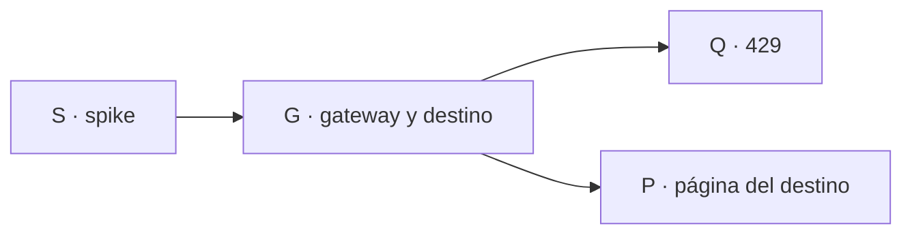

Última modificación: 2026-10-29 | Creado: 2026-10-29

# Plan: la skill con el modelo del clúster

El *qué y por qué* vive en [`spec.md`](spec.md); las tareas, en [`todo.md`](todo.md).

## Overview

Nada de código de producción hasta que el spike (S) enseñe un artefacto que
`adapt_agent_mode` acepte y una persona reconozca la skill. Si no sale, la
iniciativa se retira y no hay gateway que mantener.

Después, el orden no se invierte: primero el gateway y el destino en el
runner (G), luego el 429 (Q), y al final la página del destino (P). La página
sin el destino leído en cada `POST /run` tendría que reiniciar el runner, y
eso es lo que la spec descarta.

## Decisiones de implementación

- **El destino no es una variable de entorno del proceso.** Se guarda en el
  almacén de configuración del panel. `claude-runner` lo lee en cada
  `POST /run` y arma el `extra_env` y `allowedDomains` de esa pasada. El
  `lru_cache` de `Settings` no puede ser la fuente: no ve un cambio hecho
  desde el panel.
- **El `.env` es el valor inicial.** Si nadie ha elegido, manda
  `CLAUDE_UPSTREAM` (por defecto `anthropic`). El panel ofrece tres modelos:
  `claude`, `deepseek-v4-flash` y `glm5.3-flash`. Los dos últimos comparten
  el gateway; solo cambia el alias.
- **No hay botón de reinicio.** Los dos destinos comparten grafo, worker y
  runner. Cambiar de `claude` a `nan` es la siguiente `POST /run`. Pasar al
  motor `llm` no es de esta página: sigue siendo `REVIEW_ENGINE` en el
  `.env` y un reinicio del worker hecho a mano.
- **El 429 del gateway no pasa por `_is_quota`.** Una respuesta 429 del
  gateway, agotados los reintentos internos, es `ClaudeProcessCrashed` (o el
  transitorio que ya reencola el job). `ClaudeQuotaExceeded` sigue saliendo
  solo del desenlace del CLI en el destino Anthropic.
- **LiteLLM pineado en la imagen del gateway**, nunca `latest`. Fuera de
  1.82.7 y 1.82.8.

## Orden y dependencias

Q y P pueden ir en paralelo después de G. P necesita G porque el cambio
`claude`/`nan` no reinicia.

## Checkpoints

- **S-K.** Artefacto `mode:agent` de una review real contra el gateway, leído
  por una persona. Sin esto no se abre G.
- **G-K.** Con `gateway`, el hijo recibe URL, token, modelo y
  `CLAUDE_CODE_DISABLE_NONESSENTIAL_TRAFFIC`, y no recibe el token OAuth. Sin
  destino elegido, el entorno del hijo es el de hoy.
- **Q-K.** Un 429 que sobrevive a los reintentos del gateway reencola el job
  y no lo parkea como `quota`.
- **P-K.** La página ofrece `claude` y `nan`, y no ofrece `llm`. Cambiar de
  uno a otro no mata ningún proceso.

## Riesgos

- El spike puede demostrar que `deepseek-v4-flash` no sostiene la skill. En
  ese caso no hay G: se cierra la iniciativa.
