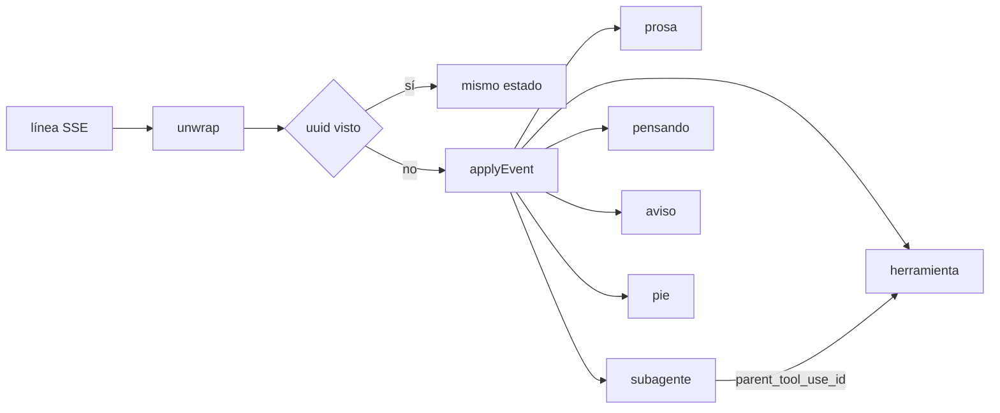

Última modificación: 2026-10-29 | Creado: 2026-10-29

# La transcripción del CLI se lee como en Claude Code

> **Estado:** borrador
>
> **Entrega objetivo:** la tarjeta «Actividad del CLI» deja de ser un volcado de
> texto y pasa a ser una transcripción: la prosa del asistente se lee como
> markdown, cada herramienta es un titular cerrado que solo se abre al pulsarlo,
> los subagentes agrupan su trabajo, y el código se ve con canal de líneas o
> como diff.

---

## 1. Objetivo

Quien mira una review con `REVIEW_ENGINE=claude` abre «Actividad del CLI» para
saber qué está haciendo el proceso. Hoy no se puede. `formatClaudeLine`
(`frontend/src/pages/review/claude.ts`) aplasta cada evento a un string y
`ClaudePanel` los concatena en un `<pre>`:

- un `Read` queda en «herramienta Read», sin la ruta;
- el fichero entero cae debajo, como texto plano y sin emparejar con la llamada
  (el `tool_result` es otro evento);
- los eventos de servicio (recuento de tokens, latidos, avance de subagentes)
  son la mayoría de las líneas y no dicen nada;
- el trabajo de los subagentes se mezcla con el del orquestador;
- no hay nada que expandir: o está todo a la vista o no está.

Claude Code no pinta eventos. Reduce el `stream-json` a bloques: prosa, y una
fila por herramienta cuyo cuerpo está oculto hasta que se abre. El parecido que
se busca es ese, no el de la terminal (no hay ANSI, ni spinner de la TUI, ni
resaltado token a token).

Se quiere:

1. **Una transcripción de bloques**, reducida en el navegador a partir del mismo
   SSE de siempre.
2. **Cada herramienta en un solo titular**, cerrado, que se abre solo al
   pulsarlo. El resultado no añade otra fila: completa la misma.
3. **Cada subagente, un titular** que contiene sus propias herramientas.
4. **El código con la forma de Claude Code:** canal de números en un `Read` y
   en una valla, y color de diff cuando la salida es un diff unificado.
5. **Fuera, lo que no aporta:** eventos de servicio, ids, uso por turno, el
   prompt y el texto de `result` cuando repite la última prosa.

## 2. No-objetivos

- **No se cambia el fichero ni el SSE.** Siguen siendo JSONL crudo
  ([028](../archivo/028-claude-revisa-con-la-skill/spec.md) §8). La descarga
  sigue siendo ese fichero: es la evidencia si la vista se equivoca.
- **No se renderiza en el servidor.** El `web` no sabe cómo se pinta una review
  ([029](../archivo/029-panel-en-react/spec.md), P13).
- **No se pide `--include-partial-messages`.** Cada línea ya es un mensaje
  cerrado. No hay parser de markdown en streaming.
- **No se resaltan tokens** (ni Shiki, ni highlight.js). El canal y el diff son
  el parecido; los colores de keyword no cambian si se entiende la pasada, y un
  WASM hincha el bundle.
- **No se interpreta la transcripción para el diagrama de pasos.** Eso queda
  fuera, como ya dice [031](../031-progreso-en-vivo-del-panel/spec.md).
- **No se implementa el maximizado.** Es de 031. Esta iniciativa no cambia la
  tarjeta ni su scroll: la clase de 031 sigue aplicando al mismo nodo.
- **No hay visor de ediciones.** `Edit` y `Write` están en `--disallowedTools`
  (`claude_cli.py`). El modelo a veces lo intenta, y el CLI lo rechaza con un
  `tool_result` de error: se ve como cualquier herramienta fallida.

## 3. Contexto y evidencia

El argv es `--output-format stream-json --verbose`, sin mensajes parciales
(`claude_argv` en `src/agent_review/adapters/claude_cli.py`). `--allowedTools`
lista `Read`, `Grep`, `Glob` y `Bash`, con `--permission-mode dontAsk`. El prompt
es `/ce-code-review`.

Al log de actividad solo entra, ya redactado, cada línea de stdout que es un
objeto JSON con `type` string, más cada línea de stderr (`_LiveStdout.add` y el
hilo de stderr). El SSE manda esa línea otra vez como string JSON
(`_sse("line", line)` en `claude_activity.py`): hay que desenvolverla, como ya
hace `unwrap` en `claude.ts`.

### 3.1 Transcripciones reales

El 2026-10-29 se leyeron las siete transcripciones guardadas en el volumen de
`claude-runner` (CLI 2.1.308, modelos `claude-sonnet-5-5` y `deepseek-v4-flash`
del clúster), entre ellas una de 11.920 líneas y 9 MB. Lo que fija la vista:

- **Un bloque por línea.** Cada evento `assistant` trae un único bloque en
  `message.content`. Los bloques de un mismo mensaje comparten `message.id` en
  líneas distintas. Toda línea JSON lleva un `uuid` propio y único.
- **La mayoría de las líneas es servicio.** `system/thinking_tokens` es el ~70 %
  de las líneas; con subagentes se suman `tool_progress` (latidos) y
  `system/task_progress`.
- **Los subagentes corren**, aunque `Agent` no esté en `--allowedTools`: el
  permiso lo acepta (`tool_result_meta.permission_decision`). Una review lanzó 9.
  Sus eventos `assistant` y `user` llevan `parent_tool_use_id` con el id del
  `tool_use` de `Agent`. Hay dos modos:
  - **Primer plano:** el `tool_result` del `Agent` es el informe del subagente,
    precedido de `[Subagent hand-back]`.
  - **Segundo plano:** el `tool_result` llega en el acto y solo dice «Async agent
    launched successfully». El final de verdad es un `system/task_notification`
    con el mismo `tool_use_id`, `status` y `summary`.
- **`Read` numera con `N` y tabulador** (`1\t# Título`).
- **`Bash` fallido** trae `is_error: true` y un cuerpo que empieza por
  `Exit code N`. En la corrida grande fue la herramienta más usada (829 de 934 llamadas); `Grep` no
  apareció ni una vez.
- **`result` puede aparecer 0, 1 o N veces.** Con subagentes en segundo plano,
  cada vuelta del orquestador cierra con su `result`, y los 11 de una corrida
  llegaron seguidos al final. Sus textos intermedios («Security is back with one
  finding…») no están en ninguna prosa. El último texto, en `mode:agent`, es el
  JSON de la skill. Una corrida de 42 minutos no tiene ningún `result`. El
  límite de sesión llega con `subtype: success`, `is_error: true` y el motivo en
  `result`.
- **Siempre hay una línea de stderr al principio**
  (`[claude-code:unrecognized_model] …`) con los modelos del clúster.

Tres recortes de esas corridas están en
`frontend/src/pages/review/fixtures/` (TC12).

### 3.2 Qué hace el reducer con cada evento

| `type` / `subtype` | Qué trae | Qué se hace |
|---|---|---|
| `system/init` | cwd, sesión, herramientas, modelo, origen de la clave | Se tira |
| `system/thinking_tokens`, `system/task_progress`, `system/task_updated`, `tool_progress`, `rate_limit_event` | servicio | Se tiran |
| `system/task_started` | `tool_use_id`, `description`, `is_backgrounded` | Marca el `Agent` como «en segundo plano» si procede |
| `system/task_notification` | `tool_use_id`, `status`, `summary` | Completa el `Agent` en segundo plano |
| `assistant` | un bloque: `text`, `thinking` o `tool_use` | Un bloque, en la raíz o bajo su `parent_tool_use_id` |
| `user` | `tool_result` con `tool_use_id`, o el prompt de un subagente | El resultado completa su herramienta. El texto de `user` se tira: es el prompt o un recordatorio del CLI. `tool_use_result` y `tool_result_meta` se ignoran |
| `result` | `result`, `subtype`, `is_error`, `duration_ms`, `num_turns`. `total_cost_usd` llega y se ignora | Pie (§5.4) |
| `stream_event` | deltas; el argv no los pide | Se tira, para no pintar dos veces si algún día llegan |
| otro `type` | — | Se tira. La descarga lo conserva |
| línea que no es JSON | stderr | Aviso de proceso |

### 3.3 Dos propiedades del SSE

- **Reanudar repite una línea.** Cada evento lleva `id:` con el byte donde
  empieza su línea, y `Last-Event-ID` reanuda desde ahí
  (`transcript_events`). Tras una reconexión del navegador, esa línea llega otra
  vez.
- **`end` no siempre es el final del proceso.** Se emite al ver `finished_at`,
  pero también sin transcripción y tras `IDLE_S` (180 s) sin líneas nuevas,
  aunque el runner siga vivo (Q3).

## 4. Decisiones

| # | Decisión | Motivo |
|---|---|---|
| TC1 | **El reducer vive en el cliente y es puro.** `applyEvent(state, event) → state`. El estado es el árbol de bloques más un índice por `tool_use_id`. Un evento que se tira devuelve el **mismo** estado, sin copiar | Emparejar la llamada con su resultado no cabe en un formateador de una línea. El servidor se queda tonto y la descarga no cambia. Con 12.000 líneas, casi todas de servicio, copiar el estado por línea es cuadrático y re-renderiza para nada |
| TC2 | **Un `<details>` sin `open` por herramienta, por subagente, por pensamiento y por aviso largo.** Nada se abre solo, tampoco la última | Es el clic que se pidió, con teclado y sin estado de acordeón. Abrir la última, como hace a veces la TUI, volcaría un fichero encima de la prosa y pelearía con «seguir el final». El titular ya dice qué pasó |
| TC3 | **El titular se actualiza al llegar el resultado** (líneas, ficheros, error) y no aparece una segunda fila | Es lo que permite escanear sin abrir. Una fila de más por resultado es el log de ahora, partido en dos |
| TC4 | **Los verbos de herramienta se quedan en inglés** (`Read`, `Grep`, `Glob`, `Bash`, `Agent`). El resto de la tarjeta, en español | Son el cromo reconocible. Traducirlos no aporta. Una herramienta desconocida usa su `name` tal cual |
| TC5 | **`parent_tool_use_id` anida bajo el `Agent`.** El hijo espera en un aparte si el padre aún no existe y se cuelga al llegar; si el stream acaba sin padre, se pinta en la raíz. El prompt del subagente no se enseña | La skill despacha revisores en paralelo (§3.1). Sin anidar, los `Read` de nueve subagentes se intercalan con los del orquestador. El prompt ya está en el `input` del `Agent` y es largo |
| TC6 | **Prosa por `react-markdown` con `remark-gfm`, sin HTML crudo ni imágenes.** Sin `rehype-raw` y sin `dangerouslySetInnerHTML`. `img` está en `disallowedElements`: una imagen no se carga. Los enlaces pasan por el `urlTransform` por defecto. El cuerpo de una herramienta, el pensamiento y el stderr no pasan por el markdown | P13: la transcripción es texto de terceros, y una imagen remota es una petición que ese texto decide. GFM, porque los informes de la skill usan tablas. Un parser propio se equivoca en listas anidadas y en vallas; la librería, empaquetada, no. El cuerpo es código: una valla dentro de un fichero no es markdown |
| TC7 | **Código a mano, en dos vistas.** `Read` y las vallas: mono con canal. Diff unificado: fondo por línea `+`/`-`/`@@`, sin canal extra. `Grep` y `Glob`: lista mono. `Bash` que no es diff: bloque de terminal | Cubre lo que el CLI puede devolver. Un editor de diff de `Edit` no tiene datos |
| TC8 | **El canal de `Read` sale del prefijo de línea**, que se quita del texto. Se acepta `^\s*\d+(\t\|→\|\|)`; hoy llega el tabulador. Si no encaja al menos la mitad de las líneas no vacías, se numera desde 1. `offset` y `limit` del `input` solo completan el titular | Pintar el prefijo y además un canal duplica los números. El formato del prefijo no es contrato del CLI |
| TC9 | **Al evento `end` del SSE, toda herramienta sin resultado pasa a «sin resultado»**, en tono neutro, no de fallo. Cómo distinguir un proceso muerto de un stream cerrado por inactividad es Q3 | Si no, el titular se queda en curso para siempre. «Interrumpido» mentiría cuando `end` llega por los 180 s de inactividad con el runner vivo |
| TC10 | **El autoscroll cuenta bloques de la raíz, no caracteres.** Abrir un `<details>`, completar una herramienta o añadir un hijo dentro de un `Agent` no cuenta | `useAutoScroll` salta cuando cambia la dependencia. Lo que pasa dentro de un titular cerrado no se ve, y no debe arrancar la lectura. Un bloque nuevo al fondo, sí |
| TC11 | **El pie no enseña dinero.** `total_cost_usd` se descarta | Q1, cerrada el 2026-10-29: no se quiere el coste en la ficha. El presupuesto del cuadro de mando sigue siendo el del motor `llm` |
| TC12 | **Los tests del reducer corren sobre recortes reales.** `frontend/src/pages/review/fixtures/` guarda tres, sacados el 2026-10-29 de corridas sobre este mismo repo: `claude-primer-plano.jsonl` (subagente en primer plano, `Read`, diff, `Bash` y `Write` con error, sin `result`), `claude-segundo-plano.jsonl` (subagente en segundo plano con `task_notification`, prosa final en JSON y tres `result`) y `claude-limite-de-sesion.jsonl` (límite de sesión). Cada string está recortado a 12 líneas o 700 caracteres. Si una versión nueva del CLI contradice §3, se añade un recorte y se enmienda la spec con fecha | Las formas de §3 salen de ahí, no de memoria. Son de este repo: no entra código ajeno |
| TC13 | **Aplicar dos veces el mismo evento no cambia el estado.** El reducer guarda los `uuid` vistos y descarta uno repetido. Una línea sin `uuid` (stderr) no se deduplica | Reanudar con `Last-Event-ID` repite la línea donde se cortó (§3.3). Todo evento JSON trae `uuid` único; `message.id` no sirve porque lo comparten los bloques de un mensaje. Un aviso de stderr repetido es inofensivo, y así `streams.ts` no cambia |
| TC14 | **Un texto que entero es JSON se enseña como código, no como prosa.** Si `text` (o el texto de `result`), recortado, empieza por `{` o `[` y `JSON.parse` lo acepta, va en un `<details>` cerrado, «Respuesta final (JSON)», con la vista de código y formateado | En `mode:agent` la respuesta final de la skill es JSON (§3.1). Como markdown sería un párrafo ilegible de una sola línea |

## 5. Diseño o contrato

### 5.1 Bloques



- **Prosa.** Cada `text` del asistente, en orden. Siempre visible, salvo el JSON
  de TC14.
- **Herramienta.** Nace con el `tool_use` («en curso») y se completa con el
  `tool_result` del mismo `id`. Cerrada. El cuerpo es texto, nunca markdown.
- **Subagente.** Un `tool_use` de `Agent`. Dentro, en orden, sus herramientas,
  su prosa y sus pensamientos (TC5), y al final su informe como texto.
- **Pensando.** Un `thinking`, cerrado, en su sitio. El cuerpo es texto plano.
  La firma no se enseña.
- **Aviso.** Una línea que no es JSON, o un `tool_result` cuyo `tool_use_id` no
  casa con nadie. Varias líneas de stderr seguidas se agrupan en un solo aviso.
  Si el texto cabe en una línea, se ve entero; si no, va cerrado.
- **Pie.** Uno, en la raíz (§5.4). No es un `<details>`.

Un bloque de `content` que no sea de esos tipos (`image`, u otro `type`) no se
pinta. En su lugar, dentro de la herramienta, una línea: «contenido no textual
omitido».

### 5.2 Titulares

El argumento sale de `input`. Si la forma no es la esperada, el titular es el
verbo solo.

| Herramienta | Titular | Al completar |
|---|---|---|
| `Read` | `Read {ruta}` y, si hay `offset`/`limit`, `· líneas {a}–{b}` | `· {n} líneas` |
| `Grep` | `Grep "{patrón}" {ruta}` | Según `output_mode`: `files_with_matches` (o sin él) → `· {n} ficheros`; `content` → `· {n} coincidencias`; `count` → `· {n} coincidencias`, sumando los recuentos. Siempre sobre líneas no vacías del cuerpo |
| `Glob` | `Glob {patrón}` | `· {n} ficheros` |
| `Bash` | `Bash {comando}` en una línea, recortado a 80 caracteres | nada más, salvo error |
| `Agent` | `Agent {description}` y, si hay `subagent_type` distinto de `general-purpose`, `· {subagent_type}`. Con `run_in_background` o `task_started.is_backgrounded`, `· en segundo plano` | Primer plano: el `tool_result`. Segundo plano: el `tool_result` («launched») no lo completa; lo completa `task_notification`, con `status` y, si `status` no es `completed`, el estilo de fallo. El cuerpo final es el informe o el `summary` |
| otra | `{name}` | nada más, salvo error |

Con `is_error`, el mismo titular lleva el estilo de fallo y el resumen pasa a
ser la primera línea del cuerpo, recortada (`Exit code 1`, o el texto de
`<tool_use_error>` sin las etiquetas). Sigue cerrado.

La ruta se enseña relativa si viene absoluta bajo el cwd del `system/init`; si
no se puede recortar, se enseña como llegó. No se inventa un cwd.

### 5.3 Código

- **`Read` y valla.** `<pre>` con canal. El lenguaje de la valla es la etiqueta
  del fence (` ```py ` → `py`); si no hay, se omite. No hay colores por token.
- **Diff.** Se trata como diff si hay una línea `diff --git` o un hunk `@@`.
  Cada línea conserva su prefijo `+`, `-` o espacio. El fondo distingue
  añadido, quitado y hunk. No se vuelve a numerar.
- **`Grep` / `Glob` / `Bash` que no es diff.** Mono, sin canal.
- **JSON de TC14.** Mono, formateado con dos espacios, sin canal.

La prosa y el código no comparten el renderer. Una valla dentro de la prosa sí
usa la vista de código.

### 5.4 Pie y lo que se tira

Solo cuentan los `result` de la raíz. Cada uno actualiza el **mismo** pie:

- **Turnos:** la suma de `num_turns`.
- **Duración:** del primer al último `timestamp` visto, con `formatDuration`
  (`frontend/src/pages/review/trace.ts`). `duration_ms` es de una vuelta y no
  suma el tiempo de pared, y `duration_api_ms` incluye a los subagentes.
- **Estado, según el último `result`:**
  - sin `is_error` y con `subtype` `success`: `Terminó · {n} turnos · {duración}`;
  - con `is_error`: `Se detuvo · {primera línea de result} · {n} turnos ·
    {duración}`. El límite de sesión se lee así («You've hit your session
    limit · resets 9:10am (UTC)»);
  - con otro `subtype`: `Se detuvo · {motivo} · …`. El motivo traduce los
    conocidos (`error_max_turns` → «tope de turnos», `error_during_execution` →
    «error durante la ejecución»); uno desconocido se enseña tal cual.
- **Sin ningún `result` al `end`:** `El CLI no cerró la sesión · {duración}`,
  en tono neutro.

Texto de `result`: solo el del **último** se considera. Se añade como prosa (o
como JSON, TC14) cuando, recortado, no es igual al último bloque de prosa de la
raíz. Si el CLI no escribió prosa y dejó la respuesta solo en `result`, esa
respuesta se ve. Los textos de los `result` intermedios no se enseñan: llegan
juntos al final, fuera de su sitio, y la descarga los conserva.

No se enseña: `session_id`, `uuid`, id de mensaje, `usage`, `total_cost_usd`,
modelo, la firma del pensamiento, el JSON crudo de `input`, el prompt de un
subagente, ni los eventos de servicio de §3.2.

### 5.5 Tarjeta

El scroll y `data-testid="claude-events"` se quedan en el contenedor, que deja
de ser un `<pre>`. La prosa va en la fuente de la ficha; el código, en mono.
«Seguir el final», el estado del stream y el enlace de descarga no cambian.
Sigue habiendo un tope de altura: la ficha no crece con la transcripción. El
maximizado de 031, cuando exista, agranda ese mismo contenedor.

### 5.6 Dónde vive

```
frontend/src/pages/review/claudeTranscript.ts       reducer puro
frontend/src/pages/review/claudeTranscript.test.ts  casos sobre los recortes de TC12
frontend/src/pages/review/fixtures/claude-*.jsonl   recortes reales (ya en el repo)
frontend/src/pages/review/ClaudeTranscript.tsx      vista
frontend/src/pages/review/ClaudePanel.tsx           deja de juntar strings
frontend/src/pages/review/claude.ts                 se queda con stepLabel y exporta unwrap
frontend/src/pages/review/review.scss               canal, diff, titular
```

`formatClaudeLine` desaparece; `claude.ts` no. `react-markdown` y `remark-gfm`
entran en `frontend/package.json`. Ningún fichero Python cambia.
`docs/operacion.md` no cambia: el contrato del SSE es el mismo.

## 6. Riesgos

| # | Riesgo | Qué lo contiene |
|---|---|---|
| R1 | El CLI cambia la forma de `input` o del cuerpo y el titular miente o el cuerpo sale vacío | Titular genérico con el `name`. El cuerpo, si es string o lista de `text`, se enseña igual. Un `type` nuevo se tira. La descarga conserva el evento. TC12 añade un recorte por versión que cambie |
| R2 | `react-markdown` interpreta HTML embebido en la prosa, o la prosa hace que el navegador pida algo | Sin `rehype-raw` e `img` deshabilitado. Un test fija que `<b>` y `<script>` se ven como texto, que `` no crea un `` y que un enlace `javascript:` no queda con ese `href` |
| R3 | Un fichero enorme, al abrirlo, congela la ficha | Sigue cerrado hasta el clic, dentro del contenedor con tope. No se carga un highlighter |
| R4 | El anidado se equivoca de padre | Solo une por `tool_use_id` / `parent_tool_use_id`. Sin padre al acabar, el bloque sube a la raíz en vez de perderse |
| R5 | Completar una herramienta, abrirla o añadir un hijo a un `Agent` dispara el autoscroll | TC10. Un test cubre que la dependencia no cambia en esos casos |
| R6 | 031 maximiza asumiendo un único `<pre>` | El testid y el nodo con scroll no se mueven de la tarjeta. 031 no tiene que conocer los bloques |
| R7 | Una reconexión duplica prosa o herramientas | TC13. Un test aplica la misma línea dos veces y el estado no cambia |
| R8 | Una transcripción de 12.000 líneas y 9 MB, que el SSE manda entera al abrir la ficha, congela la pestaña | TC1: lo que se tira no copia ni re-renderiza. Un test pasa 10.000 eventos de servicio y comprueba que el estado es el mismo objeto |
| R9 | Un `Agent` en segundo plano parece terminado al lanzarse | §5.2: el `tool_result` «launched» no lo completa; lo hace `task_notification`. Lo cubre `claude-segundo-plano.jsonl` |

## 7. Criterios de hecho

1. Un `Read` se ve como `Read {ruta}`, cerrado. Al pulsarlo se ve el fichero con
   canal, y el prefijo `N\t` no se repite en el texto.
2. El `tool_result` no añade una fila: el mismo titular gana el recuento, y un
   `is_error` (un `Bash` con `Exit code 1`, un `Write` rechazado) se distingue
   sin abrirlo.
3. Una valla de la prosa y un `Bash` con `diff --git` o `@@` usan la vista de
   código y la de diff. `Grep` y `Glob` son una lista, y el recuento de `Grep`
   coincide con su `output_mode`.
4. Un `Agent` es un titular con su `description`. Sus herramientas están dentro,
   también cerradas. En segundo plano sigue en curso hasta su
   `task_notification`.
5. No aparecen eventos de servicio, ids, `usage`, coste, prompts de usuario ni de
   subagente. El pie sale una vez, con turnos y duración, sin importe, y dice
   «Se detuvo» con el límite de sesión. El texto de `result` no duplica la
   última prosa, y la respuesta final en JSON sale como código.
6. Un pensamiento es un titular «Pensando», cerrado. Al `end` del stream, una
   herramienta sin resultado dice «sin resultado» sin estilo de fallo, y una
   corrida sin `result` dice que el CLI no cerró la sesión.
7. Nada de la transcripción se interpreta como HTML ni carga una imagen. El
   enlace de descarga y el SSE no cambian.
8. Reanudar el stream no duplica bloques.
9. Los tres recortes de TC12 tienen su test, y 10.000 eventos de servicio no
   cambian el estado.
10. `make frontend-check` y `make docs-check` en verde. `docs/desarrollo.md` §2
    solo se toca si la frase del test de la ficha deja de ser verdad.

## 8. Preguntas abiertas

- **Q1** — cerrada el 2026-10-29: el pie no enseña el coste (TC11).
- **Q2** — cerrada el 2026-10-29: los subagentes corren con el argv actual
  (§3.1). `Agent` no está en `--allowedTools`, pero el CLI lo acepta en
  `dontAsk`; `Write` sí se rechaza. Esto es de 028, no de esta vista.
- **Q3 — ¿Cómo se distingue un `end` por inactividad de un proceso muerto?**
  Mientras corre un `Agent` llegan latidos (`tool_progress`), así que los 180 s
  sin líneas solo se alcanzan con un `Bash` largo del orquestador. Se propone
  dejar «sin resultado» (TC9) y no tocar el servidor. Alternativa: que la vista
  consulte `running` de la ficha al recibir `end` y, si sigue en marcha, deje
  las herramientas «en curso» y ofrezca reconectar. Eso añade estado a la
  tarjeta.
