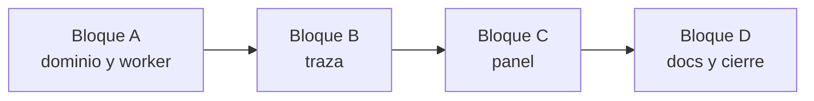

Última modificación: 2026-10-29 | Creado: 2026-10-29

# Plan: cada paso dice cuántos hallazgos entraron, salieron y por qué

## Overview

Tres capas, en orden: el dominio y el worker registran los descartes, la traza
los resume por nodo y el panel los pinta. Cada capa se prueba sola. Spec:
[spec.md](spec.md).

## Decisiones de implementación

- `DiscardedFinding` vive en `domain/models.py`, junto a `ReviewerResult`.
- `AgentModeReview` y `AgentModeRejected` guardan `rejected: tuple[DiscardedFinding, ...]`.
  `reasons` pasa a ser una propiedad derivada (`"#id: motivo"`), para que el diario
  y los tests de hoy no cambien.
- `ClaudeArtifactStore` gana `save_discarded`/`load_discarded`, en
  `<sha>.discarded.json`. `discard` borra también ese fichero.
- L0 traduce su `reason` interno a los tres textos de la spec §4.3 en
  `ClaudeArtifactReviewer`, no en `verification/l0.py`, que comparte el motor `llm`.
- `ReviewState.discarded` usa `operator.add`, como `findings`.
- El resumen se calcula en `trace.py` con una función por nodo sobre las
  escrituras de la tarea. `TraceNode` gana `summary` y `discarded`.
- El texto del paso se escribe en `steps.ts`. Los descartes se pintan en
  `StepsPanel.tsx` con un `
`.

## Orden y dependencias

## Checkpoints

- **A:** un artefacto como el de la PR 27 hace que `persona` escriba un descarte
  `l0` con el motivo «la cita no aparece en el diff». `make test` en verde.
- **B:** la traza de un grafo en memoria lleva `summary` en `scope`, `persona`,
  `merge`, `stamp` y `publish`. Un checkpoint sin `discarded` se lee.
- **C:** `make frontend-check` en verde. La tarjeta dice las cifras y abre los
  descartes.
- **D:** `make ci` en verde y documentos vivos al día.

## Riesgos

Los de la spec §5. Además: el serde rechaza `DiscardedFinding` si no entra en la
allowlist. Un test de ida y vuelta por el checkpointer lo cubre.
