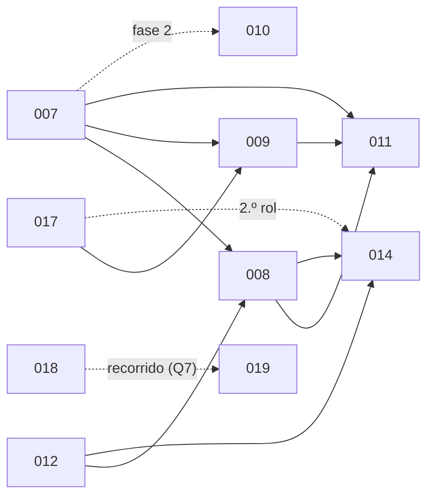

Última modificación: 2026-10-17 | Creado: 2026-10-11

# Iniciativas

Cada iniciativa tiene su carpeta `NNN-slug/` con `spec.md` (qué y por qué),
`plan.md` (cómo y en qué orden) y `todo.md` (qué falta). El ciclo de vida y la
nomenclatura están en la regla [`documentacion`](../../.agents/rules/documentacion.md).
Las cerradas sin pendientes se mueven a `archivo/`.

## Activas

| # | Iniciativa | Spec | Estado | Depende de / lo que queda |
|---|---|---|---|---|
| 010 | [Personas deterministas de wiring y configuración](010-personas-de-wiring/spec.md) | borrador | 🔵 Vía de recall | Fase 1 (gate de CI) sin dependencias; fase 2 (persona), 007 · 5 preguntas abiertas |
| 014 | [Revisor con herramientas de lectura](014-revisor-con-herramientas/spec.md) | aprobada | 🔵 Las personas LLM leen ficheros y hacen `grep` mientras revisan · [plan](014-revisor-con-herramientas/plan.md) · [todo](014-revisor-con-herramientas/todo.md) | 008 (012, 016 y 017 hechas) · RH1–RH10 hechas; RH11–RH12 pendientes |
| 015 | [Puesta en marcha real](015-puesta-en-marcha-real/spec.md) | borrador | 🟠 Smokes, pendientes humanos y endurecimiento de `production` | Sin dependencias de código · reúne los pendientes de 001–005 y 013 · **P7 primero** |
| 018 | [Trazas de la review](018-trazas-de-la-review/spec.md) | borrador | 🟠 Recorrido visible de una petición (D14); Langfuse v3 self-hosted | Sin dependencias · 5 preguntas abiertas · comparte la lectura del `usage` con 017 |
| 023 | [Eficacia del bucle de lectura](023-eficacia-del-bucle-de-lectura/spec.md) | aprobada | 🟠 Que `grep`, `read_file` y `list_dir` de 014 sirvan de verdad: dialecto ERE único, `grep` acotado, corte con tamaño real, `outline`, estado y `served` por review · [plan](023-eficacia-del-bucle-de-lectura/plan.md) · [todo](023-eficacia-del-bucle-de-lectura/todo.md) | 014 (medida) · K0 (D23 en 3 niveles + matcher + flags + clasificación replay/live) bloquea el resto · T0–D1 pendientes |
| 024 | [Contexto conversacional del bucle](024-contexto-conversacional-del-bucle/spec.md) | aprobada | 🟠 El bucle pasa a mensajes y se mide `cached_tokens` antes de decidir si la review se parte en fases (`plan`/`read`/`review`) · [plan](024-contexto-conversacional-del-bucle/plan.md) · [todo](024-contexto-conversacional-del-bucle/todo.md) | 023 (K0 y K3) · S1–S5 (medida) van antes de las corridas *live* de 023 · A tras K3 · B solo con número · S–D pendientes |

### Orden

Las iniciativas **006–012** son el desglose de una única auditoría de la calidad de
la review del PR #3 (6 falsos positivos, 1 hallazgo invertido y 6 hallazgos reales no
detectados —3 P1 de integración y 3 P2 de código—). La **014** amplía esa cascada,
y **017** es la pieza compartida que salió de la deuda D17. La **008**, **009**,
**011**, **016**, **017**, **019**, **020** y **021** ya están entregadas y
archivadas.

- **Archivadas el 2026-10-17:** 008 (L0/L1), 009 (L2) y **011** (gate de
  severidad; [ADR-0024](../adr/0024-gate-de-severidad-en-la-politica.md)). El *gold
  set* del PR #3 se regrabó el 2026-10-17 al cerrar la RH10 de 014 (cierra la CX11 de
  008): cobertura 1.0, 3 TP, precisión 0.30 y recall 0.375. Siguiente de la cascada:
  **014** (RH11 en adelante).
- **Se puede empezar ya**, sin esperar a nadie: la fase 1 de 010 y 015.
- **015 corre en paralelo** a todo lo demás: depende de personas e infraestructura,
  no de código.

## Archivadas

Sin tareas abiertas. Lo que les quedaba (smokes y pendientes humanos) se trasladó a
[015](015-puesta-en-marcha-real/spec.md) el 2026-10-16 (OP35 de 019, el 2026-10-17),
conservando sus IDs.

| # | Iniciativa | Spec | Entregado |
|---|---|---|---|
| 001 | [Diseño base y Fase 1 (report-only)](archivo/001-diseno-base/spec.md) | implementada | Fase 1 con smoke real en el PR 430 · [todo](archivo/001-diseno-base/todo.md) |
| 002 | [Fase 2 — HITL](archivo/002-fase2-hitl/spec.md) | implementada | T1–T10 · [todo](archivo/002-fase2-hitl/todo.md) |
| 003 | [Fase 3 — Fix + verificación](archivo/003-fase3-fix-verificacion/spec.md) | implementada | F1–F10 y F13 · [todo](archivo/003-fase3-fix-verificacion/todo.md) |
| 004 | [Fase 3-E7 — Desacople fuerte de la verificación](archivo/004-fase3-e7-desacople/spec.md) | implementada | F14–F28 · [todo](archivo/004-fase3-e7-desacople/todo.md) |
| 005 | [Fase 3.5 — Modelos declarativos por rol](archivo/005-modelos-declarativos/spec.md) | implementada | M1–M11 · [todo](archivo/005-modelos-declarativos/todo.md) |
| 006 | [Evaluación de la review: *gold set* y métricas](archivo/006-eval-de-la-review/spec.md) | implementada | E1–E12; mide el resto de iniciativas · [todo](archivo/006-eval-de-la-review/todo.md) |
| 007 | [Contrato de verificación del hallazgo](archivo/007-contrato-de-verificacion/spec.md) | implementada | V1–V8 · `verification`, `failure_scenario`, `verification_evidence` y `context_scope` en el contrato; fuera `requires_verification` · [ADR-0021](../adr/0021-cascada-de-verificacion-del-hallazgo.md) · [todo](archivo/007-contrato-de-verificacion/todo.md) |
| 008 | [Contexto del revisor: L0 y L1](archivo/008-contexto-del-revisor/spec.md) | implementada | CX1–CX12 · L0 determinista y L1 `ReviewContext`; CX11 cerrada al regrabar el *gold set* con 014 · [todo](archivo/008-contexto-del-revisor/todo.md) |
| 009 | [Verificador adversarial (L2)](archivo/009-verificador-adversarial/spec.md) | implementada | VF1–VF15 · nodo `verify`, `LlmVerifier`, binding `gemma4`, `severity_gate` declarado · [todo](archivo/009-verificador-adversarial/todo.md) |
| 011 | [Gate de severidad por política y observabilidad](archivo/011-gate-de-severidad/spec.md) | implementada | G1–G5 · `severity_gate` aplicado en el motor y en publish · [ADR-0024](../adr/0024-gate-de-severidad-en-la-politica.md) · [todo](archivo/011-gate-de-severidad/todo.md) |
| 012 | [Cobertura de la review](archivo/012-cobertura-de-la-review/spec.md) | implementada | CB1–CB11 · sin `max_files_per_pr`; el `scope` prioriza y el `LlmReviewer` revisa por lotes de ficheros enteros y declara lo que no lee (`ReviewCoverage`, review parcial) · cierra D18 · cobertura del PR #3 de 0.2 a 1.0 · [todo](archivo/012-cobertura-de-la-review/todo.md) |
| 013 | [Canal bidireccional de Teams](archivo/013-canal-teams-bidireccional/spec.md) | implementada | T1–T9 y T11–T17 · [ADR-0016](../adr/0016-bot-de-teams-para-el-canal-de-decision.md) · [todo](archivo/013-canal-teams-bidireccional/todo.md) |
| 016 | [Lector de contexto](archivo/016-lector-de-contexto/spec.md) | implementada | L1–L12 · puerto, bucle de herramientas y workspace de lectura en el runner · [ADR-0018](../adr/0018-workspace-de-lectura-en-el-runner.md) · [todo](archivo/016-lector-de-contexto/todo.md) |
| 017 | [Presupuesto de tokens por PR](archivo/017-presupuesto-por-pr/spec.md) | implementada | P1–P12 · contador por review compartido y atómico, corte como hecho · cierra D17 y D21 · [ADR-0019](../adr/0019-presupuesto-de-tokens-por-review.md) · [todo](archivo/017-presupuesto-por-pr/todo.md) |
| 019 | [Panel de operación](archivo/019-panel-de-operacion/spec.md) | implementada | OP1–OP51 · servicio `web` con sesión y rol, recorrido y progreso, consola del sandbox por SSE y comandos de cancelar/reintentar/reanudar · cierra D16 · [ADR-0020](../adr/0020-panel-como-servicio-aparte.md) · [todo](archivo/019-panel-de-operacion/todo.md) |
| 020 | [Contrato de secretos declarado en el modelo](archivo/020-secretos-declarados/spec.md) | implementada | S1–S7 · contrato derivado de `Settings` (`secrets_for`) · cierra D22 · [ADR-0022](../adr/0022-contrato-de-secretos-declarado.md) · [todo](archivo/020-secretos-declarados/todo.md) |
| 021 | [Razonamiento del revisor visible en el panel](archivo/021-razonamiento-visible/spec.md) | implementada | RZ1–RZ14 · *streaming*, sink Redis, panel en vivo e histórico · *gold set* 0.375/0.375 (superado por la regrabación con herramientas: 0.30/0.375, ver 014 RH10) · [ADR-0023](../adr/0023-razonamiento-por-streaming-y-stream-de-redis.md) · [todo](archivo/021-razonamiento-visible/todo.md) |
| 022 | [Decisión humana desde el panel](archivo/022-decision-humana-en-el-panel/spec.md) | implementada | DH1–DH14 · el detalle muestra cada pendiente y el formulario decide (`approved`/`rejected`/`noted`) con `build_decision`; la UI deja de ofrecer «Reanudar» en pausas humanas · [todo](archivo/022-decision-humana-en-el-panel/todo.md) |

## Pendientes humanos o externos

Viven en un solo sitio: [015 §3.1](015-puesta-en-marcha-real/spec.md). El más urgente
es **P7**: rotar la API key de `nan.builders` que quedó expuesta en el chat de diseño.

Siguiente número libre: **025**. La Fase 4 (autonomía por política, Jira, memoria,
métricas) está esbozada en la [spec de 001 §13](archivo/001-diseno-base/spec.md) y
aún no tiene iniciativa.
