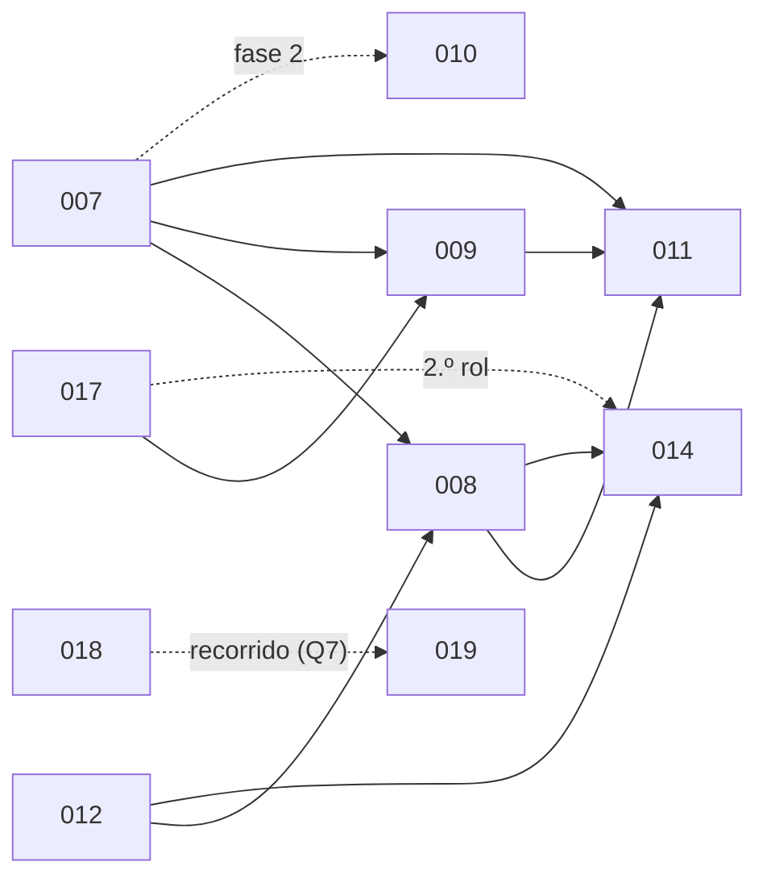

Última modificación: 2026-10-16 | Creado: 2026-10-11

# Iniciativas

Cada iniciativa tiene su carpeta `NNN-slug/` con `spec.md` (qué y por qué),
`plan.md` (cómo y en qué orden) y `todo.md` (qué falta). El ciclo de vida y la
nomenclatura están en la regla [`documentacion`](../../.agents/rules/documentacion.md).
Las cerradas sin pendientes se mueven a `archivo/`.

## Activas

| # | Iniciativa | Spec | Estado | Depende de / lo que queda |
|---|---|---|---|---|
| 007 | [Contrato de verificación del hallazgo](007-contrato-de-verificacion/spec.md) | borrador | 🔵 Habilita la cascada | Sin dependencias (se mide con 006) · 5 preguntas abiertas · habilita 008, 009, 010 (fase 2) y 011 |
| 008 | [Contexto del revisor: L0 determinista y L1 contexto](008-contexto-del-revisor/spec.md) | borrador | 🔵 Capas baratas de la cascada | 007 y 012 · 6 preguntas abiertas |
| 009 | [Verificador adversarial (L2)](009-verificador-adversarial/spec.md) | aprobada | 🔵 Capa de pago de la cascada | 007, 016 y 017 · falta plan y todo |
| 010 | [Personas deterministas de wiring y configuración](010-personas-de-wiring/spec.md) | borrador | 🔵 Vía de recall | Fase 1 (gate de CI) sin dependencias; fase 2 (persona), 007 · 5 preguntas abiertas |
| 011 | [Gate de severidad por política y observabilidad](011-gate-de-severidad/spec.md) | borrador | 🔵 Cierre de la cascada; único dueño de la severidad | 007, 008 y 009 · 7 preguntas abiertas |
| 012 | [Cobertura de la review](012-cobertura-de-la-review/spec.md) | borrador | 🔵 Que el revisor vea el PR y diga lo que no vio | Sin dependencias (se mide con 006) · 4 preguntas abiertas · habilita 008 y 014 |
| 014 | [Revisor con herramientas de lectura](014-revisor-con-herramientas/spec.md) | aprobada | 🔵 Las personas LLM leen ficheros y hacen `grep` mientras revisan | 008, 012 y 016; un segundo rol, también 017 · falta plan y todo |
| 015 | [Puesta en marcha real](015-puesta-en-marcha-real/spec.md) | borrador | 🟠 Smokes, pendientes humanos y endurecimiento de `production` | Sin dependencias de código · reúne los pendientes de 001–005 y 013 · **P7 primero** |
| 017 | [Presupuesto de tokens por PR](017-presupuesto-por-pr/spec.md) | implementada | ✅ Tope real por review: contador compartido y atómico, corte como hecho · cierra D17 y D21 · [ADR-0019](../adr/0019-presupuesto-de-tokens-por-review.md) · [todo](017-presupuesto-por-pr/todo.md) |
| 018 | [Trazas de la review](018-trazas-de-la-review/spec.md) | borrador | 🟠 Recorrido visible de una petición (D14); Langfuse v3 self-hosted | Sin dependencias · 5 preguntas abiertas · comparte la lectura del `usage` con 017 |
| 019 | [Panel de operación](019-panel-de-operacion/spec.md) | implementada | ✅ Panel como servicio aparte: recorrido y progreso, servicio `web` con sesión y rol, consola del sandbox por SSE y comandos de cancelar/reintentar/reanudar · cierra D16 · [ADR-0020](../adr/0020-panel-como-servicio-aparte.md) · [todo](019-panel-de-operacion/todo.md) | Frontera con 018 (operación vs análisis) · comparte el `usage` de 017 |

### Orden

Las iniciativas **006–012** son el desglose de una única auditoría de la calidad de
la review del PR #3 (6 falsos positivos, 1 hallazgo invertido y 6 hallazgos reales no
detectados —3 P1 de integración y 3 P2 de código—). La **014** amplía esa cascada,
y **017** es la pieza compartida que salió de la deuda D17. La **016** (lector de
contexto) ya está entregada y archivada.

La **016** (lector de contexto) ya está entregada: 009 y 014 la consumen, no la
esperan.

- **Aprobar primero lo que desbloquea:** 012 y 007 (9 preguntas abiertas entre las
  dos) y después 008.
- **Se puede empezar ya**, sin esperar a nadie: 017, la fase 1 de 010 y 015.
- **015 corre en paralelo** a todo lo demás: depende de personas e infraestructura,
  no de código.

## Archivadas

Sin tareas abiertas. Lo que les quedaba (smokes y pendientes humanos) se trasladó a
[015](015-puesta-en-marcha-real/spec.md) el 2026-10-16, conservando sus IDs.

| # | Iniciativa | Spec | Entregado |
|---|---|---|---|
| 001 | [Diseño base y Fase 1 (report-only)](archivo/001-diseno-base/spec.md) | implementada | Fase 1 con smoke real en el PR 430 · [todo](archivo/001-diseno-base/todo.md) |
| 002 | [Fase 2 — HITL](archivo/002-fase2-hitl/spec.md) | implementada | T1–T10 · [todo](archivo/002-fase2-hitl/todo.md) |
| 003 | [Fase 3 — Fix + verificación](archivo/003-fase3-fix-verificacion/spec.md) | implementada | F1–F10 y F13 · [todo](archivo/003-fase3-fix-verificacion/todo.md) |
| 004 | [Fase 3-E7 — Desacople fuerte de la verificación](archivo/004-fase3-e7-desacople/spec.md) | implementada | F14–F28 · [todo](archivo/004-fase3-e7-desacople/todo.md) |
| 005 | [Fase 3.5 — Modelos declarativos por rol](archivo/005-modelos-declarativos/spec.md) | implementada | M1–M11 · [todo](archivo/005-modelos-declarativos/todo.md) |
| 006 | [Evaluación de la review: *gold set* y métricas](archivo/006-eval-de-la-review/spec.md) | implementada | E1–E12; mide el resto de iniciativas · [todo](archivo/006-eval-de-la-review/todo.md) |
| 013 | [Canal bidireccional de Teams](archivo/013-canal-teams-bidireccional/spec.md) | implementada | T1–T9 y T11–T17 · [ADR-0016](../adr/0016-bot-de-teams-para-el-canal-de-decision.md) · [todo](archivo/013-canal-teams-bidireccional/todo.md) |
| 016 | [Lector de contexto](archivo/016-lector-de-contexto/spec.md) | implementada | L1–L12 · puerto, bucle de herramientas y workspace de lectura en el runner · [ADR-0018](../adr/0018-workspace-de-lectura-en-el-runner.md) · [todo](archivo/016-lector-de-contexto/todo.md) |

## Pendientes humanos o externos

Viven en un solo sitio: [015 §3.1](015-puesta-en-marcha-real/spec.md). El más urgente
es **P7**: rotar la API key de `nan.builders` que quedó expuesta en el chat de diseño.

Siguiente número libre: **019**. La Fase 4 (autonomía por política, Jira, memoria,
métricas) está esbozada en la [spec de 001 §13](archivo/001-diseno-base/spec.md) y
aún no tiene iniciativa.
