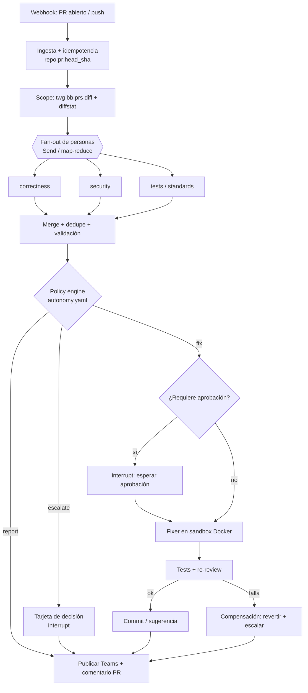

Última modificación: 2026-10-11 | Creado: 2026-10-10

# Diseño: agente autónomo de code review sobre LangGraph

> **Estado:** implementada (Fases 0–1). Las fases siguientes tienen su propia iniciativa (002–004); el estado del sistema hoy está en `docs/arquitectura.md`.

Propuesta de arquitectura para un agente que detecta PRs nuevos en Bitbucket, hace la
review, publica los hallazgos en un canal de Microsoft Teams, y —según una política de
autonomía— corrige, pregunta o escala.

---

## 0. Contexto y decisiones tomadas

| Decisión | Valor | Consecuencia clave |
|---|---|---|
| VCS / PRs | **Bitbucket** | Se usa `twg` como adaptador. El MCP de GitHub queda como adaptador alternativo. |
| Jira | **Sí** (`twg jira`) | Los hallazgos que requieren decisión de negocio pueden terminar en un workitem enlazado. |
| Canal | **Microsoft Teams, solo Incoming Webhook** | **Unidireccional**: no hay callbacks. El bucle humano→agente no se puede cerrar solo con Teams (ver §5). |
| Framework | **LangGraph** | Interés formativo + encaje real con HITL durable, fan-out y estado. |
| Review | Contrato de `ce-code-review` | Se reutiliza su esquema de hallazgos, **no** su runtime (ver §6). |
| Runtime | Python 3.12 + Docker 29 + Postgres | Checkpointer durable para sobrevivir a reinicios. |
| Publicación en PR | **Comentarios inline + resumen** | Un comentario anclado por hallazgo; un resumen general + Teams. Ver §6.1.1. |

> Nota: `twg teams` **no es Microsoft Teams**. Es Atlassian Teams (identidad y membresía
> de equipos). No sirve como canal de chat.

---

## 1. Principios y alcance

1. **Report-only por defecto.** El valor principal está en los hallazgos, no en el autofix.
   El agente empieza sin permiso de escritura y lo gana por fases.
2. **La autonomía es una política por hallazgo**, no un nivel global del agente (§2).
3. **Nunca auto-merge.** El agente propone o arregla; una persona mergea.
4. **Determinismo en las decisiones.** La política es YAML auditable, no `if`s enterrados.
5. **Todo es observable.** Sin trazas, el agente es un agujero negro.
6. **Idempotencia por `repo:pr:head_sha`.** Un push nuevo = una review nueva; nunca se
   reprocesa el mismo estado dos veces.

**Fuera de alcance (v1):** auto-merge, revisión de código no-PR, multi-repo en un mismo
grafo, ejecución de código del PR fuera del sandbox.

---

## 2. Crítica a "grados de autonomía" (y alternativa)

La idea intuitiva es un **escalar**: "el agente está en Nivel 2". Es cómodo de explicar
pero **incorrecto como mecanismo**, porque el nivel adecuado no depende del agente sino
de **cada hallazgo**:

- Un `P3` de naming en un fichero de test: corregir sin preguntar es razonable.
- Un cambio en autorización, criptografía, concurrencia o contrato público: nunca
  automático, aunque la confianza sea 100 y sea "una línea".
- Un hallazgo de arquitectura (`manual`): ninguna cantidad de confianza lo convierte en
  autofix.

Por eso se propone **policy-as-data por hallazgo**. El "grado de autonomía" pasa a ser la
acción que la política asigna a ese hallazgo concreto. Además se mantiene **un dial
global** (`max_autonomy`) que sube o baja el techo sin reescribir el grafo.

Se reutiliza el contrato de `ce-code-review` como vocabulario de clasificación:
`severity` (P0–P3), `autofix_class` (`gated_auto`/`manual`/`advisory`), `owner`,
`confidence` (0/25/50/75/100), `protected_subject`, `requires_verification`.

---

## 3. Modelo de autonomía

### 3.1 Acciones posibles

| Acción | Significado | Efecto en el sistema |
|---|---|---|
| `report` | Solo informar | Comentario en PR + tarjeta en Teams |
| `escalate` | Necesita a un humano | Tarjeta de decisión en Teams (+ workitem Jira opcional) y **pausa** el grafo |
| `fix_with_approval` | Arreglar, pero preguntando | Pregunta por Teams: publica enlace/PR y espera aprobación |
| `fix_auto` | Arreglar sin preguntar | Sandbox, tests, commit en rama del PR, re-review |

### 3.2 Reglas de enrutamiento

| Condición del hallazgo | Acción |
|---|---|
| `protected_subject` != null (auth, cripto, concurrencia, data-loss, secretos, contrato público, inyección) | `escalate` |
| `severity = P0` | `escalate` |
| `autofix_class = manual` | `escalate` |
| `autofix_class = advisory` o `confidence < 75` | `report` |
| `autofix_class = gated_auto`, `confidence >= 75`, `P1–P2` | `fix_with_approval` |
| `autofix_class = gated_auto`, `confidence >= 75`, `P3`, ruta de bajo riesgo | `fix_auto` |

### 3.3 `autonomy.yaml` (borrador)

```yaml
version: 1
max_autonomy: fix_with_approval   # dial global: report | fix_with_approval | fix_auto
default_action: report

rules:                            # se evalúan en orden; gana la primera que casa
  - when: { protected_subject: "*" }
    action: escalate
    reason: "Tema protegido: requiere criterio humano"
  - when: { severity: P0 }
    action: escalate
  - when: { autofix_class: manual }
    action: escalate
  - when: { autofix_class: advisory }
    action: report
  - when: { confidence: [0, 25, 50] }
    action: report
  - when: { autofix_class: gated_auto, severity: [P1, P2] }
    action: fix_with_approval
  - when: { autofix_class: gated_auto, severity: P3, paths: ["*.test.*", "docs/**", "**/*.md"] }
    action: fix_auto

guards:
  max_files_per_pr: 10
  never_auto_paths: [".github/**", "infra/**", "migrations/**", "**/auth/**", "**/security/**"]
  require_tests_pass: true
  max_fix_attempts: 2
  budget_tokens_per_pr: 500000
  dedupe_by: [file, title]       # no repetir hallazgos ya reportados en el PR
```

La escritura de `autonomy.yaml` es revisable por cualquiera y cambia sin redesplegar el
grafo. Es el punto donde un equipo de seguridad puede auditar y frenar al agente.

---

## 4. Arquitectura

### 4.1 Grafo



### 4.2 Nodos y responsabilidades

| Nodo | Tipo | Responsabilidad |
|---|---|---|
| `intake` | determinista | Valida webhook, calcula la clave de idempotencia, encola. |
| `scope` | tool | Obtiene diff y diffstat vía `twg`, filtra ruido (generados, lockfiles). |
| `fan_out` | LangGraph `Send` | Lanza las personas en paralelo sobre el mismo diff. |
| `persona_*` | LLM + validación | Devuelve hallazgos validados contra el esquema. |
| `merge` | determinista | Deduplica, resuelve conflictos entre personas, valida claims. |
| `policy` | determinista | Aplica `autonomy.yaml`. Sin LLM. |
| `gate` | LangGraph router | Decide `report` / `escalate` / `fix` / `approve`. |
| `hitl` | LangGraph `interrupt` | Pausa durable; se reanuda con la decisión del humano. |
| `fix` | LLM + sandbox | Aplica el `suggested_fix` dentro del sandbox. |
| `verify` | determinista | Ejecuta las recipes del `repo_profile` (lint, typecheck, tests dirigidos, suite) + segunda pasada de review. |
| `publish` | tool | Comentarios **inline** por hallazgo + resumen general en el PR. |
| `notify` | tool | Tarjeta Teams. Nodo aparte para que un fallo de Teams no repita `publish` (B9 de la revisión de `main`). |

### 4.3 Estado (con reducers)

```python
import operator
from typing import Annotated, TypedDict

class ReviewState(TypedDict, total=False):
    request: ReviewRequest
    diff: str
    # Las personas escriben en paralelo; el reducer acumula.
    findings: Annotated[list[Finding], operator.add]
    # Resultado del merge: sin reducer, se sustituye (no se reacumula).
    merged: list[Finding]
    # Juicio de la politica sobre cada hallazgo mergeado. Sin reducer.
    decisions: list[Decision]
    fix_attempts: int
    teams_message_id: str
    artifacts: list[str]
```

Tres decisiones del estado que conviene entender:

- **`findings` con reducer, `merged` sin reducer.** Las personas escriben `findings` en
  paralelo, así que necesita `operator.add`. El merge escribe `merged`, que debe
  **sustituirse**: si compartiera campo con `findings`, el resultado del merge se
  reacumularía sobre lo ya acumulado y cada hallazgo aparecería duplicado. Es el patrón
  map-reduce canónico de LangGraph.
- **`decisions` no se fusiona con `Finding`.** La política corre *después* del merge, así
  que decide sobre el conjunto depurado, no sobre lo que dijo cada persona. Fusionarlas
  metería un juicio dentro de un objeto que el merge manipula: se mezclarían hecho y
  juicio.
- **`pending_approvals` no existe como campo.** Es una **vista derivada** de `decisions`
  (filtrar por `escalate`/`fix_with_approval`). Guardarlo aparte duplicaría la fuente de
  verdad y podría desincronizarse.

Cada `Decision` lleva, además de la acción, la **regla que la disparó** (`matched_rule`) y
la **versión de la política** (`policy_version`). Sin eso no se puede auditar por qué se
autoarregló algo meses después.

El criterio de dedupe es **único** en todo el grafo: `(file, line, title)`. El merge y
la política usan la misma clave para que no haya dos lógicas. Además, el merge fusiona
el mismo `(file, title)` con anclas a 5 líneas o menos **solo si viene de personas
distintas** (la estática y el LLM viendo el mismo problema); dos hallazgos de la misma
persona en líneas distintas nunca se fusionan. La procedencia viaja en el estado
(`finding_sources`), no en `Finding`.

> Actualizado tras la revisión de `main` (B5): con `(file, title)`, dos errores de
> PHPStan con el mismo mensaje en líneas distintas de un fichero se quedaban en uno.

### 4.4 Checkpointer

`langgraph-checkpoint-postgres` sobre el Postgres del compose. Es lo que permite que un
`interrupt` sobreviva a un reinicio del worker: la review queda pausada esperando la
aprobación hasta que llegue la respuesta. Sin checkpointer, `interrupt` no es durable.

---

## 5. HITL con Teams unidireccional (el problema)

Con **solo Incoming Webhook** el agente puede *publicar* pero **no puede recibir** la
respuesta. El bucle "el agente pregunta → el humano responde → el agente continúa" no se
cierra con Teams. Hay tres salidas, ordenadas por recomendación:

### Opción A — Bot de Azure (dos sentidos) — recomendada
Registrar un **Azure Bot** + Bot Framework y exponer un endpoint de mensajería en la
`api`. Permite **Adaptive Cards** con botones (`Aprobar`, `Rechazar`, `Responder`) y
recibir respuestas de texto en el mismo hilo. Mapeo natural:

- `conversationId` + `activityId` de Teams ↔ `interrupt` pendiente en el checkpointer.
- Al pulsar un botón o responder texto → `Command(resume=...)` al grafo.
- El mensaje raíz se **actualiza** (`updateActivity`) según avanza el grafo; no se
  crea un mensaje nuevo por cada paso.

Requiere: registro de app en Azure AD, identidad del bot, endpoint HTTPS público.

### Opción B — Webhook + decisión por otro canal (fallback pragmático)
Mantener el Incoming Webhook para **notificar** (hallazgos + enlace al PR), y aceptar la
decisión por otro canal que sí tenga recepción:

- **Comentarios del PR** en Bitbucket: "responde `/@bot apply <id>` o reacciona". El
  agente sondea `twg bb prs comment query` / `prs activity`. Es fiable y no requiere
  infraestructura nueva.
- **Jira**: crear un workitem para cada escalado y escuchar sus transiciones
  (`twg jira`).
- **Aprobación por CLI** (`reviews approve <pr> <finding>`): mínimo, para uso interno.

Ventaja: cero infraestructura de bot. Inconveniente: la decisión vive en otro sitio que
Teams; la tarjeta de Teams solo informa.

### Opción C — Power Automate como puente
Un flujo de Power Automate que escuche las respuestas del canal y llame a un endpoint
HTTP de la `api`. Evita el Bot Framework, pero introduce dependencia de licencias y de
un servicio externo difícil de testear. Solo si ya tenéis Power Automate.

> **Recomendación:** empezar en Opción B (Fase 2, sin infra nueva) y migrar a A cuando
> la experiencia lo justifique. En ambos casos, Teams es **UI**, no base de datos: el
> estado vive en Postgres.

### 5.1 Reglas de UX del canal
- **Un hilo por PR**, no un mensaje por hallazgo. Evento raíz + replies.
- **Editar** la tarjeta cuando el grafo avanza (no spamear).
- Agrupar hallazgos por `severity`; el detalle va al PR, el resumen a Teams.
- Un canal inundado deja de leerse: es un fallo de producto, no de código.

---

## 6. Herramientas: qué usar y qué no

### 6.1 `twg` como adaptador de VCS y Jira — sí
Es la pieza correcta para Bitbucket y Jira. Comandos relevantes verificados en v1.3.x:

> **Contrato de salida (v1.3).** `-o json` **no** imprime JSON puro: emite un
> envoltorio YAML con el payload en un fichero aparte (`stdout.json`). Para JSON puro
> hay que usar `--output json --output-summary none`. El adaptador lo hace así.

```
twg bb prs diff <id>                  # diff unificado del PR
twg bb prs diff-line <id>             # líneas nuevas/contexto para comentarios inline
twg bb prs diffstat <id>              # alcance del cambio (ficheros, +/-)
twg bb prs get <id> --full            # descripción, commits, comentarios, checks
twg bb prs activity <id>              # log cronológico (aprobaciones, comentarios…)
twg bb prs comment create --pull-request <id> --text "…"
twg bb prs comment create … --path <file> --line <n>   # inline (lado nuevo)
twg bb prs diff-line <id> --path <file> --text <quote>  # devuelve matches[].toLine
twg bb prs task create --pull-request <id> --text "…"
twg bb prs approve <id>
twg bb pipeline get --pipeline <id> --logs
twg jira workitem …                   # escalado a workitem
```

Uso recomendado: **CLI detrás de un adaptador**, invocado por `subprocess` con
`-o json`. No meterlo como MCP dentro del LLM de forma libre: expón **acciones tipadas**
y deja que el LLM solo elija *qué* acción, nunca *cómo* invoca la shell.

#### 6.1.1 Publicación: inline primero, resumen después

El valor de una review automática está en el **sitio del cambio**, no en un muro de
Markdown al final del PR. Por eso el nodo `publish` en Fase 1 hace:

1. **Un comentario inline por hallazgo** (`path` + línea del lado nuevo), con título,
   severidad, por qué importa y (si existe) `suggested_fix` corto.
2. **Un comentario general de resumen**: conteo por severidad, índice de hallazgos y
   enlace; lo que Teams ya resume.
3. **Teams** sigue siendo solo el teaser: no sustituye los inline. Sale del nodo
   `notify`, después de `publish`.

**Anclaje seguro (no negociable).** Bitbucket rechaza o cuelga mal un comentario si la
línea no está en el diff actual. En la implementación actual las personas anclan
directamente en las **líneas añadidas del diff** (`parse_unified_diff`), que por
construcción son válidas; `diff-line` queda para el adaptador real y como verificación.
Flujo conceptual por hallazgo:

```
Finding(file, line, evidence)
        │
        ├── linea anadida del diff → post_inline_comment(path, line, body)
        └── no esta en el diff → el hallazgo va solo al resumen general
```

`twg bb prs diff-line` devuelve `{matches: [{path, content, toLine}]}`; el adaptador usa
`toLine` como línea del lado nuevo.

No usar `--pending`: `twg` no puede cerrar la review en la UI; los comentarios deben
ser públicos desde el create.

**Guardrails de producto** (si se omiten, el canal muere):

| Guard | Valor inicial | Motivo |
|---|---|---|
| `max_inline_comments` | 20 por PR/run | Un PR ruidoso no debe spamear |
| Prioridad al cortar | P0 → P3 | Los graves siempre anclan; el resto al resumen |
| Dedupe | marca del hallazgo (`_finding_id`) ya vista en comentarios del agente | Re-push no duplica el mismo hallazgo |
| Fallback | resumen si el ancla falla | Nunca perder el hallazgo por un número de línea malo |
| Sin inline en borrados puros | usar `--from-line` solo si `diff-line` lo indica | El lado viejo es otro contrato |

Patrón: **Ports & Adapters** en `VcsPort` con `resolve_inline_anchor` +
`post_inline_comment`; el grafo no conoce flags de `twg`.

### 6.2 `ce-code-review` — reutilizar el contrato, no el runtime
Es una **skill de prompt** (subagentes, jobs cross-model, artefactos en `docs/`,
fusión de findings). No es una API y su contrato cambia con el plugin: invocarla desde
LangGraph es frágil e imposible de testear en serio.

Plan:
1. **Copiar a este repo** `findings-schema.json` y `action-class-rubric.md` como
   contrato versionado. Aportan: `severity`, `autofix_class`, `owner`, `confidence`
   anclado, `evidence` con "quote-the-line", `pre_existing`, `protected_subject`.
2. **Reimplementar cada persona** como nodo LangGraph con salida validada contra ese
   esquema. Se gana determinismo, trazas y control de coste.
3. Dejar la skill para la review **interactiva** de un humano en el IDE.

Si en algún momento se quiere apoyar en ella, la única forma razonable es un **CLI agent**
(`cursor-agent` / `claude --print`) como tool. Añade una capa opaca; no en el núcleo.

### 6.3 Microsoft Teams — Incoming Webhook (MVP) → Bot (objetivo)
Ver §5. El MVP publica tarjetas simples (MessageCard/Adaptive Card vía webhook). El
objetivo es Bot Framework con Adaptive Cards interactivas.

### 6.4 Sandbox de fix — Docker
Contenedor efímero por job: clona el repo en el `head_sha`, aplica el parche, corre
tests, sin red saliente innecesaria y con un token de push de scope mínimo (idealmente
ninguno; el push lo hace el orquestador fuera del sandbox).

### 6.5 GitHub MCP
Solo si en el futuro hay repos en GitHub. El adaptador `VCS` permite añadirlo sin tocar
el grafo.

---

## 7. Patrones de diseño

| Patrón | Dónde | Por qué |
|---|---|---|
| State machine / grafo explícito | LangGraph | El estado es ciudadano de primera; trazas por nodo. |
| Map-reduce (fan-out/fan-in) | Personas + merge | Paraleliza y aísla el fallo de una persona. |
| Strategy | `Fixer` por tipo de hallazgo | Intercambiable: refactor mecánico, test faltante, security patch. |
| Policy-as-data | `autonomy.yaml` | Auditable, cambia sin desplegar, freno de seguridad. |
| Ports & Adapters | `VCS`, `Chat`, `Sandbox` | Bitbucket hoy, GitHub mañana, sin tocar el grafo. |
| Durable execution + interrupt | HITL | Reanuda tras reinicio; no `sleep`/polling casero. |
| Saga / compensación | Tras un fix que falla | Revertir el commit y escalar; nunca dejar el repo roto. |
| Idempotency key | Intake | No reprocesar el mismo `head_sha`. |
| Outbox | Publicación en Teams | Si Teams cae, se reintenta; no se pierde el evento. |
| Reducer con dedupe | Merge | Evita hallazgos duplicados entre personas. |

---

## 8. Seguridad y salvaguardas (no negociable)

Un agente que **escribe en el repo** es superficie de supply-chain.

- **Nunca auto-merge.** Ni con tests en verde.
- **`protected_subject` bloquea el autofix** siempre. La lista es corta y revisable.
- **Rama de push configurable**: por defecto `suggestion` (bloque de sugerencia en el
  PR, sin commit). Subir al branch del PR solo con aprobación; alternativa: **PR
  follow-up** separado (radio de daño mínimo).
- **Token de scopes mínimos** y branch protection que impida al bot saltarse checks.
- **Commits** con conventional commits, mensaje en español y sin rastro de autoría IA.
- **Presupuesto y límite de intentos** por PR: máximo 2 ciclos de fix para evitar bucles.
- **Auditoría**: cada decisión de política, cada aprobación y cada commit quedan
  registrados con quién los autorizó.
- **Sin ejecución arbitraria** de código del PR fuera del sandbox.

---

## 9. Ejecución de tests y scripts (el agente como tú)

El objetivo realista no es "igual que en tu portátil", sino **"igual que en el CI de ese
repo, con el mismo comando"**. Si el agente ejecuta los tests de forma distinta a como los
ejecuta el pipeline, cualquier fix que pase en el sandbox puede fallar al mergear. El CI es
la única fuente de verdad reproducible y compartida.

### 9.1 Fuente de verdad: descubrir el runner del repo

El agente **no debe adivinar** cómo se corren los tests. Debe descubrirlo, por este orden:

1. **El workflow de CI** (`.github/workflows`, `bitbucket-pipelines.yml`, `.gitlab-ci.yml`):
   es literalmente el comando que ya corre en cada PR. Es la mejor fuente.
2. **El manifiesto del proyecto**: `package.json` (`scripts.test`), `Makefile`
   (`test:`), `pyproject.toml`/`tox.ini`, `build.gradle`, `pom.xml`, `go.mod`… el runner
   declarado por el propio repo.
3. **Convención** (último recurso): `pytest`, `npm test`, `go test ./...`.

Esto se resuelve una vez por repo y se guarda como **perfil del repositorio**
(`repo_profile`): lenguaje, gestor de paquetes (con lockfile), imagen base del runner,
comando de test, comando de build, servicios de test y política de sandbox. A partir de
ahí, cada review lo reutiliza en lugar de re-deducirlo.

### 9.2 Entorno reproducible: "drift, no igual"

Las tres opciones, de menos a más fidelidad y a más coste:

| Opción | Fidelidad | Coste / riesgo |
|---|---|---|
| Contenedor genérico (Python/Node + deps) | Baja | Rápido, pero reproduce mal los servicios |
| **La imagen del CI, tal cual** (la que ya publicáis) | **Alta, es la del pipeline** | Barato: si ya existe, se reutiliza |
| Reconstruir el runner del CI en el sandbox | Alta | Mantenimiento; puede derivar del original |
| VM efímera con Docker-in-Docker | Máxima | Pesado; solo si hay que lanzar el compose entero |

El caso dulce es el segundo: **usar la misma imagen que el CI**. Si vuestro pipeline es
Docker (ya tenéis Docker en la máquina), la fidelidad sale gratis en lugar de "parecerse a
tu portátil".

### 9.3 Descubrimiento por extracción, nunca por ejecución a ciegas

Para no inventarse comandos, el agente extrae **posibles comandos con su procedencia**
(`source`, `command`, `confidence`) de los ficheros de CI y de los manifiestos, y los
ejecuta en modo sondeo dentro del sandbox. Ejemplo de contrato del perfil:

```yaml
repo_profile:
  language: python 3.12
  package_manager: uv            # detectado por uv.lock
  test_command: "uv run pytest -q"
  source: ".github/workflows/ci.yml:42"
  services: [postgres]           # servicios que el CI levanta para los tests
  sandbox:
    base_image: "ci-runner:latest"
    network: "internal-only"
    timeout_s: 900
```

La *procedencia* es lo que hace auditable la elección: siempre se puede decir "lo corro así
porque en `ci.yml:42` se corre así".

### 9.4 Cómo ejecuta: recipes de allowlist, no libre albedrío

El agente nunca genera una línea de shell arbitraria. Elige de una **allowlist de recipes**
declaradas y parametrizables (`install`, `lint`, `typecheck`, `test`, `test [target]`,
`build`, `script:<nombre declarado>`). Cada recipe es un comando con plantilla, timeout y
red acotada. Si un repo necesita un comando nuevo, se añade a la allowlist revisándolo:
una receta nueva es una decisión humana, no una alucinación del modelo.

Cada ejecución devuelve una estructura, no un volcado de logs:

```python
class ExecResult(BaseModel):
    recipe: str
    argv: list[str]          # el argv real, para auditoría
    exit_code: int
    duration_s: float
    stdout_tail: str
    stderr_tail: str
    passed: int | None
    failed: int | None
    flaky: bool
```

### 9.5 El bucle de arreglo

1. El fixer aplica el `suggested_fix` en el sandbox.
2. Corre los tests **dirigidos** (los del área tocada) antes que la suite completa: es lo
   que haría una persona, y ahorra minutos y tokens.
3. Si pasan, corre la suite completa según el perfil.
4. Solo si todo pasa se publica el commit en la rama.
5. Si falla, **hasta 2 intentos** (guardrail `max_fix_attempts`); el segundo intento usa
   los `stderr_tail` reales como entrada.
6. Si agota los intentos: **compensa** (revierte) y **escala** por Teams con el log
   adjunto. Nunca se deja un commit que rompe tests.

### 9.6 Guardrails de ejecución (la parte que importa)

Ejecutar scripts es la capacidad de riesgo del agente. Reglas mínimas:

- **Aislamiento**: efímero, un job por PR y commit, sin acceso a la red del host más allá
  de lo declarado, sin `/var/run/docker.sock`, recursos limitados (cpu/mem/tiempo).
- **Solo recetas declaradas**, y las que se declaran a sí mismas como destructivas no se
  ejecutan nunca automáticamente (migraciones, seeds, `terraform apply`, deploys).
- **Secretos**: inyectados solo si el repo los necesita para tests, con el **mínimo
  scope**, y nunca accesibles al modelo (el modelo ve el resultado, no el `.env`).
- **Cachés de dependencias** por repo y por lockfile, montadas de solo lectura. Ahorran
  tiempo y, si el lockfile no cambia, evitan tocar la red.
- **Límite de CPU/memoria/tiempo** y **coste de ejecución** por PR.
- **Correlación** para poder mapear en local: misma imagen, mismas variables y mismos
  servicios que el CI. Si algo falla "solo en el agente", la primera sospecha es *drift* de
  entorno, y el `repo_profile` con su imagen de CI lo minimiza.

### 9.7 Consejo pragmático

No intentes arrancar el `docker-compose` completo del proyecto de entrada. La mayoría de
fallos se detectan con: linter, typecheck y la suite dirigida del área tocada. El compose
completo, solo para cambios que tocan integración. Y **un cambio de infraestructura del
proyecto no debe exigir tocar el agente**: si necesitas un comando nuevo, se añade a la
allowlist de recipes.

---

## 10. Stack y `docker-compose`

```
services:
  api:       FastAPI — recibe webhooks, valida firma, idempotencia, encola (202)
  worker:    ejecuta el grafo LangGraph; consume la cola
  postgres:  checkpointer (langgraph-checkpoint-postgres) + estado + auditoría
  redis:     cola de eventos
  sandbox:   efímero por job de fix (repo montado, sin privilegios)
```

- **Cola obligatoria**: nunca procesar la review en el propio endpoint webhook; el
  proveedor corta por timeout. Responder 202 y encolar.
- **LangSmith** (o equivalente) para trazas desde el día 1.
- Python 3.12 + `uv`; `langgraph` + `langgraph-checkpoint-postgres` + `pydantic`.

---

## 11. Contrato de hallazgo (a copiar de `ce-code-review`)

Campos imprescindibles que ya cubre el esquema:

- `title`, `severity` (P0–P3), `file`, `line`
- `why_it_matters` (impacto y modo de fallo, no "qué está mal")
- `autofix_class` (`gated_auto` | `manual` | `advisory`)
- `owner` (`downstream-resolver` | `human` | `release`)
- `requires_verification` (bool)
- `confidence` anclado a 0/25/50/75/100
- `evidence` (al menos 1; para confianza 75+ la primera cita textual la línea)
- `pre_existing` (bool)
- `suggested_fix` (obligatorio salvo que no exista cambio de código defendible)
- `protected_subject` y `validation_status` (los rellena la fase de validación)

El `confidence` anclado es lo que permite una política determinista y defendible; sin él,
"¿me fío?" se vuelve una corazonada.

---

## 12. Observabilidad y métricas de éxito

- Trazas por PR y por nodo; coste en tokens por review.
- **Métricas**: % de hallazgos aceptados por humanos, % de fixes que pasan tests,
  tasa de falsos positivos, tiempo ahorrado por PR, nº de escalados.
- **Memoria**: guardar hallazgos aceptados/rechazados para afinar personas y política.
  Es lo que hace que la señal mejore con el tiempo; sin esto, el agente no aprende.

---

## 13. Roadmap por fases

| Fase | Objetivo | Define "hecho" |
|---|---|---|
| 0 — Esqueleto | Repo Python + LangGraph + Postgres + compose + webhook Bitbucket | Un push crea una review vacía registrada e idempotente |
| 1 — Report-only | Diff con `twg`, 1–2 personas, merge, **inline + resumen** en PR + Teams | Hallazgos anclados en el diff (y resumen/Teams); cero escritura de código |
| 2 — HITL | Pregunta "¿lo arreglo?" y recibe respuesta real | El grafo se pausa y reanuda con la decisión (Opción B, luego A) |
| 3 — Fix + verificación | Sandbox, ejecución de tests, saga de compensación | Un fix aprobado pasa la suite con la imagen del CI; uno que falla revierte y escala |
| 4 — Autonomía por política | `autonomy.yaml` completo, Jira, memoria, métricas | `fix_auto` solo en rutas seguras y `P3`; todo lo demás humano |

**Orden recomendado:** no dar capacidad de escritura hasta tener la Fase 3 probada. El
MVP honesto es la Fase 1: valida personas, canal y coste antes de dar permisos.

---

## 14. Riesgos y decisiones abiertas

| Riesgo / decisión | Opciones | Comentario |
|---|---|---|
| Canal de decisión | B (PR/Jira/CLI) vs A (Bot) vs C (Power Automate) | Empezar en B; migrar a A cuando duela. |
| Push del fix | `suggestion` / rama del PR / PR follow-up | Empezar en `suggestion`; subir de nivel con datos. |
| Modelo por persona | Mismo modelo vs modelos distintos | `correctness`/`tests` baratos; `security` con el mejor disponible. |
| Coste | Presupuesto por PR | Rate-limit y `max_fix_attempts` desde el principio. |
| Falsos positivos | Umbral de confianza | Arrancar publicando solo `>=75`; bajar si hay demasiado ruido. |
| Idiomas de review | ES / EN | El canal de Teams del equipo está en español; el código puede ir en EN. |
| Drift de entorno | Imagen del CI vs contenedor genérico | Si el agente usa la misma imagen del pipeline, un fallo "solo en el agente" es raro. |
| Comandos por repo | Autodescubiertos vs allowlist curada | Arrancar con descubrimiento + revisión humana de la allowlist; luego automatizar. |
| Coste de ejecución | Tests dirigidos vs suite completa | Dirigidos primero; suite completa solo si pasan y el cambio lo exige. |

---

## 15. Anexo A — Perfil real del repositorio `emotivoo-v2`

Inspección del repo (`bitbucket.org:cqm/emotivoo-v2`, rama `main`) para aterrizar §9. Es
un **monolito Symfony 7.4 / PHP 8.4** con arquitectura por contextos (`Shared`,
`BackOffice`, `Portal`), verificado por Deptrac.

### 15.1 Lo bueno: el pipeline y el Makefile ya son la interfaz

El pipeline tiene una propiedad que encaja de forma casi perfecta con el diseño: **todo
se ejecuta a través del `Makefile`**, con la variable `EXEC_PHP` como prefijo de ejecución.

- En local, `EXEC_PHP` por defecto es `docker compose exec php`.
- En el pipeline, cada paso lo anula con `EXEC_PHP=""`, así que el comando corre
  **directamente dentro de la imagen del contenedor de CI**.

Es decir: la abstracción "mismo comando, distinto entorno de ejecución" que proponía §9.4
**ya existe en el repo**. El agente no tiene que inventar recipes: tiene que reutilizar
los targets de `make` con `EXEC_PHP=""`.

Y hay una imagen de CI dedicada:

```yaml
image:
  name: crg.apkg.io/cqm/emotivoo-v2/emotivoo-ci:latest
  username: $BITBUCKET_PACKAGES_USERNAME
  password: $BITBUCKET_PACKAGES_TOKEN
```

Se construye en el pipeline custom `build-ci-image` desde `docker/php/Dockerfile.ci`
(un `php:8.4-cli-alpine` + `make` + `pcov` + Composer, ver §15.5). Este es exactamente el
caso dulce de §9.2: **el sandbox usa esta misma imagen**.

> **Estado (2026-10-11):** implementado. El agente recibe el artefacto por
> `POST /webhook/tooling` firmado y lo espera con barrera y TTL. Detalle del
> diseño, el contrato del CI y por qué el artefacto es un **puente desechable**
> (no la cimentación): `docs/adr/0004-ingesta-diferida-por-artefacto-del-ci.md`.

### 15.2 Los checks de PR (lo que el agente debe reproducir)

```yaml
pull-requests:
  '**':
    - step: &setup                    # composer install → artifacts vendor/**
    - parallel:
        - step: &cs-check             # EXEC_PHP="" make cs-check
        - step: &stan                 # bin/console cache:clear -n ; APP_ENV=test EXEC_PHP="" make stan
        - step: &phpunit              # assets:install ; importmap:install ; APP_ENV=test EXEC_PHP="" make test
        - step: &deptrac              # EXEC_PHP="" make deptrac
```

Traducido a un `repo_profile` real:

```yaml
repo_profile:
  repo: cqm/emotivoo-v2
  language: php 8.4
  framework: symfony 7.4
  package_manager: composer        # composer.lock
  ci_image: "crg.apkg.io/cqm/emotivoo-v2/emotivoo-ci:latest"
  source: "bitbucket-pipelines.yml:pull-requests"
  env:
    EXEC_PHP: ""                   # clave: ejecuta dentro del contenedor, no vía compose
    APP_ENV: test
  setup:
    - composer install --no-interaction --prefer-dist --optimize-autoloader --no-progress
    - bin/console cache:clear -n
    - bin/console assets:install -n
    - bin/console importmap:install -n
  checks:                          # el pipeline los corre en paralelo
    lint:       "make cs-check"     # php-cs-fixer --dry-run --diff
    typecheck:  "make stan"         # PHPStan nivel max
    arch:       "make deptrac"      # reglas de dependencia entre contextos
    tests:      "make test"         # ParaTest (paralelo)
  targeted_tests:
    unit:        "make test-unit"         # --group unit
    functional:  "make test-functional"   # --group functional
    integration: "make test-integration"  # --group integration
  extra_checks:                    # no están en CI; ver §15.4
    rector:   "make rector-check"
    mutation: "make mutation-diff MUTATION_DIFF_BASE=origin/main"
  caches:
    vendor:   { key: composer.lock, path: vendor }
    tailwind: { key: config/packages/symfonycasts_tailwind.yaml, path: var/tailwind }
  sandbox:
    network: "allowlist"           # composer, registro de la imagen, tailwind
    timeout_s: 1200                # el paso phpunit va con size: 2x
```

### 15.3 El hook pre-commit ya define "como lo hago yo"

`.githooks/pre-commit` ejecuta, en este orden: **PHPStan → Deptrac → PHP CS Fixer →
Rector → tests unitarios**. Es literalmente la secuencia de lo que hace una persona antes
de commitear, y es la plantilla natural del nodo `verify`. Para el agente, el orden
razonable de verificación es ese, ampliado con los checks que solo corren en CI, **con un
matiz**: la verificación del fix ejecuta primero los **tests dirigidos** del área tocada
(`targeted`) y después el resto. Es la señal más barata y local, y las reglas custom de
PHPStan (`ApplicationServiceMustHaveTestRule`) exigen el test que el fix ya debería traer:
correr `stan` antes daría un fallo caro y redundante. El orden vive en el `verify` del
perfil (§5.4 de `docs/iniciativas/archivo/003-fase3-fix-verificacion/spec.md`).

Dos detalles de los hooks que el agente debe respetar:

- `prepare-commit-msg` **extrae el ID de Jira del nombre de la rama** (`[A-Z][A-Z0-9]*-[0-9]+`)
  y lo añade al mensaje. El agente no debe inventar el ticket: lo saca de la rama y, si
  quiere enlazarlo, usa `twg jira`.
- Convención de commits del repo: **Conventional Commits en español**, `<tipo>: <descripción
  en infinitivo>`, máx. 72 caracteres, sin punto final. Los tipos válidos son
  `feat, fix, docs, style, refactor, perf, test, chore, ci`.

### 15.4 Dónde el agente aporta valor real (y dónde no)

**No aporta valor** re-derivar con un LLM lo que la estática ya decide. Este repo tiene
reglas PHPStan custom muy concretas:

- `ApplicationServiceMustHaveTestRule` — todo servicio de `Application` debe tener test.
- `TooManyConditionOperatorsRule` / `...InTernaryRule` — máx. 2 operadores lógicos.
- `ApplicationInvokableMustBeInServiceRule` — los `__invoke()` deben ser servicios.
- `FormComponentMustDeferValidationRule` — regla de LiveComponent.
- `SinglePublicMethodRule`, `LoggerContextConventionRule`.

Y `phpunit.dist.xml` es **estricto**: `failOnDeprecation`, `failOnNotice` y `failOnWarning`
están a `true`. Es decir, la suite ya es un juez durísimo. **El agente debe ejecutar
`make stan` y `make deptrac` y tratar su salida como hallazgos autoritativos**, no gastar
tokens opinando sobre estilo o arquitectura que ya está mecanizada. La persona LLM de
"standards" solo debería cubrir lo que la estática no ve (semántica del dominio,
nombres, tests que no prueban nada real).

**Sí aporta valor** en los huecos del CI:

1. **Rector no corre en CI** (solo en pre-commit). Si alguien salta los hooks, CI no lo
   detecta. El agente puede correr `make rector-check` por PR.
2. **Mutation testing no corre en CI** y está ya preparado para diffs:
   `make mutation-diff MUTATION_DIFF_BASE=origin/main`. Es un candidato excelente para
   una comprobación **autónoma por PR**: mide si los tests nuevos *de verdad* cubren la
   lógica nueva. Encaja en la Fase 4.
3. **Hallazgos cualitativos** que ni PHPStan ni Deptrac cubren.

### 15.5 Detalles operativos que condicionan el sandbox

- **No hay servicios de test.** El entorno `test` usa **SQLite en fichero**
  (`sqlite:///%kernel.cache_dir%/test_database.db`, deliberado, no `:memory:`). El
  sandbox **no necesita MySQL ni sidecars**: simplifica mucho el diseño y el coste.
- **`make test` depende de `tailwind-build`**, que descarga/ejecuta el binario standalone
  de Tailwind y escribe en `var/tailwind` (cacheado en CI con clave
  `config/packages/symfonycasts_tailwind.yaml`). Hay que cachear ese directorio o el
  primer test pagará la descarga.
- **`stan` necesita el contenedor de dev cacheado**: `phpstan.neon.dist` apunta a
  `var/cache/dev/App_KernelDevDebugContainer.xml`, y por eso el CI hace `cache:clear -n`
  justo antes. El orden importa: limpiar caché → stan.
- **`assets:install` e `importmap:install` antes de los tests funcionales** (los pasos
  paralelos los ejecutan antes de `make test`). Sin ellos, los tests que renderizan
  plantillas fallan.
- **`composer install` sí necesita red** la primera vez; después, `vendor/` cacheado por
  `composer.lock`.
- **Credenciales necesarias**: solo lectura contra el registro `crg.apkg.io` para hacer
  `pull` de la imagen de CI (`$BITBUCKET_PACKAGES_USERNAME/$BITBUCKET_PACKAGES_TOKEN`).
  Nada de AWS: el sandbox no despliega.
- **Renderizado Twig / `HTML_HOST`**: los tests funcionales del backoffice crean el
  cliente con `HTTP_HOST => 'backoffice.test'`. Es una convención del repo que la persona
  de tests debe conocer para no marcar como fallo un test correcto.

### 15.6 Riesgos específicos de este repo

| Riesgo | Detalle | Mitigación |
|---|---|---|
| Tag `:latest` mutable | La imagen `emotivoo-ci:latest` puede cambiar entre la ejecución del pipeline y la del agente | Fijar por **digest** o por commit; nunca por `latest` |
| PR que cambia `Dockerfile.ci` | El sandbox usaría la imagen vieja y no validaría el cambio | Detectar el cambio y usar la imagen construida por el propio PR |
| Comandos en paralelo | El pipeline corre los 4 checks en paralelo; el agente puede serializarlos | Paralelizar en el sandbox para parecerse al CI y ganar tiempo |
| `phpunit size: 2x` | ParaTest usa varios procesos | Dar CPU al sandbox o el tiempo de test se dispara |
| Mutation testing caro | `minMsi: 70`, `threads: 4`, timeout 15s | Solo en modo `mutation-diff` y como check opcional/no bloqueante |
| Tests dependientes de caché | Tailwind y cache dev | Cachear por clave config, invalidando por lockfile/hash |

