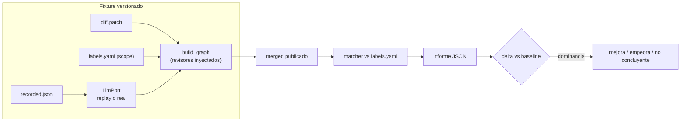

Última modificación: 2026-10-16 | Creado: 2026-10-16

# Evaluación de la review: gold set y métricas

Un *gold set* versionado y un harness offline que corre el grafo real y traduce una
review en seis números (precisión, recall, *accuracy* de severidad, falsos positivos
`P0`/`P1`, coste por hallazgo verificado y cobertura). Es el punto de partida de cualquier
cambio de prompt, contrato o modelo: sin esto, «mejora» es una opinión.

> **Estado:** implementada (2026-10-16)
> **Entrega objetivo:** que `make test` corra un caso real de punta a punta y que el
> informe diga, con criterio explícito, si un cambio de contrato o de modelo mejora,
> empeora o no es concluyente.

---

## 1. Objetivo

La review del PR #3 de este repositorio (`agent-review-langgraph`, commit `008da57`)
publicó **9 hallazgos**: **6** se rechazaron a mano, **1** describía un fallo real
**invertido** y con la severidad inflada, **1** confirmaba una decisión ya documentada
y **1** era cierto en parte. La revisión del código a mano fijó **7 hallazgos reales**
en total: además de ese fallo invertido y del cierto en parte, **no detectó 3 `P1`** de
integración y configuración **ni 3 `P2`** de código. Los seis estaban en el diff del
PR, pero el `scope` y el recorte del prompt los dejaron fuera de lo que vio el modelo
(ver [012](../../012-cobertura-de-la-review/spec.md)). Ese juicio —hecho por una persona,
hallazgo a hallazgo— es valiosísimo y hoy no está en ninguna parte: se pierde al cerrar
la pestaña. Y sin un número no hay forma de saber si un *prompt* nuevo mejora o solo
cambia el ruido.

Este checkpoint **no arregla** la calidad: la **mide**, para que los arreglos de las
iniciativas hermanas (007 en adelante) se aprueben con un número delante.

Se quiere:

1. Un ***gold set* versionado** en `tests/eval/`: un caso por PR auditado a mano, con
   el diff, la configuración de `scope` con la que corrió, el artefacto del CI si lo
   hubo, la lista de hallazgos que **sí** deben salir (`expected`), la de los que
   **no** (`must_not_report`, cada uno con su motivo) y la de los tolerables
   (`acceptable`).
2. Un **harness offline** que corre el **grafo real** sobre el caso y calcula las
   métricas sobre lo que se habría **publicado**, no sobre lo que el modelo propuso.
3. **Seis métricas** con definición cerrada (§5.4): precisión, recall, *accuracy* de
   severidad, falsos positivos `P0`/`P1`, coste por hallazgo verificado y cobertura.
4. El **baseline actual registrado** y reproducible (§3.3). Esta spec es la **fuente
   única** del baseline: las demás iniciativas enlazan aquí, no copian los números.
5. Una **comparación explícita** entre corridas: dónde mejora, dónde empeora, con un
   criterio de dominancia que no se pueda satisfacer moviendo una sola métrica.

## 2. No-objetivos

- **Arreglar la calidad.** Filtrar hallazgos, dar contexto al revisor, gatear la
  severidad o añadir personas es de las iniciativas 007 en adelante. Aquí solo se lee
  y se mide: el harness **no** modifica el grafo, el contrato ni la política.
- **Sustituir al `ToolingReviewer` ni depurar sus hallazgos.** Un hallazgo de
  herramienta está *grounded*; si un caso trae artefacto, sus hallazgos entran en
  `subset: tooling` (Q6). El caso semilla, de un repo Python sin artefacto PHPStan,
  no tiene.
- **Un panel de observabilidad.** `docs/arquitectura.md` §7 mantiene D14 abierto: el
  *gold set* mide calidad sobre fixtures versionados, no tráfico real ni trazas.
- **Ejecutar código del PR.** No se toca el `sandbox-runner` ni se ejecutan tests del
  repo revisado; el caso es estático (diff + artefacto).
- **Un gate de CI contra el modelo real.** El modelo no es determinista; CI corre con
  respuestas grabadas. El modelo real se mide aparte (§5.3).
- **Arreglar el presupuesto de tokens (D17).** El harness lo hace visible por corrida
  (coste por hallazgo), no cambia cómo se cuenta.
- **Reescribir el contrato de hallazgos.** El informe añade campos **solo** en su
  propio JSON de salida; `contracts/findings-schema.json` no cambia.

## 3. Contexto y evidencia

### 3.1 El caso semilla

La auditoría manual del PR #3 dejó un veredicto por hallazgo. Es, tal cual, el primer
`labels.yaml`:

| Caso | Qué afirma el hallazgo | Etiqueta | Motivo del veredicto |
|---|---|---|---|
| A | El de `mark_done`/`enqueue` se ordena mal | `expected` (`P2`) | Real, pero el fallo se describió **invertido** y con la severidad inflada (el TTL recupera la review) |
| B | `_requeue_or_drop` reverifica | `must_not_report` | Semántica inventada de `verifier.py`, fuera del diff |
| C | `_route_fix_wait` bucle infinito | `must_not_report` | El propio texto admite que el bucle es finito |
| D | `run_key` cambia de valor | `must_not_report` | Topología del grafo deducida de un fragmento |
| E | Tope de intentos del grafo ≠ worker | `must_not_report` | Confunde `max_fix_attempts` con `max_fix_attempts_job` |
| F | `build_fix_wait` fuerza `targets=[]` | `must_not_report` | Afirma una regresión sin comparar con el `base_sha` |
| G | Wave parcial vs job perdido | `must_not_report` | Requisito inventado sin leer `verify_job` |
| H | `env_for` expone `Settings` | `acceptable` | Cierto, pero es una decisión ya documentada: ni acierto ni falso positivo |
| I | `_touch_heartbeat` silencia `OSError` | `expected` (`P3`) | Real en parte |
| #1 | El `fix-worker` recibe todos los secretos (`env_file: .env`) | `expected` (`P1`, integración) | **No detectado**: `docker-compose.yml` lo descartó `max_files_per_pr` |
| #2 | El `fix-worker` no arranca en producción | `expected` (`P1`, integración) | **No detectado**: `fixworker/main.py` se vio, su par en `docker-compose.yml` no |
| #3 | `MODELS_CONFIG` pisa `LLM_*` | `expected` (`P1`, integración) | **No detectado**: `settings.py` lo descartó `max_files_per_pr` |
| #5 | El arranque fatal-vs-warning se decide casando el texto del mensaje | `expected` (`P2`, no detectado) | **No detectado**: su fichero, `worker/main.py`, quedó fuera del recorte |
| #6 | Se envía `json_object` aunque el modelo no declare `json_mode` | `expected` (`P2`, no detectado) | **No detectado**: en código que sí se vio |
| #7 | `SANDBOX_ENABLED` ya no gatea el fix | `expected` (`P2`, no detectado) | **No detectado**: en código que sí se vio |

Los seis últimos **sí estaban en el diff del PR**, pero no en lo que vio el modelo: El
#1, #2, #3 y #5 por **cobertura**, el #6 y #7 por **contexto**: de 51 ficheros,
`max_files_per_pr: 10` dejó 10 (ordenados por churn) y el corte a
60 000 caracteres dejó ≈ 5 (reproducción en
[012 §3.1](../../012-cobertura-de-la-review/spec.md)). El *gold set* tiene que poder
decir eso en dos números: el `recall` del subconjunto `integracion`/`no_detectado` y la
cobertura.

Las causas son dos y se miden por separado. Primero, **cobertura**: el revisor no vio
la mayor parte del PR y la review no lo dijo. Segundo, **contexto**: sobre lo que sí
vio, afirma sobre código que no ve; los falsos positivos **fabrican** el contexto que
falta y los falsos negativos **carecen** del que existe. Medir los dos signos a la vez
es justamente lo que separa «menos ruido» de «menos ruido y menos recall».

### 3.2 Piezas que ya existen

El harness no necesita nada nuevo del grafo:

| Pieza | Dónde | Para qué |
|---|---|---|
| Grafo real con revisores inyectables | [`build_graph`](../../../../src/agent_review/graph/build.py) | Corre scope→personas→merge→policy→publish sobre el caso |
| Persona LLM con puerto inyectable | [`LlmReviewer`](../../../../src/agent_review/adapters/llm_reviewer.py) | Sustituir el puerto por grabaciones sin tocar la persona |
| Persona estática desde artefacto | [`ToolingReviewer`](../../../../src/agent_review/adapters/tooling_reviewer.py) | Ingerir el artefacto de un caso que lo traiga (el semilla no) |
| Filtro y tope de ficheros | [`scope.py`](../../../../src/agent_review/scope.py) | Reproducir lo que vio el modelo con la configuración del caso |
| Puerto de modelo | [`LlmPort`/`LlmReply`](../../../../src/agent_review/ports/llm.py) | El *replay* y el modelo real son el mismo puerto |
| `FakeVcs` + `FakeLlm` como patrón | [`test_llm_reviewer.py`](../../../../tests/test_llm_reviewer.py) | El VCS falso que registra lo publicado no hay que inventarlo |
| Fixtures mínimos | [`diff_emotivoo.diff`](../../../../tests/fixtures/diff_emotivoo.diff), [`analysis.json`](../../../../tests/fixtures/phpstan/analysis.json) | Son *smoke* de forma, **no** el PR #3: el caso real se captura una vez (§5.2) |
| Coste real por llamada | `LlmReviewer.last_usage` (`LlmReply`) | `coste por hallazgo verificado` con `usage` del proveedor, no estimando |
| Marca `live` y `-m 'not live'` | [`pyproject.toml`](../../../../pyproject.toml), [`ci.yml`](../../../../.github/workflows/ci.yml) | La corrida real queda fuera de CI sin inventar un mecanismo nuevo |
| Aislamiento del entorno | [`conftest.py`](../../../../tests/conftest.py) | Un caso no depende del `.env` del host |

### 3.3 El baseline

| Métrica | Baseline (PR #3) |
|---|---|
| Precisión | **2/8 = 0,25** (H es `acceptable` y no cuenta; contando H como acierto, 3/9 ≈ 0,33) |
| Recall en `P1` de integración | **0/3 = 0,00** |
| Recall global | **2/8 = 0,25** (A e I de 8 `expected`: A, I, integración 1–3 y no-detectado 1–3) |
| Cobertura | **4/20 = 0,20** (código y configuración vistos por el `LlmReviewer`; sin revisar: `docker-compose.yml`, `settings.py`, `.env.example`, `worker/main.py`, `models_registry.py`, `llm_reviewer.py`…) |
| *Accuracy* de severidad | **1/2 = 0,50** (A se publicó `P1` pero es `P2`; I coincide en `P3`) |
| Falsos positivos `P0`/`P1` | **3** (de 6 falsos) |
| Coste por hallazgo verificado | Se registra en la primera corrida *replay* |

Los números «se registran en la primera corrida» no son un hueco: son la salida
congelada del caso, que pasa a ser el `expected_report.json` versionado. A partir de
ahí, cualquier deriva de las métricas se ve como un diff.

## 4. Decisiones

| # | Decisión | Motivo |
|---|---|---|
| E1 | Se mide sobre lo **publicado** (el conjunto de `merged` que la política deja salir), no sobre los `findings` crudos | Lo que quema la confianza es lo que la persona ve en el PR; un hallazgo que el merge dedupe no debe contar como mérito |
| E2 | El caso es **un directorio versionado** con diff, artefacto, `labels.yaml` y grabaciones | Un *gold set* en una hoja de cálculo no se reproduce; en git, cualquier corrida es auditable |
| E3 | CI corre con **respuestas grabadas** (*replay*); el modelo real corre fuera de CI | Determinismo dentro, fidelidad fuera. Un CI que llama al modelo es un test *flaky* que además se paga |
| E4 | La grabación lleva el **fingerprint del prompt y del caso**, **por rol y por llamada**, y CI falla si no coinciden. *(Enmienda 2026-10-16: el del prompt incluye también `json_mode` y `response_schema`; ver ADR-0017)* | Un *prompt* nuevo con grabación vieja mediría el pasado en silencio: se fuerza a regrabar, y esa regrabación es un diff revisable. El rol forma parte del fingerprint porque dos roles con el mismo diff y `max_findings` generan el mismo prompt |
| E5 | Las métricas tienen **definición cerrada** (§5.4) y un hallazgo no etiquetado cuenta como falso positivo | Un matcher laxo infla la precisión; dejarlo explícito evita discutir el número en vez del hallazgo |
| E6 | «Mejora» es una relación de **dominancia**: precisión, recall y cobertura no bajan, los falsos `P0`/`P1` no suben, y algo sube estrictamente | Sin esto, se «mejora» subiendo recall a base de publicar basura, o precisión callando o mirando menos código |
| E9 | Tres etiquetas: `expected`, `must_not_report` y `acceptable` (cierto pero sin valor, p. ej. una decisión ya documentada); `acceptable` no cuenta ni como `tp` ni como `fp` | Forzar H a acierto infla la precisión; forzarlo a error castiga un hallazgo cierto |
| E10 | El caso congela la configuración de `scope` (`max_files_per_pr`, ignorados) con la que corrió | Sin ella, el *replay* no reproduce lo que vio el modelo |
| E7 | El harness usa el **grafo real** con un VCS falso; lo único que cambia entre *replay* y real es el `LlmPort` | Mide el sistema, no una copia del sistema; y deja una sola variable que comparar |
| E8 | Este checkpoint **no toca** prompt, contrato ni política: solo lee | Separar la medida del arreglo es lo que hace creíble la medida |
| E11 | La **cobertura** sale de un campo de solo lectura del `LlmReviewer` (`last_seen_files`), no de reconstruir el recorte | Medir lo que el modelo realmente vio hace el número fiel y lo desacopla de una constante interna; 012 lo sustituirá por el `ReviewCoverage` publicado |
| E12 | El conjunto **publicado** se deriva del `FakeVcs` casando la marca inline determinista (`sha256(finding_id)`) y del conjunto `merged` del estado | Da a E1 una fuente estructurada, independiente del markdown del resumen; si el merge dedupe, no cuenta como mérito |
| E13 | El coste se mide en **tokens** (`usage` del proveedor), no en dinero | El registro de modelos no declara tarifa; añadirla amplía el alcance sin necesidad |
| E14 | Los hallazgos de tooling van a `subset: tooling` **aparte** de las métricas globales | Que PHPStan suba la precisión no dice nada de la mejora del LLM |
| E15 | La corrida real es **a mano** (`make eval-live`), sin *nightly* en 006, con n=1 y la varianza declarada como no medida | Un gate de CI contra un modelo no determinista sería *flaky* y se pagaría; repetir es de otra iniciativa |
| E16 | Un `expected` cuyo `match` casa pero cuyo `must_mention` no: el informe lo marca `tp_inverted` y **no** mueve precisión ni recall | Mantiene el baseline (A es `tp`, 2/8) y conserva el hecho «descrito invertido» sin castigarlo dos veces |

## 5. Diseño o contrato

### 5.1 Estructura

```
tests/eval/
  harness.py            carga del caso, matcher, métricas, comparación (sin red)
  test_eval_pr_3.py     regresión en CI (replay) + corrida real (marca live)
  pr_3/
    labels.yaml         procedencia + config de scope + expected + must_not_report + acceptable
    diff.patch          diff del PR auditado (copiado una vez)
    recorded.json       respuestas del modelo por rol, con fingerprint
    expected_report.json  informe congelado = baseline
scripts/eval.py         CLI: informe, comparación y regrabación
```

Sin `__init__.py` en `tests/`: el test importa `harness` como módulo hermano y
`scripts/eval.py` añade `tests/eval` a `sys.path`. No se introduce paquete en `tests/`.

### 5.2 El caso: `labels.yaml`

La procedencia va dentro del caso, para que el fixture no sea un fichero huérfano:
repo, `pr_id`, `head_sha`, fecha de captura y de dónde salió (auditoría manual).

```yaml
case: pr-3-agent-review
repo: "pcgarat/agent-review-langgraph"
pr_id: 3
base_sha: a8ead73
head_sha: 008da57
captured_at: 2026-10-16
source: "auditoria manual de la review publicada"
scope:                                   # E10: lo que vio el modelo
  max_files_per_pr: 10
  scope_ignore: ""

expected:
  - id: A
    severity: P2
    subset: correctness
    match: ["mark_done", "enqueue"]      # frases distintivas del hallazgo
    must_mention: ["..."]                # opcional: dirección correcta del fallo
  - id: integracion-1
    severity: P1
    subset: integracion
    match: ["secretos", "entorno"]
  - id: no-detectado-1
    severity: P2
    subset: no_detectado
    match: ["probe", "fatal"]

must_not_report:
  - id: B
    match: ["requeue_or_drop"]
    why: "semantica inventada de verifier.py, fuera del diff"

acceptable:
  - id: H
    match: ["env_for", "Settings"]
    why: "cierto, pero es una decision ya documentada"
```

- `match` son frases **conjuntivas** (todas deben aparecer) sobre `title` +
  `why_it_matters`, normalizadas como en [`text_utils`](../../../../src/agent_review/adapters/text_utils.py).
- `file` y `line` son **opcionales**: cuando están, el hallazgo debe caer en el mismo
  fichero y a ≤ 5 líneas (misma tolerancia que el merge entre personas,
  [ADR-0014](../../../adr/0014-criterio-de-merge-entre-personas.md)). Cuando no están,
  casa por contenido: es lo que permite etiquetar los `#1`–`#7`, que no tienen línea.
- `subset` agrupa para reportar (`correctness`, `integracion`, `no_detectado`,
  `tooling`…) y permite el `recall` por subconjunto sin duplicar casos.
- `must_mention` es opcional y solo lo usa el caso **A**: captura que el fallo se
  describió invertido, cosa que la severidad no ve.
- La atribución es **1:1 y determinista**: orden canónico (severidad, línea, `id`) y
  el primer match no consumido gana, igual que el merge no depende del orden del
  fan-out.

El diff (y el artefacto, si un caso lo trae) **no** se genera en el test: se captura
una vez del PR (VCS y `var/tooling`) y se versiona. Los fixtures actuales son de
juguete; el caso real es otro.

### 5.3 Modos de ejecución



| Modo | Puerto LLM | Cuándo | Qué responde |
|---|---|---|---|
| **replay** (por defecto) | `recorded.json`, cacheado por fingerprint | `make test` y CI | ¿Un cambio de contrato, merge o política mueve las métricas? |
| **real** (`-m live`) | `ModelRegistry.port_for(rol)` ([ADR-0015](../../../adr/0015-registro-declarativo-de-modelos.md)) | `make eval-live`, a mano y en *nightly* | ¿Un cambio de prompt o de modelo mejora la calidad? |

En `replay`, el puerto devuelve el `text` y el `usage` grabados y **aborta** si el
fingerprint del prompt o del caso no coincide con la grabación (E4). Así, la corrida
de CI reproduce el baseline exacto y las mejoras que actúan **después** del modelo
(L0 de [008](../../008-contexto-del-revisor/spec.md), merge, gate de
[011](../../011-gate-de-severidad/spec.md)) se ven **sin gastar un token**.

Las que cambian **lo que recibe** el modelo (lotes de
[012](../../012-cobertura-de-la-review/spec.md), contexto L1 de 008, prompt del
verificador de [009](../../009-verificador-adversarial/spec.md)) invalidan el
fingerprint: exigen regrabar con `make eval-record`, y esa regrabación es parte del
PR que las introduce. Las grabaciones se guardan **por rol y por llamada**
(`correctness`, `verifier`…), de modo que regrabar un rol no invalida los demás.

En `real`, la corrida es comparativa, no un gate: se ejecuta el caso, se emite el
informe y se compara con el baseline. Es el paso previo a aprobar un *prompt* nuevo.

### 5.4 Métricas

| Métrica | Definición | Cómo se lee |
|---|---|---|
| **Precisión** | `tp / (tp + fp)` sobre `subset != tooling` | Proporción de lo publicado que era cierto. Un no etiquetado es `fp` (E5) |
| **Recall** | `tp / n_expected`, y por `subset` (`recall_by_subset`) | Cuánto de lo que debía salir salió. El `P1` de integración se mira aparte |
| ***Accuracy* de severidad** | casados con la severidad del `expected` / `tp` | Un `P1` publicado como `P3` sigue siendo `tp`, pero con la severidad mal |
| **Falsos positivos `P0`/`P1`** | nº de `fp` con severidad `P0` o `P1` | El fallo caro: la rúbrica ya dice que un falso `P0` quema la confianza antes que diez `P3` |
| **Coste por hallazgo verificado** | tokens del `usage` del run / `tp` (E13) | `None` si `tp = 0`. En *replay* usa el `usage` grabado; sin él, la estimación |
| **Cobertura** | ficheros de código y configuración vistos por el `LlmReviewer` / total de esas clases en el PR | Sale de `last_seen_files` (E11); 012 lo sustituirá por el `ReviewCoverage` publicado |

Precisión y recall **globales** se calculan excluyendo `subset: tooling`; el
subconjunto `tooling` se reporta aparte (E14), porque un hallazgo de PHPStan es
*grounded* y no mide al LLM. «Publicado» (E1, E12) es el conjunto que `publish` deja
salir —hoy, en `max_autonomy: report`, el resumen lista todos los `merged`—; el
harness lo contrasta contra `merged` y declarará cualquier supresión cuando la
política la introduzca (011).

Los hallazgos que casan con `acceptable` se listan en el informe pero no entran en
ninguna métrica (E9).

El informe es un JSON estable (claves ordenadas, floats redondeados a 4 decimales) y
se congela en `expected_report.json`:

```json
{
  "case": "pr-3-agent-review",
  "mode": "replay",
  "fingerprints": {"case": "sha256:...", "correctness": "sha256:..."},
  "counts": {
    "published": 9, "tp": 2, "fp": 6, "acceptable": 1, "fp_labeled": 6,
    "fp_unknown": 0, "fn": 6, "fp_p0_p1": 3, "tp_inverted": 1
  },
  "metrics": {
    "precision": 0.25, "recall": 0.25,
    "recall_by_subset": {"correctness": 1.0, "integracion": 0.0, "no_detectado": 0.0},
    "severity_accuracy": 0.5, "cost_per_tp_tokens": 10333.5, "coverage": 0.2
  },
  "matched": [], "unmatched": [], "missing": [], "acceptable": [], "inverted": []
}
```

`fp_p0_p1` del ejemplo es un **placeholder**: sale de la primera corrida *replay*,
no de la auditoría manual (§3.3). `coverage` se alimenta de `last_seen_files` (E11);
`tp_inverted` cuenta los `expected` con `must_mention` no cumplido (E16) y no entra
en ninguna métrica.

`matched` / `unmatched` / `missing` nombran los `id` para que el fallo de CI diga
**qué** hallazgo se movió, no solo que un número cambió.

La comparación (`harness.compare`) dice **mejora** si y solo si, contra el baseline,
la precisión, el recall y la cobertura no bajan, los falsos `P0`/`P1` no suben y al
menos una mejora estrictamente; **empeora** si lo contrario en cualquier métrica; y **no concluyente**
en el resto (por ejemplo, sube el recall y bajan los `P0`/`P1`, pero cae la precisión).

### 5.5 CI y comandos

- El caso corre dentro de `pytest` (sin job nuevo en [`ci.yml`](../../../../.github/workflows/ci.yml)):
  `make test` ya recorre `tests/`.
- `make eval` — informe *replay* por consola; `EVAL_COMPARE=expected_report.json`
  añade el delta contra el baseline congelado.
- `make eval-live` — corrida contra el modelo real (marca `live`, `-m live`).
- `make eval-record` — regraba `recorded.json` contra el modelo real. **Es el único
  camino** que produce grabaciones y su diff se revisa.
- Sin *nightly* en este checkpoint (E15): la corrida real queda a mano antes de
  aprobar un cambio de *prompt*. Un `schedule` opcional es de otra iniciativa.

## 6. Riesgos

| Riesgo | Mitigación |
|---|---|
| ***Gold set* de un solo caso**: sobreajustar al PR #3 y llamar «mejora» a lo que solo funciona ahí | El sesgo se declara en el informe (`case`); cada review validada a mano añade un caso, y 007+ no puede aceptar una mejora sostenida solo por este caso (Q3) |
| **El matcher decide el número**: laxo infla precisión, estricto infla falsos positivos | Reglas cerradas y conjuntivas (§5.2), atribución 1:1 determinista y tests propios del matcher; la tolerancia de 5 líneas se hereda de una regla ya validada del merge |
| **Grabaciones obsoletas**: medir el pasado en silencio | El fingerprint del prompt (por rol) y del caso aborta la corrida en CI (E4) |
| **El modelo real es no determinista**: dos corridas del mismo prompt dan números distintos | La corrida real es comparativa y no bloquea CI; el informe declara la varianza como **no medida** en 006 (n=1, E15) |
| **Coste de medir**: la corrida real consume tokens (agrava D17) | Un caso, un PR, fuera de CI y bajo demanda; en CI, coste cero |
| **Medir de más**: acabar midiendo anclaje, formato o latencia | El alcance son las seis métricas de §5.4; lo demás va a Q8 y a las iniciativas que corresponda |
| **Confundir el fixture de juguete con el caso** | Bright line en §5.2: el caso es el PR auditado, capturado y versionado, no `tests/fixtures/` |

## 7. Criterios de hecho

- [ ] `tests/eval/pr_3/` existe con diff, `labels.yaml` (con procedencia,
      configuración de `scope`, `expected`, `must_not_report` y `acceptable` con
      motivo) y `recorded.json`.
- [ ] La corrida *replay* es determinista: dos ejecuciones dan el mismo
      `expected_report.json`, byte a byte (claves ordenadas, floats a 4 decimales).
- [ ] El baseline de §3.3 queda registrado y reproducible, incluida la cobertura.
- [ ] La triaje inicial es **exhaustivo**: ningún hallazgo publicado del caso se queda
      sin etiqueta (`fp_unknown == 0`), o está documentado por qué.
- [ ] Ningún hallazgo que case con un `must_not_report` cuenta como acierto, y cada
      uno lleva su motivo escrito.
- [ ] `harness.compare` implementa la dominancia de E6 con sus tres veredictos, y
      tiene tests propios (incluido el caso «no concluyente»).
- [ ] `make test` en verde **sin** red ni credenciales, y `make eval` imprime el
      informe con el delta contra el baseline.
- [ ] Existe una vía declarada y ejecutable para la corrida contra el modelo real
      (`make eval-live`), con su regrabación (`make eval-record`).
- [ ] Un cambio de prompt que invalide la grabación **falla** en CI con un mensaje que
      nombra el fingerprint; regrabar y revisar el diff es la salida.
- [ ] Cada `expected` con `must_mention` no cumplido aparece en `inverted` y **no**
      mueve precisión ni recall (E16).
- [ ] `make ci` y `make docs-check` en verde.
- [ ] Documentos vivos al día: [`desarrollo.md`](../../../desarrollo.md) §1–2 (comandos y
      zona `eval`), [`arquitectura.md`](../../../arquitectura.md) §7 (D14 pasa a parcial),
      [`CONTEXT.md`](../../../../CONTEXT.md) si nacen «*gold set*», «caso de evaluación» o
      «mejora (dominancia)», y un ADR nuevo para E3/E4 (el siguiente número libre).

## 8. Preguntas abiertas

Resueltas al aprobar el borrador (2026-10-16):

- **Q1.** Corrida real **a mano** (`make eval-live`), sin *nightly* en 006 (E15).
- **Q2.** La tolerancia de 5 líneas y el `match` conjuntivo se dan por buenas y se
  ajustan solo si un veredicto chirría; el matcher tiene tests propios.
- **Q3.** El PR #3 es el primer caso; 007+ no acepta una mejora sostenida solo por este
  caso (sesgo declarado en el informe).
- **Q4.** n=1 sin repeticiones; la varianza se declara **no medida** en 006.
- **Q5.** El coste, en **tokens** (E13).
- **Q6.** Tooling en `subset: tooling`, aparte de las métricas globales (E14).
- **Q7.** El informe se imprime por consola; publicarlo como artefacto o comentario
  queda para otra iniciativa.

Siguen abiertas:

- **Q8.** ¿Se mide también el anclaje (publicado inline vs solo en resumen,
  `inlined_count`)? Es calidad visible, pero toca el camino de publicación.
