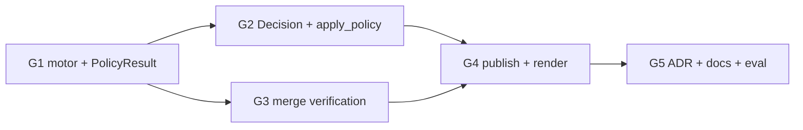

Última modificación: 2026-10-17 | Creado: 2026-10-17

# Plan: Gate de severidad por política

El *qué y por qué* vive en [`spec.md`](spec.md); las tareas, en [`todo.md`](todo.md).
Este plan fija el orden y cómo aterriza sobre el código de hoy (007–009 y VF15
ya entregadas: el bloque `severity_gate` está declarado, L2 ya lee
`require_verified_for`).

## Overview

Cuatro piezas, en este orden:

1. **El motor.** Validar `severity_gate` al cargar; ampliar `PolicyResult` con
   severidad efectiva, motivo y modo de publicación; aplicar gate → reglas →
   techo (G7).
2. **La decisión y el merge.** `Decision` transporta lo del gate; `_merge_findings`
   conserva el `verification` más fuerte (§5.3).
3. **La publicación.** `publish` respeta `drop` / `summary`; el render muestra el
   veredicto según G13 y la severidad efectiva.
4. **Cierre.** ADR-0024, documentos vivos, tests de política/grafo y medida con
   006 si el *replay* basta sin regrabar.

## Decisiones de implementación

- **El `Finding` no se muta en `policy`.** L0/L2 siguen sin tocar `severity` (G8).
  La severidad efectiva viaja en `Decision` (`severity`, `severity_reason`,
  `publication`). El render y el HITL leen la efectiva de la decisión; si falta
  (decisions antiguas / dobles de test), caen a `finding.severity`.
- **`publication`: `full` | `summary` | `drop`.** `drop` = `on_refuted: drop`
  (no inline ni resumen); `summary` = `on_refuted: summary` (solo resumen);
  `full` = el resto. Un degradado es `full` con acción forzada a `report`.
- **Reglas ven la severidad efectiva.** `decide` hace `model_copy` temporal del
  hallazgo con la severidad del gate antes de `_match_condition`; el original no
  cambia.
- **Validación *fail-fast* al construir el motor.** `require_verified_for` /
  `verified` no vacíos, `degrade_to` ∈ P0–P3, `on_unverified` ∈ {`degrade`}
  (possibles aún no implementado), `on_refuted` ∈ {`drop`, `summary`}. Sin bloque
  `severity_gate`, el motor se comporta como hoy (L2 ya tiene respaldo en
  Settings).
- **Merge: escalera de verificación.**
  `verified_executed > verified_grounded > verified_static > refuted > unverified`.
  El representante por evidencia hereda el veredicto más fuerte del grupo (y su
  `verification_evidence`).
- **ADR-0024 nuevo** (G14), no se toca ADR-0003.

## Orden y dependencias

## Checkpoints

| # | Tras | Qué se puede afirmar |
|---|---|---|
| C1 | G1 | Un P1 `unverified` degrada a P3/`report`; un `refuted` con `drop` no publica; un `verified_static` P1 no degrada |
| C2 | G2–G3 | `Decision` lleva severidad efectiva; el merge no degrada un veredicto fuerte |
| C3 | G4–G5 | Inline/resumen muestran veredicto (G13); `make ci` verde; ADR-0024 y docs al día |

## Riesgos

| Riesgo | Mitigación |
|---|---|
| Decisions antiguas en checkpoint sin `severity` | Campo opcional con *fallback* a `finding.severity` |
| `on_unverified: possibles` en un YAML futuro | *Fail-fast* hasta que se implemente |
| HITL muestra severidad del modelo, no la efectiva | `build_approval` usa `decision.severity` |
| El *gold set* aún no regrabado (CX11 de 008) | El gate se mide en *replay* sin tokens (§5.5); regrabar es aparte |
