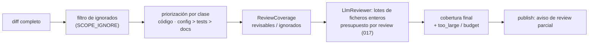

Última modificación: 2026-10-17 | Creado: 2026-10-16

# Cobertura de la review: nada se recorta en silencio

> **Estado:** implementada *(2026-10-17)*
> **Entrega objetivo:** que el `LlmReviewer` vea todo el código y la configuración
> del PR que el presupuesto permita, en lotes de ficheros enteros, y que la review
> publicada diga qué no ha visto; una review parcial nunca se lee como completa.

---

## 1. Objetivo

La auditoría de la review del PR #3 (ver [006](../006-eval-de-la-review/spec.md))
atribuyó los falsos positivos y los `P1` perdidos a que el revisor «solo ve el
diff». Al reproducir el `scope` sobre ese PR, la causa primera es otra: **el revisor
no vio la mayor parte del diff, y nadie lo dijo**.

- El PR tocaba **51 ficheros** (≈ 300 KB de diff). `max_files_per_pr: 10`
  ([`autonomy.yaml`](../../../../config/autonomy.yaml)) dejó 10, ordenados solo por
  churn: fuera quedaron `docker-compose.yml`, `settings.py` y `.env.example`, que es
  donde vivían dos de los tres `P1` no detectados.
- Los 10 supervivientes sumaban ≈ 133 KB y el `LlmReviewer` corta a
  `_MAX_DIFF_CHARS = 60_000` por caracteres. Al modelo llegaron la spec de 005,
  `fix/node.py`, `fixworker/main.py`, `graph/build.py` y parte de
  `models_config.py`. **`worker/main.py`, el fichero de más churn (+388), no llegó.**
- Ambos recortes solo dejan un `logger.warning`. La review publicada no lo menciona.
- [`best_line`](../../../../src/agent_review/adapters/diff_parser.py) siempre devuelve
  una línea si hay añadidas: un hallazgo sobre código no visto se ancla a la línea
  visible más cercana al número que dé el modelo.

Se quiere:

1. **Cobertura explícita.** El `scope` y el `LlmReviewer` registran qué ficheros se
   revisaron, cuáles no y por qué; el resumen publicado lo muestra.
2. **Fail-closed.** Una review con ficheros relevantes sin revisar se publica como
   **parcial**, igual que una fuente de tooling sin cubrir
   ([`ToolingSourceStatus`](../../../../src/agent_review/domain/models.py)): «sin
   hallazgos» nunca significa «limpio» si no se miró.
3. **Revisión por lotes de ficheros enteros** en vez de un prompt único cortado a
   mitad de fichero.
4. **Selección por relevancia**, no solo por churn: código y configuración antes que
   tests y documentación.
5. Medir la cobertura en el *gold set* (métrica de [006](../006-eval-de-la-review/spec.md)).

## 2. No-objetivos

- **Dar contexto fuera del diff** (fichero completo, ADR, glosario). Es
  [008](../008-contexto-del-revisor/spec.md); esta iniciativa solo garantiza que el
  diff mismo llegue.
- **El anclaje estricto.** Que `best_line` deje de recolocar por cercanía es L0 de
  [008](../008-contexto-del-revisor/spec.md); aquí solo se documenta el síntoma.
- **El presupuesto de tokens.** Lo resolvió [017](../017-presupuesto-por-pr/spec.md):
  un contador por review, compartido y atómico. Esta iniciativa lo consume lote a
  lote; no lo redefine.
- **Cambiar el contrato de hallazgo** ni la política de acciones.

## 3. Contexto y evidencia

### 3.1 Reproducción sobre el PR #3

Diff `a8ead73..008da57` pasado por `limit_files(…, 10)` y `filter_diff`
([`scope.py`](../../../../src/agent_review/scope.py)), en el orden del diff:

| Offset (chars) | Fichero | ¿Lo vio el modelo? |
|---|---|---|
| 0 | `docs/iniciativas/archivo/005-modelos-declarativos/spec.md` | Sí |
| 10 536 | `src/agent_review/fix/node.py` | Sí |
| 26 063 | `src/agent_review/fixworker/main.py` | Sí |
| 33 237 | `src/agent_review/graph/build.py` | Sí |
| 53 386 | `src/agent_review/models_config.py` | En parte (corte a 60 000) |
| 61 559 | `src/agent_review/worker/main.py` | **No** |
| 91 717 – 116 938 | cinco ficheros de `tests/` | **No** |

Los 41 restantes (incluidos `docker-compose.yml`, `settings.py` y `.env.example`) los
descartó `max_files_per_pr`. Supuestos: el VCS devuelve los ficheros en orden
alfabético, como `git diff`, y la review corrió con el `autonomy.yaml` actual.

### 3.2 Qué dice hoy cada pieza

| Pieza | Comportamiento | Dónde |
|---|---|---|
| Tope de ficheros | Ordena por `added + removed` y corta; loguea | [`limit_files`](../../../../src/agent_review/scope.py), nodo `scope` en [`build.py`](../../../../src/agent_review/graph/build.py) |
| Tope de caracteres | `diff[:60_000]`, a mitad de hunk; loguea | `LlmReviewer._call` en [`llm_reviewer.py`](../../../../src/agent_review/adapters/llm_reviewer.py) |
| Presupuesto | Reserva la estimación de su única llamada contra el contador por review de 017; si no cabe, la omite entera y marca `budget_exhausted` | Ídem |
| Review parcial | Solo existe para fuentes de tooling (`tooling_status`) | `publish` en [`build.py`](../../../../src/agent_review/graph/build.py) |

## 4. Decisiones

| # | Decisión | Motivo |
|---|---|---|
| C1 | El `scope` produce un **`ReviewCoverage`** (ficheros revisables, descartados y motivo) que viaja en el estado | Una sola fuente para el aviso publicado, los logs y la métrica de 006 |
| C2 | El `LlmReviewer` revisa en **lotes de ficheros enteros**; nunca corta un fichero | Un corte por caracteres a mitad de hunk es lo que dejó fuera `worker/main.py` sin rastro |
| C3 | Un fichero que no cabe solo en un lote se marca `too_large` en la cobertura, no se trocea (*enmienda 2026-10-17:* desde [021](../021-razonamiento-visible/spec.md) R16 se trocea por hunks; solo un hunk que no cabe sigue `too_large`) | Trocear un fichero por hunks es una optimización posterior; marcarlo es honesto ya |
| C4 | La selección prioriza por **clase** (código y configuración > tests > docs) y dentro de cada clase por churn | El churn sólo premia ficheros grandes; la configuración pequeña es donde se rompe producción |
| C5 | Las clases se declaran por *globs* con un default razonable, ampliable en el perfil del repo | Mismo patrón que `SCOPE_IGNORE` y el perfil: datos, no código |
| C6 | Cada lote **reserva y confirma** contra el presupuesto por review de [017](../017-presupuesto-por-pr/spec.md) (`BudgetPort`); al agotarse, los lotes pendientes pasan a la cobertura como `budget` | El contador ya es compartido por todas las personas; con lotes, cada llamada paga lo suyo y lo que no cabe se declara |
| C7 | Review parcial = algún fichero de clase código o configuración sin revisar. Docs o tests sin revisar se listan pero no la hacen parcial | Evita que todo PR grande se marque parcial por documentación |
| C8 | **Se elimina `max_files_per_pr`** (guarda, `autonomy.yaml` y su lectura en `scope`). El único tope de coste es el presupuesto por review de 017; la priorización por clase (C4) decide qué lotes entran antes de agotarlo | Con lotes y presupuesto real, un tope por número de ficheros es una segunda guarda de coste más tosca: cuenta ficheros, no tokens, y es la que dejó fuera la configuración en el PR #3. *Decidido 2026-10-17 (Q1).* |

## 5. Diseño o contrato

### 5.1 Flujo



### 5.2 `ReviewCoverage`

```python
class SkipReason(StrEnum):
    IGNORED = "ignored"        # SCOPE_IGNORE / defaults
    TOO_LARGE = "too_large"    # no cabe solo en un lote
    BUDGET = "budget"          # presupuesto agotado antes de su lote
    FAILED = "failed"          # su lote fallo de forma permanente (enmienda 2026-10-17)


class ReviewCoverage(BaseModel):
    files_total: int
    reviewed: list[str] = Field(default_factory=list)
    skipped: dict[str, SkipReason] = Field(default_factory=dict)
    file_class: dict[str, str] = Field(default_factory=dict)   # code|config|test|docs

    @property
    def partial(self) -> bool: ...   # C7
```

- `scope` la crea con `IGNORED`; el `LlmReviewer` la completa con
  `TOO_LARGE` y `BUDGET` a través de `ReviewerResult` (campo nuevo opcional
  `coverage`), y el `merge` la combina: un fichero cuenta como revisado si alguna
  persona LLM lo revisó.
- Entra en la *allowlist* `_STATE_TYPES` del checkpointer
  ([`desarrollo.md`](../../../desarrollo.md) §3).

### 5.3 Lotes en el `LlmReviewer`

- Se agrupan ficheros enteros hasta `LLM_BATCH_MAX_CHARS` (por defecto 60 000, el
  valor actual), manteniendo juntos los del mismo directorio para conservar algo de
  razonamiento entre ficheros.
- Cada lote es una llamada con el mismo prompt; `max_findings` se aplica al total
  de la persona, priorizando por severidad.
- Los errores transitorios siguen subiendo a la `RetryPolicy` del nodo; un lote que
  falla de forma permanente pasa a la cobertura como no revisado, con motivo
  `failed` (*enmienda 2026-10-17*: la spec no le daba motivo y `SkipReason` lo necesita).

### 5.4 Clases por defecto

| Clase | *Globs* por defecto |
|---|---|
| `config` | `docker-compose*.yml`, `Dockerfile*`, `**/*.yaml`, `**/*.yml`, `**/*.toml`, `.env.example`, `**/settings.py`, `**/config/**` |
| `code` | Lo que no casa con otra clase |
| `test` | `tests/**`, `**/test_*.py`, `**/*Test.php` |
| `docs` | `**/*.md`, `docs/**` |

Ampliables en el perfil con `scope.classes`.

### 5.5 Publicación

El resumen gana una cabecera cuando `coverage.partial`:

> **Review parcial:** revisados 38 de 51 ficheros. Sin revisar: 2 de configuración
> (`docker-compose.yml`, `.env.example`; presupuesto), 1 de código
> (`worker/main.py`; demasiado grande para un lote). Los hallazgos de abajo no
> cubren esos ficheros.

La review parcial es **solo informativa**: no cambia la acción permitida. Si una
review parcial debe limitar `fix_auto` lo decide el gate de
[011](../011-gate-de-severidad/spec.md), único dueño de la política. *Decidido
2026-10-17 (Q3).*

La cobertura del `ToolingReviewer` **no** entra en `ReviewCoverage`: sigue en
`tooling_status` (`ToolingSourceStatus`), que ya marca la review como parcial por su
cuenta. `ReviewCoverage` mide lo que leyó el revisor LLM; «pasó phpstan» es otra
señal y el resumen las muestra por separado. *Decidido 2026-10-17 (Q4).*

Docs y tests sin revisar se listan en una línea plegable, sin marcar la review como
parcial (C7).

## 6. Riesgos

| Riesgo | Mitigación |
|---|---|
| **Más llamadas, más coste**; sin `max_files_per_pr`, un PR enorme gasta hasta agotar el presupuesto | El presupuesto por review de 017 es el tope (C6, C8); lo que no cabe se declara `budget`, no se paga. La priorización por clase hace que lo agotado sean tests y docs |
| **Se pierde razonamiento entre ficheros** al separar en lotes | Agrupación por directorio; el contexto entre ficheros es de 008 y los pares de configuración de 010 |
| **Toda review de un PR grande sale «parcial»** y el aviso se ignora | C7 limita el aviso a código y configuración; el umbral se revisa con datos |
| **Duplicados entre lotes** | Los lotes son de ficheros disjuntos; el `merge` ya deduplica por fichero y línea |
| **Las clases por *glob* fallan en otro stack** | Default razonable más override en el perfil (C5) |

## 7. Criterios de hecho

1. Reproducir el PR #3 (fixture de [006](../006-eval-de-la-review/spec.md)) con el
   presupuesto por defecto deja `docker-compose.yml`, `settings.py` y `.env.example`
   dentro de los ficheros revisados, y `worker/main.py` revisado o declarado
   `too_large`/`budget`. `max_files_per_pr` ya no existe en `autonomy.yaml` ni en el
   código.
2. Ningún fichero se corta a mitad: test que lo prueba con un diff mayor que el lote.
3. Un fichero de código o configuración sin revisar produce la cabecera de review
   parcial en el resumen; uno de docs no.
4. Cada lote reserva contra el presupuesto por review de 017 y, al agotarse, los
   pendientes salen como `budget` (test con contador).
5. `ReviewCoverage` sobrevive a una pausa y reanudación (test de serialización).
6. La métrica de cobertura de 006 se calcula a partir de `ReviewCoverage`.
7. `make ci` y `make docs-check` en verde; vivos al día: `arquitectura.md` §3–4
   (estado y nodo `scope`) y §7 (cierra D18), `operacion.md` §2
   (`LLM_BATCH_MAX_CHARS`), `desarrollo.md` §3 (tipo de estado nuevo), `CONTEXT.md`
   («cobertura», «review parcial»; «Scope» y «Guarda» sin `max_files_per_pr`),
   `operacion.md` §7 (diagnóstico de «0 hallazgos» sin el log de `max_files_per_pr`).

## 8. Preguntas abiertas

Todas resueltas el 2026-10-17.

- **Q1.** ¿`max_files_per_pr: 10` sigue teniendo sentido con lotes y presupuesto
  acumulado? *Resuelta (2026-10-17):* no; **se elimina** y el único tope es el
  presupuesto por review de 017 (C8).
- **Q2.** Un fichero `too_large`: ¿se queda fuera o se trocea por hunks?
  *Resuelta (2026-10-17):* se marca `too_large` y no se trocea (C3). Trocear queda
  para una iniciativa posterior si el *gold set* lo justifica.
- **Q3.** ¿La cabecera de review parcial cambia también la acción?
  *Resuelta (2026-10-17):* no, es solo informativa; la política es de 011 (§5.5).
- **Q4.** ¿La cobertura del `ToolingReviewer` entra en `ReviewCoverage`?
  *Resuelta (2026-10-17):* no; sigue en `tooling_status` (§5.5).
