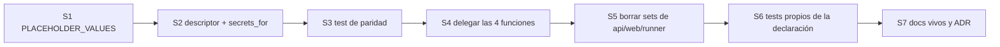

Última modificación: 2026-10-17 | Creado: 2026-10-17

# Plan: Contrato de secretos declarado en el modelo

El *qué y por qué* viven en [`spec.md`](spec.md) —incluida la **enmienda del
2026-10-17**, que es la que manda donde divergan—; las tareas, en [`todo.md`](todo.md).
Decisión: [ADR-0022](../../../adr/0022-contrato-de-secretos-declarado.md).

## Overview

Un refactor **sin cambio de comportamiento**: el contrato que hoy se escribe a mano en
cuatro funciones y cuatro sets de placeholders pasa a declararse en el propio campo de
`Settings`. El orden es de dentro hacia fuera, para poder comparar en cada paso:

1. **Predicado y declaración.** `PLACEHOLDER_VALUES` público; descriptor `Secret` y
   `secrets_for` conviviendo con las funciones actuales, sin tocarlas.
2. **Paridad.** Un test compara, escenario a escenario, `secrets_for` con las cuatro
   funciones de hoy. Verde antes de delegar.
3. **Delegación.** Las cuatro funciones pasan a llamar a `secrets_for`; se borran los
   sets duplicados de API, web y runner.
4. **Cierre.** Documentos vivos, ADR a `Aceptado` y `make ci`.

## Decisiones de implementación

- **`secrets_for` devuelve `list[str]`** con los nombres en el **orden de
  `model_fields`**, no en el orden de las listas actuales. Los tests de hoy comparan
  con `in`/`match`, no con igualdad de lista, así que no rompe; el orden de
  `model_fields` es estable y no depende de la evaluación.
- **La tabla de `features` vive en el módulo**, como un `Mapping` de nombre →
  callable(`settings`) → `bool`. Es lo único que el descriptor no puede capturar; se
  testea que **toda** `feature` declarada está en la tabla (si no, error al construir,
  no un secreto que deja de exigirse).
- **`_FEATURES["sandbox_always"]` y `["panel_always"]`** existen porque `required_in`
  no distingue el proceso dentro del descriptor: el `fix-worker` exige el token del
  runner siempre, y el `web` su sesión siempre. Están nombradas, no escondidas en un
  `if`, y la paridad las fija.
- **`SANDBOX_RUNNER_URL` y `TEAMS_NOTICES_KEY` no son secretos** y se declaran con
  `expect="url"`/`"value"` y `required_when_empty=True`. Sin esto el refactor no los
  reproduciría (una `TEAMS_NOTICES_KEY` en `change-me` es un valor válido).
- **El registro de modelos no se declara como campo.** El nombre que se exige lo
  produce `unresolved_secrets`; `secrets_for` conserva esa rama, con su test doble
  (vía `${VAR}` del YAML y vía `LLM_API_KEY` de compatibilidad).
- **El runner no replica nada**: `sandbox_runner/main.py` ya importa `settings`
  (`is_missing`), así que importa `PLACEHOLDER_VALUES` igual. La nota de D7 en la spec
  queda superada por la enmienda.
- **`required_in` con `frozenset()` significa «todos»**, como en el diseño original:
  así un secreto global no enumera los cinco procesos ni se olvida de uno nuevo.

## Orden y dependencias

S1–S3 son aditivos: nada de producción cambia hasta S4. Si S3 da rojo, el fallo es de
la declaración, no del contrato, y se arregla ahí (R1 de la spec).

## Checkpoints

- **C1 (tras S1–S3):** `secrets_for` reproduce el contrato actual en los 48 escenarios
  del test de paridad; `make ci` en verde con las funciones antiguas intactas.
- **C2 (tras S4–S6):** las cuatro funciones delegan; los sets duplicados han
  desaparecido; I1/I3 con test; `make ci` en verde.
- **C3 (tras S7):** `arquitectura.md` (D22 pasa a resuelta), `operacion.md` §3,
  `desarrollo.md` §4, `CONTEXT.md`, ADR-0022 a `Aceptado`, índice de iniciativas y
  `make docs-check` en verde.

## Riesgos

| Riesgo | Mitigación |
|---|---|
| El test de paridad «pasa» pero el contrato cambia en un escenario que no se enumera | Los 48 escenarios cubren el producto completo de las cinco condiciones booleanas/elecciones; `feature_enabled` permite añadir escenarios puntuales |
| `metadata` en el `Field` es opaco y alguien lee `model_fields` sin ver el descriptor | Comentario en el módulo y `secrets_for` como única vía; un test comprueba que ningún campo con nombre de secreto se queda sin declarar (I1) |
| Las `= "change-me"` de campo (3) se confunden con el placeholder global | Comentario en cada una; el criterio 1 del `todo` usa `grep` de la lista, no del literal suelto |
| El refactor toca `settings.py`, que la 021 también toca (RZ4/RZ7) | Reparto acordado: 020 toca las **funciones del contrato** (`is_missing` en adelante) y 021 la **clase** `Settings` y del bloque de LLM hacia abajo |
