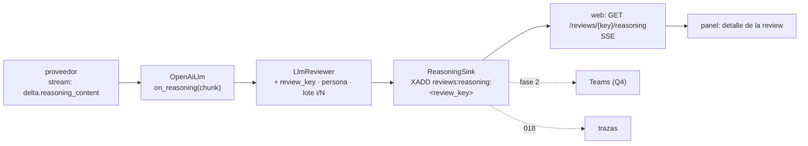

Última modificación: 2026-10-17 | Creado: 2026-10-17

# Razonamiento del revisor visible en el panel

> **Estado:** implementada *(2026-10-17)*
>
> **Entrega objetivo:** los revisores LLM razonan siempre, y mientras revisan el panel
> de operación muestra **en vivo** lo que el modelo razona en cada lote, igual que un
> agente de chat. El panel gana un **histórico** de reviews hechas desde el que se
> relee el razonamiento de cada una. Teams recibe un enlace en una fase posterior.

---

## 1. Objetivo

Hoy el razonamiento del modelo se pierde. El proveedor lo devuelve
(`message.reasoning_content`), pero `OpenAiLlm` solo lee `content`
([`openai_llm.py`](../../../../src/agent_review/adapters/openai_llm.py)), así que nadie
puede ver por qué el revisor afirmó lo que afirmó, ni seguir una review larga mientras
ocurre. Con razonamiento alto, una review del PR #3 tarda decenas de minutos y el panel
solo enseña «nodo `persona` en curso».

Se quiere:

1. **Capturar** el razonamiento de cada llamada sin cambiar lo que se publica.
2. **Verlo en vivo** en el panel, por review, por persona y por lote, como ya se ve la
   consola del sandbox ([019](../019-panel-de-operacion/spec.md)).
3. **Releerlo** después durante un tiempo acotado, para entender un falso positivo
   o un hallazgo que sorprende.
4. Dejar **un único punto de captura** que también puedan usar las trazas de
   [018](../../018-trazas-de-la-review/spec.md) y, más adelante, Teams.
5. **Histórico de reviews** en el panel: la lista de las reviews terminadas, con su
   resultado, desde la que se abre el detalle y el razonamiento (Q3).
6. **Razonamiento activo en los revisores** por configuración del modelo, no del
   proveedor (Q6).

## 2. No-objetivos

- **Razonamiento en el fixer.** Se queda sin razonamiento: los parámetros por modelo
  (R10) lo permiten, pero activarlo es otra decisión.
- **Teams en esta entrega.** Se diseña el punto de captura pensando en él, pero el
  envío a Teams es una fase posterior (Q4).
- **Analizar el razonamiento** (búsquedas, métricas, comparar corridas). Es de 018.
- **Publicarlo en el PR.** El razonamiento es material de operación, no un comentario
  de review.

## 3. Contexto y evidencia

### 3.1 El proveedor lo devuelve; nosotros lo tiramos

Sonda del 2026-10-17 contra `nan.builders` (`deepseek-v4-flash`):

- Sin *streaming*: el mensaje trae `content`, `reasoning_content` y
  `provider_specific_fields.reasoning_content`; el `usage` desglosa
  `reasoning_tokens`.
- Con *streaming* (`stream: true`, `stream_options.include_usage`): cada *chunk*
  trae `delta.reasoning_content` y, al final, `delta.content` y el `usage`. En un lote
  real del PR #3 (`graph/build.py`, razonamiento alto) el **primer token de
  razonamiento llegó a los 2 s** y la llamada terminó a los 109 s, con 21 489 tokens
  de razonamiento (≈ 80 KB de texto) y 6 139 de entrada.

### 3.2 El límite de ~2 minutos del proveedor

En la corrida sin *streaming* con razonamiento alto, el primer lote respondió y los
cinco siguientes murieron con **`408 Request Timeout` a los ~116 s**, todos iguales,
aunque el cliente esperaba 900 s: el *gateway* corta la petición. El *streaming*
podría evitarlo (la conexión deja de estar muda), pero **no está probado**: la llamada
de §3.1 terminó a los 109 s, justo por debajo del corte. Ver Q1.

**Prueba del 2026-10-17 (Q1), con *streaming* y un lote de 60 000 caracteres:** la
conexión aguantó **234 s** sin 408 (primer token a los 2,3 s): el *streaming* evita el
corte. Pero el modelo razonó 43 194 tokens y terminó con `finish_reason: length`
**sin respuesta**, con 65 536 de margen y el `usage` marcado `estimated`, `billed:
false`: el proveedor corta antes, por tiempo o por tokens de salida. Con lotes de
30 000 caracteres (§3.1) la llamada termina bien. De ahí R12.

### 3.4b Un segundo límite: la duración del stream (enmienda 2026-10-17)

En la corrida real del PR #3 en el stack (RZ12), el lote 4 (4 ficheros) se cortó a
mitad de *stream* a los **~3 min** («*peer closed connection without sending
complete message body*»); el lote 2 terminó a los 2 min 42 s y la prueba de §3.2
aguantó 234 s. El *streaming* evita el corte de ~2 min sin datos, pero el proveedor
tiene **otro tope de duración total, entre 3 y 4 minutos**.

Y el corte, al ser transitorio, subió al nodo `persona`, cuya `RetryPolicy`
**re-ejecutó la persona entera desde el lote 1**: se pagaron otra vez los lotes ya
hechos (riesgo anotado en el plan de 012). Con lotes de minutos ya no es aceptable.
De ahí R14 y R15.

### 3.5 En qué gasta el razonamiento

En el razonamiento de esa prueba (173 KB, sin bucles: 1 171 líneas distintas de 1 687)
una parte grande se va en **contar a mano números de línea del diff** («*Let me recount
the added docstring lines… That's 10 added lines (625-634 with my numbering)*»),
porque el *prompt* exige la `line` del lado nuevo y el diff unificado no la trae. De
ahí R13.

### 3.3 Para qué sirve, con un ejemplo real

El razonamiento de ese lote dice, sobre `build_fix_wait`: *«`build_wave` is not in the
diff, this depends on outside code. Hard to say»*, y aun así lo publica como hallazgo
(variante del FP F del *gold set*). Verlo explica el fallo en segundos: el modelo
razona bien pero no puede abrir el fichero (lo resuelve
[014](../../014-revisor-con-herramientas/spec.md)). Sin el razonamiento, ese diagnóstico
costó verificar a mano diez hallazgos.

### 3.4 Lo que ya existe y se reutiliza

| Pieza | Dónde | Cómo se reutiliza |
|---|---|---|
| SSE en el panel | Consola del sandbox (019 W8/W9): `on_line` *best-effort* y `GET .../console` | Mismo patrón: un *callback* que nunca altera el resultado y un endpoint SSE |
| Progreso por review | `reviews:active:<review_key>` (019 W10) | El razonamiento se indexa por la misma `review_key` |
| Sesión y rol | `require_session` del panel | Leer el razonamiento es lectura (rol `lector`) |
| Puerto LLM | `LlmPort.complete` / `LlmReply` | Gana un *callback* opcional y el texto del razonamiento |

## 4. Decisiones

| # | Decisión | Motivo |
|---|---|---|
| R1 | `OpenAiLlm` pasa a **streaming** cuando hay quien escuche el razonamiento (o siempre, según Q1), y acumula `content`, `reasoning_content` y `usage` | Es la única forma de verlo en vivo; y puede evitar el 408 de §3.2 |
| R2 | `LlmPort.complete` acepta un `on_reasoning(chunk: str)` **opcional** y *best-effort*, y `LlmReply` gana `reasoning: str` | Mismo contrato que `on_line` de la consola: un fallo del oyente nunca cambia la respuesta ni la review |
| R3 | **Un único punto de captura**: el adaptador emite; el `LlmReviewer` le añade el contexto (`review_key`, persona, lote *i/N*, ficheros) | 018 y Teams leen del mismo sitio; nadie vuelve a parsear el proveedor |
| R4 | El razonamiento viaja por un **`ReasoningSink`** (puerto) con adaptador Redis: un *stream* `reviews:reasoning:<review_key>` (`XADD`, con tope de tamaño y TTL) | Lo escriben el worker (y en el futuro el fixer y el verificador de 009) y lo lee el servicio `web`, que viven en procesos distintos; Redis ya es el bus entre ellos |
| R5 | El panel lo sirve por **SSE** (`GET /reviews/{key}/reasoning`) leyendo el *stream* desde el principio y siguiendo en vivo; vista en el detalle de la review, agrupada por persona y lote | Mismo patrón que la consola; releer después es leer el *stream* mientras viva su TTL |
| R6 | Lo que se publica **no cambia**: el razonamiento no entra en el estado del grafo, ni en el `ReviewOutcome`, ni en el *fingerprint* de las grabaciones | Ni el *replay* ni el checkpointer crecen con decenas de KB por lote |
| R7 | Sin `ReasoningSink` configurado, la review es la de hoy (el *streaming* sigue, R1) | *Opt-in*, como el progreso de 019 (W2) |
| R8 | **Siempre *streaming*** en `OpenAiLlm`, haya o no quien escuche | Un solo camino que probar; y, si evita el 408 de §3.2, es lo que permite razonar más de 2 minutos. *Decidido 2026-10-17 (Q1).* |
| R9 | **Histórico de reviews**: al terminar, el worker deja un resumen en `reviews:history` (*sorted set* por fecha: `review_key`, repo, PR, `head_sha`, completa/parcial/incompleta, hallazgos, tokens, si hubo razonamiento). El panel lo lista y enlaza al detalle; la retención es la de los checkpoints (`CHECKPOINT_RETENTION_DAYS`, 30 días) | Leer el histórico de Postgres obligaría a recorrer todos los hilos; el resumen ya existe en el `ReviewOutcome` al cerrar. *Decidido 2026-10-17 (Q3).* |
| R10 | **Parámetros por modelo**: `ModelSpec` gana `params` (p. ej. `reasoning_effort`, `temperature`) que **sustituyen** a los `defaults` del proveedor; el registro declara una entrada de revisor con razonamiento y los roles revisores (`correctness`, `security`, `arch`) se enlazan a ella. El fixer sigue con `reasoning_effort: none` | Hoy el razonamiento solo se enciende por proveedor, para todos los roles a la vez. *Decidido 2026-10-17 (Q6).* |
| R12 | Con razonamiento, el lote por defecto baja a **30 000 caracteres** (`LLM_BATCH_MAX_CHARS`) | Con 60 000 el proveedor corta antes de que el modelo responda (§3.2); con 30 000 termina en ~110 s |
| R13 | El `LlmReviewer` entrega el diff con el **número de línea del lado nuevo** en cada línea añadida o de contexto | El modelo deja de gastar razonamiento en aritmética (§3.5) y el anclaje mejora. Cambia el *prompt*: se regraba el *gold set* (criterio 6) |
| R14 | **Reintento por lote** dentro del `LlmReviewer`: un fallo transitorio reintenta *ese* lote (hasta `LLM_BATCH_RETRIES`, 2, con espera creciente); si sigue fallando, el lote sale `failed` en la cobertura y se sigue con los demás. El reintento del nodo `persona` queda solo para lo que falle fuera de las llamadas | Repetir la persona entera tira minutos de trabajo hecho y puede acabar con todo `failed` por un solo lote. *Enmienda 2026-10-17 (§3.4b).* |
| R15 | Con razonamiento alto, el lote por defecto baja a **20 000 caracteres** | Mantiene cada llamada holgada por debajo del tope de duración del proveedor (§3.4b). Sustituye a R12 (30 000) |
| R16 | Un fichero que no cabe en un lote **se trocea por hunks** (cada trozo con sus cabeceras) y los trozos van en lotes como cualquier fichero. El fichero cuenta como revisado si se revisaron todos sus trozos; si no, sale con el motivo del primero que faltó. Solo un hunk que por sí solo no cabe sigue siendo `too_large` | En la corrida real, `worker/main.py` (donde vive un real no detectado) salió `too_large` con lotes de 30 000, y R15 los baja a 20 000. Enmienda C3 y Q2 de [012](../012-cobertura-de-la-review/spec.md) |
| R11 | **Los revisores razonan siempre**, con nivel `high` (el del experimento de §3.1) y `reasoning_min_max_tokens` de 65 536 | Pensar es lo que el usuario espera de una review «como con un agente de chat». El coste y la latencia se miden en el *gold set* (criterio 6) |

## 5. Diseño o contrato

### 5.1 Flujo



### 5.2 Entrada del *stream*

```text
XADD reviews:reasoning:<review_key> MAXLEN ~ <tope> *
     role=correctness  batch=3/12  files=src/a.py,docker-compose.yml
     kind=reasoning|answer|start|end|error  text=<trozo>
```

- `start` y `end` delimitan cada llamada (con `usage` y `finish_reason` en `end`); un
  `error` deja el motivo (por ejemplo, el 408) visible en el panel.
- Los trozos se agrupan antes de escribir (por tamaño o cada ~250 ms) para no hacer
  un `XADD` por token.

### 5.3 Panel

- Detalle de una review: pestaña «Razonamiento» con una sección por persona y lote,
  que se rellena en vivo y se puede plegar. El lote en curso se marca.
- Sin *stream* (TTL vencido o sink desactivado): «no hay razonamiento guardado».

### 5.4 Configuración

| Variable | Defecto | Uso |
|---|---|---|
| `REASONING_STREAM_ENABLED` | `false` | Activa el sink en el worker |
| `REASONING_TTL_S` | `864000` (10 días) | Cuánto se conserva tras la review (Q2) |
| `REASONING_MAX_BYTES` | `10485760` (10 MB) | Tope por review (`MAXLEN` aproximado) (Q2) |

### 5.5 Histórico (R9)

- `reviews:history`: *sorted set* con *score* = fin de la review y valor = resumen en
  JSON. Se recorta por fecha a `CHECKPOINT_RETENTION_DAYS` en el mismo barrido que
  poda los checkpoints.
- Panel: página «Histórico» (más reciente primero, filtrable por repo y PR) que
  enlaza al detalle de cada review; el detalle ya existe (recorrido de 019) y gana la
  pestaña «Razonamiento» de §5.3. Pasados 10 días, el detalle sigue pero sin
  razonamiento.

### 5.6 Registro de modelos (R10, R11)

```yaml
models:
  deepseek-v4-flash:            # fixer: como hoy
    provider: nan
    json_mode: json_object
  deepseek-v4-flash-revisor:    # revisores: razonamiento alto
    provider: nan
    model: deepseek-v4-flash    # nombre real en la API
    json_mode: json_object
    reasoning_min_max_tokens: 65536
    params:
      reasoning_effort: high
bindings:
  correctness: deepseek-v4-flash-revisor
  fixer: deepseek-v4-flash
```

La forma exacta (alias con `model:` o parámetros por *binding*) se fija en el plan.

## 6. Riesgos

| Riesgo | Mitigación |
|---|---|
| El razonamiento repite código o secretos del diff | Ya están en el diff y en el PR; se sirve tras sesión del panel, nunca al PR. Para Teams, ver Q4 |
| Tamaño: ~80 KB por lote con razonamiento alto; ~1 MB por review del PR #3 | `MAXLEN` y TTL (Q2); el estado del grafo no lo lleva (R6) |
| El *streaming* rompe algo del adaptador (JSON, `usage`, errores) | Tests con respuestas SSE grabadas; el camino sin *streaming* se mantiene mientras Q1 no se cierre |
| Un oyente lento o caído frena la review | *Best-effort*: el sink escribe sin bloquear y un fallo se registra y se ignora (R2) |
| Solapar con 018 | R3: un único punto de captura; 021 es operación en vivo, 018 análisis |
| Razonar siempre (R11) **multiplica coste y latencia**: ~20 000 tokens de razonamiento por lote y varios minutos por llamada; el PR #3 pasaría de ~105 000 a ~300 000–400 000 tokens y a 20–30 minutos | Se mide en el *gold set* antes de cerrar (criterio 6); el presupuesto por review sube a 2 000 000 (`LLM_BUDGET_TOKENS_PER_PR`, 2026-10-17); lo que aun asi no quepa sale `budget` en la cobertura (012) |
| El *gateway* corta a los ~116 s (§3.2) | R8 y Q1: si el *streaming* no lo evita, lotes más pequeños o un nivel de razonamiento menor |

## 7. Criterios de hecho

1. Con `REASONING_STREAM_ENABLED=true`, una review con razonamiento activo muestra en
   el panel el razonamiento de cada lote **mientras se genera** (test con un LLM falso
   que emite trozos y el SSE del panel).
2. Lo publicado en el PR y el *replay* del *gold set* no cambian (mismo baseline).
3. Un fallo del sink no cambia la review (test).
4. Una review real del PR #3 con razonamiento alto termina sin 408 ni lotes vacíos
   por `length` (Q1, R12).
5. El panel lista el histórico de reviews terminadas y enlaza a su detalle y
   razonamiento (R9); el histórico se poda con los checkpoints.
6. Los revisores razonan con `high` y el fixer no (R10, R11); el *gold set* se regraba
   con el razonamiento activo y se anotan coste, latencia y resultado.
5. `make ci` y `make docs-check` en verde; vivos al día: `arquitectura.md` §5 (clave
   nueva), `operacion.md` §2 y §7, `desarrollo.md` §3 (una fuente de razonamiento
   nueva) y `CONTEXT.md` («razonamiento»).

## 8. Preguntas abiertas

Todas resueltas el 2026-10-17.

- **Q1 — ¿Streaming siempre o solo cuando hay sink?** *Resuelta:* siempre (R8).
  Probado el 2026-10-17: evita el 408 (234 s sin corte); el límite que queda es el de
  salida del proveedor, que se resuelve con lotes de 30 000 (R12) y numerando las
  líneas (R13).
- **Q2 — Retención y tamaño.** *Resuelta:* 10 días y 10 MB por review (§5.4).
- **Q3 — ¿Quién puede verlo?** *Resuelta:* cualquier sesión del panel (`lector`). Y
  además, un **histórico** de reviews hechas (R9, §5.5).
- **Q4 — Teams, fase 2.** *Resuelta:* un **enlace** al razonamiento en el panel, en
  la tarjeta de Teams; nunca el texto.
- **Q5 — ¿Fixer y verificador también?** *Resuelta:* el contrato (R2–R4) los admite
  desde el principio; se activan cuando existan (009) o cuando se pida.
- **Q6 — ¿Encender el razonamiento?** *Resuelta:* parámetros por modelo (R10) y los
  revisores razonan siempre (R11).
