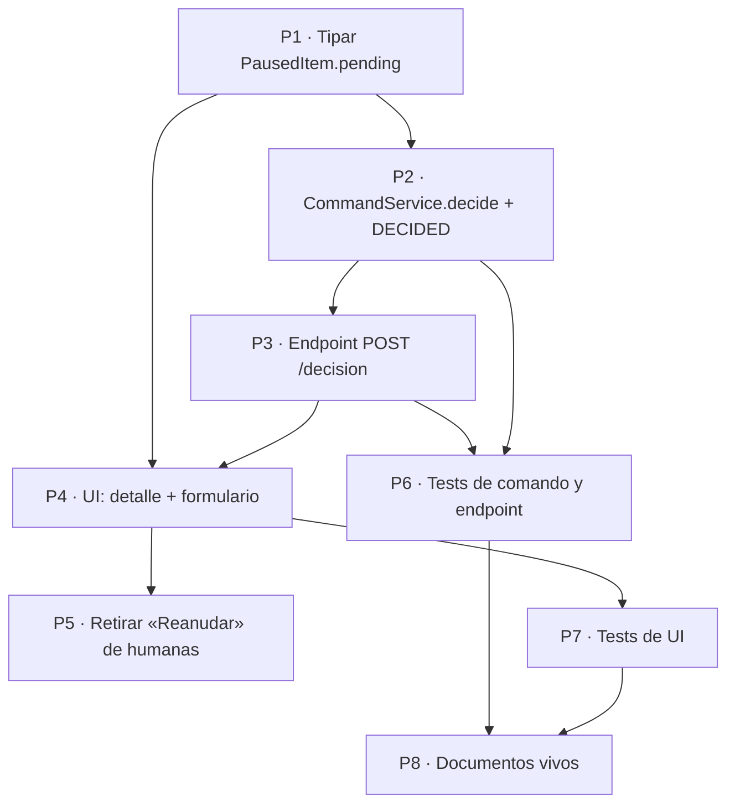

Última modificación: 2026-10-17 | Creado: 2026-10-17

# Plan: decisión humana desde el panel

El qué y el por qué están en [`spec.md`](spec.md); las tareas, en [`todo.md`](todo.md).
Spec aprobada el 2026-10-17. Depende de la [019](../019-panel-de-operacion/spec.md)
(el panel ya existe) y reutiliza `build_decision` y el transporte de reanudación
([ADR-0008](../../../adr/0008-hitl-por-cli-y-http-con-cola-unica.md)).

---

## 1. Overview

El cambio es pequeño y de bajo riesgo porque **no inventa contrato**: reutiliza el
modelo de decisión (`HitlDecision`/`FindingDecision`), su validador (`build_decision`)
y el transporte (un `ReviewRequest` con `decision`). Sólo hay que:

1. **Tipar** lo que el panel ya lee: `PausedItem.pending` pasa de `list[dict]` a
   `list[PendingDecision]`.
2. **Añadir un comando** `decide` al `CommandService` (construye con `build_decision` y
   encola) y su efecto `DECIDED`.
3. **Exponer un endpoint** `POST /api/reviews/{key}/decision` con el actor de la sesión.
4. **Pintar** el formulario de decisión en la UI (un control por hallazgo + nota) y
   retirar «Reanudar» de las pausas humanas.

## 2. Decisiones de implementación

| # | Decisión | Motivo |
|---|---|---|
| P1 | El comando vive en `CommandService.decide`, no en el endpoint | Toda la semántica de comandos ya está ahí; el endpoint sólo valida sesión y traduce `CommandError` a `409` (patrón de OP29-OP32) |
| P2 | `CommandService` gana una dependencia `reviewed_key` implícita (la del `review_key`) | `build_decision` exige `reviewed_key == paused.review_key`; el panel sólo tiene una clave, así que pasa la misma |
| P3 | El cuerpo del endpoint lleva **sólo** `items`; el `actor` no | OP51: el actor auditado es el de la sesión; el cuerpo no puede suplantarlo |
| P4 | La validación de forma (¿es un `FindingDecision`?) es `pydantic` → `400`; la de negocio (¿cubre los pendientes?) es `build_decision` → `409` | Distinguir «cuerpo mal formado» de «decisión que no aplica», como en la API |
| P5 | La UI no valida la completitud; muestra el `409` del servidor tal cual | Una sola regla (`build_decision`); el navegador no la reimplementa |
| P6 | La nota es por hallazgo | `FindingDecision.note` ya la tiene; un `rejected` explica su motivo |
| P7 | `PausedItem.pending` tipado obliga a tocar los fakes de test (`test_web.py`, `test_web_ui.py`, `test_web_commands.py`) | Es el precio de tipar; se hace en el mismo cambio |

## 3. Orden y dependencias

1. **Lectura (P1).** Tipar `pending`; ajustar `_paused_item` y los fakes.
2. **Comando (P2).** `decide` + `DECIDED`; test unitario.
3. **Endpoint (P3).** `POST /api/reviews/{key}/decision`; test HTTP por rol y por error.
4. **UI (P4, P5).** Detalle con campos y formulario; retirar «Reanudar» de humanas.
5. **Docs (P8).** `operacion.md` §5, `CONTEXT.md` si procede, `arquitectura.md` §7.

Cada bloque cierra con su test en verde; `make ci` al final.

## 4. Checkpoints

- **C1 — Lectura tipada.** `PausedItem.pending` es `list[PendingDecision]`; los tests
  del read model y de la UI pasan con el fake actualizado.
- **C2 — Comando.** `CommandService.decide` encola una `HitlDecision` que cubre los
  pendientes; decisión incompleta → `CommandError`; efecto `DECIDED`.
- **C3 — Endpoint.** `200` con efecto y actor de la sesión; `400`/`403`/`409`/`503`
  según el contrato §5.4 de la spec.
- **C4 — UI.** El detalle pinta los campos y el formulario; «Reanudar» no aparece en
  pausas humanas; `make ci` y `make docs-check` en verde.

## 5. Riesgos

| # | Riesgo | Mitigación |
|---|---|---|
| R1 | Tipar `pending` rompe fakes de test que usan `dict` | Se actualizan en el mismo commit (P7); el fallo es de test, no de producción |
| R2 | Doble envío del formulario encola dos decisiones | El segundo job es no-op en el worker (H6); el botón se deshabilita tras enviar, como los demás comandos |
| R3 | El formulario no cubre un pendiente añadido entre la carga y el envío | `build_decision` da `409` con los ids; la UI recarga |
| R4 | XSS en la nota del usuario | `_esc` sobre la nota, como el resto de la UI |
