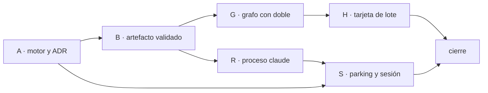

Última modificación: 2026-10-23 | Creado: 2026-10-23

# Plan: Review con Claude CLI

El *qué y por qué* vive en [`spec.md`](spec.md); las tareas, en [`todo.md`](todo.md).
Este plan fija el orden y por qué el orden es ese.

## Overview

Seis bloques. El primero no cambia el recorrido de una review. El segundo deja
un artefacto que el grafo puede leer sin tener el binario `claude`. El grafo y
la tarjeta se prueban contra ese artefacto **antes** de clonar nada: los
criterios 2 a 7 de la spec son un doble y un diff. El proceso real y la sesión
van después, porque son los que pueden escribir en un checkout o colar un
secreto en Redis.

1. **Frontera (A).** `REVIEW_ENGINE` al arrancar y el ADR del proceso. Con
   `llm` se compila el grafo de hoy.
2. **Artefacto (B).** Validación contra `contracts/findings-schema.json` y
   clave `repo + pr + head_sha`. Un JSON inválido no se guarda como válido.
3. **Grafo (G).** Otro grafo compilado: scope, carga con L0, persona estática
   si el perfil la declara, merge, sello, pausa, publish, notify. Sin fan-out
   LLM, sin `verify`, sin `fix_dispatch`.
4. **Tarjeta (H).** El lote se resuelve a un `HitlDecision` con un ítem por
   hallazgo antes de reanudar. El grafo no conoce los cuatro botones.
5. **Proceso (R).** Servicio aparte del worker y del `sandbox-runner`. El
   subproceso `claude` no hereda credencial de VCS ni de Teams.
6. **Sesión (S).** Sin token, el job sale de `reviews:jobs` a una lista de
   parking y el bucle sigue. El secreto no entra en Redis ni en el estado.

## Decisiones de implementación

Supuestos con los que está escrito este plan:

1. El corte de bloqueante es P0+P1, como quedó en la decisión 7 al aprobar.
2. La credencial de clonado vive en el servicio del CLI. El subproceso
   `claude` arranca con un entorno filtrado: el criterio 9 mira ese entorno.
3. El servicio entra en un perfil de compose `claude`. `docker compose up` sin
   ese perfil sigue siendo el motor `llm`.
4. Un artefacto válido y vacío no pausa y no escribe en el PR. Teams recibe un
   aviso corto, para que el job no parezca perdido.
5. La acción que abre la pausa es nueva (`publish`). `escalate` sigue
   significando el freno de hoy.

- **Dos grafos, un arranque.** `build_runtime` elige `build_graph` o
  `build_claude_graph` según `REVIEW_ENGINE`. Un valor distinto de `llm` o
  `claude` aborta el proceso. El grafo de `llm` conserva sus aristas: `scope →
  persona → merge → verify → policy → hitl → fix_dispatch → publish →
  fix_wait → publish_fix → notify_fix → notify`.
- **El artefacto entra como una persona sintética `claude`.** `dispatch` de
  este grafo manda un `Send` al cargador y, si el perfil declara
  `checks.typecheck`, otro a `ToolingReviewer`. El merge de hoy deduplica. L0
  se aplica solo a lo que salió del CLI, antes de entrar al merge. La persona
  estática sigue con su anclaje.
- **No se llama a `PolicyEngine`.** El gate de severidad ocultaría hallazgos
  antes de la pausa (decisión 7). Un sello marca cada hallazgo que pasó L0 con
  acción `publish`, `publication=FULL` y una razón fija. `publish` entra en
  `PENDING_ACTIONS`. No es `fix_*`: aunque alguien reutilice `APPROVED`,
  `dispatch_fixes` no lo elige. Este grafo, además, no tiene nodo
  `fix_dispatch` ni puerto de fixer.
- **`dropped` se traduce en publish, no en el sello.** Si el resultado humano
  es `dropped`, ese hallazgo se publica como `PublicationMode.DROP`: ni inline
  ni resumen. `rejected` sigue saliendo como «descartado» en el motor `llm`,
  que no emite `dropped`.
- **Un campo de estado que el grafo `llm` no escribe.** Hoy, si no hay
  publicables pero la review es parcial, `publish` comenta el PR. En este
  modo eso contradice la decisión 8. El grafo `claude` deja
  `silence_without_choice` en el estado. Con ese campo, todo en `drop` no
  escribe en el PR aunque haya cobertura parcial. Una fuente estática sin
  cubrir sigue comentando: «no pude leer la herramienta» no es «0 hallazgos».
  El aviso corto de Teams sale de `notify`, que hoy solo habla si `published`.
  Aquí habla también cuando la persona no eligió nada y el PR quedó en
  silencio.
- **La tarjeta no es un nodo.** Tres acciones de lote (`solo bloqueantes`,
  `todos`, `ninguno`) cubren todos los pendientes y se envían al momento. La
  cuarta marca un hallazgo (`approved` o `dropped`) y el Enviar sigue
  exigiendo la cobertura completa, la misma regla de `build_decision`. El
  `ApprovalRequest` lleva `pause_kind=publication`. Ausente, la tarjeta de hoy
  (Aprobar / Rechazar / Anotar).
- **El worker llama al runner antes de `invoke`.** Artefacto válido para ese
  `head_sha`: no hay segunda llamada. JSON inválido, proceso caído o tiempo
  agotado: el artefacto no se da por bueno, no se entra al grafo y el job se
  reintenta como cualquier review. Un fallo de cupo no se reintenta: parkea,
  igual que la falta de sesión, con un aviso distinto.
- **El secreto es un fichero `0600`.** Lo montan el panel (escritura) y el
  `claude-runner` (lectura). El worker no monta ese volumen. Pregunta
  `GET /session`, que responde sí o no. La lista de parking es
  `reviews:claude:parked`. El aviso único es una clave Redis sin el secreto;
  al volver la sesión se borra, y una caducidad vuelve a avisar.
- **Checkout propio.** Volumen distinto del clon *bare* del runner
  ([ADR-0018](../../../adr/0018-workspace-de-lectura-en-el-runner.md)). El ADR
  nuevo es el 0028. El wrapper valida stdout contra el esquema y descarta el
  resto de la salida. Claude no elige la ruta del fichero.

### Crítica al diseño (y qué se hace en su lugar)

- **Ramificar `build_graph` con un `if` dejaría el modo `llm` a un test de no
  haberlo tocado.** El criterio 1 pide los tests del grafo verdes sin cambiar
  el gold set. Un segundo builder es más código de aristas y menos sitios
  donde un `continue` se coma `verify`.
- **Reutilizar `escalate` para esta pausa mezclaría el freno con la pregunta
  de publicación.** `build_approval` solo pausa en `PENDING_ACTIONS`. Hace
  falta una acción pendiente que este grafo selle y que la política de `llm`
  no emita. `publish` es esa acción. El verbo de la tarjeta lo pone
  `pause_kind`, no el nombre de la acción.
- **Un subproceso dentro del worker no cumple «fuera del worker».** La imagen
  del worker lleva el token con el que se publica en el PR. Filtrar el entorno
  a mano es un olvido de una variable. El contenedor del CLI no recibe esas
  variables. El test del criterio 9 inspecciona el entorno del subproceso, no
  el del contenedor que clona.
- **Reencolar en `reviews:jobs` un job sin sesión atasca el bucle.** Con un
  solo job, el worker lo saca y lo vuelve a meter, y no llega al barrido. La
  lista de parking no se mira hasta que `GET /session` dice que hay sesión.
- **Meter el token en Redis lo pone al lado de colas que se vuelcan y se
  registran.** El booleano de sesión y el texto del aviso bastan al worker.

## Orden y dependencias

**Por qué G va antes que R.** Los criterios 2 a 7 se demuestran con un
artefacto fijado en el test. Esperar al binario y al clon retrasa la pausa,
que es el comportamiento visible, y mezcla un fallo de checkout con un fallo
de publicación.

**Por qué S espera a A y a R.** El parking distingue un job de este motor, y
el cupo lo señala el runner. La lista y el aviso se pueden probar con un doble
de `GET /session` en cuanto existe el puerto (R1); el fichero real cierra S3.

**Qué puede ir en paralelo.** H no toca el runner. R no toca la tarjeta.
Comparten el artefacto (B) y el resultado `dropped` (G4): H no se cierra sin
G4, R no necesita la tarjeta.

## Checkpoints

- **A-K (tras A):** `REVIEW_ENGINE=llm` compila el grafo de hoy. Un valor
  desconocido no arranca. ADR-0028 aceptado. `make ci` verde.
- **B-K (tras B):** un JSON que cumple el esquema se lee por `repo + pr +
  head_sha`. Uno que no cumple no queda como válido y no es una review de cero
  hallazgos.
- **G-K (tras G):** con el doble, el grafo no llama a `LlmReviewer` ni a
  `VerifierPort`. L0 tira la cita fuera del diff antes de la pausa. La persona
  estática entra en la misma pausa. «Ninguno» no escribe en el PR; el aviso
  corto está en la outbox; P2 queda fuera del resumen cuando se publican solo
  bloqueantes. Los tests del grafo `llm` siguen verdes.
- **H-K (tras H):** cada acción de lote produce un `HitlDecision` que cubre
  todos los pendientes. La tarjeta de `llm` sigue con Aprobar, Rechazar y
  Anotar.
- **R-K (tras R):** el segundo intento con artefacto válido no ejecuta el
  doble. El entorno del subproceso de prueba no contiene token de VCS ni de
  Teams. Un JSON inválido no entra al grafo.
- **S-K (tras S):** sin sesión, el job no hace `invoke`, un job `llm` de la
  misma cola sí se consume, y la outbox tiene un solo aviso cuyo texto no es
  el token. Al guardar el token en el panel, el job parqueado vuelve a
  `reviews:jobs`. Un fallo de cupo parkea y no publica.

## Riesgos

| Riesgo | Impacto | Contención en este plan |
|---|---|---|
| R1 de la spec: cupo compartido con el IDE | Alto | Topes de tiempo y de turnos en el runner. El cupo parkea (S4), no publica «0 hallazgos». Queda como riesgo de operación: la spec se aprobó sin esa confirmación. |
| El CLI escribe en el checkout o comenta el PR | Alto | Contenedor sin token de publicación, herramientas de escritura fuera del argv, única salida aceptada es stdout (R2, ADR-0028). |
| El token cae en Teams o en el checkpointer | Alto | Fichero `0600` fuera de Redis y de `ReviewState`. El aviso se asserta sin el secreto (S2). |
| El login bloquea la cola | Alto | Lista `reviews:claude:parked`, fuera del `BLPOP` (S1). |
| `approved` se lee como «arreglar» | Medio | Acción `publish`, que no es `fix_*`, y este grafo no tiene `fix_dispatch` ni fixer. |
| Un `if` en `publish` cambia el motor `llm` | Medio | El silencio extra solo corre con `silence_without_choice`, campo que `build_graph` no escribe. Test de la review parcial de `llm`. |
| Reintento que relanza Claude | Medio | El grafo no llama al CLI. La clave del artefacto es el `head_sha` (R3). |
