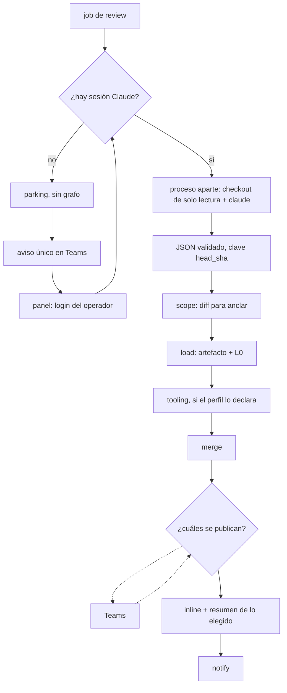

Última modificación: 2026-10-23 | Creado: 2026-10-23

# Review con Claude CLI, publicación elegida en Teams

> **Estado:** implementada

---

## 1. Objetivo

La empresa ya paga Claude Code. El modo actual gasta la API de `nan.builders` en
tres personas LLM y en el verificador adversarial. Se quiere un **segundo motor**,
elegible al arrancar el worker, en el que un solo `claude` haga la review y el
grafo conserve el resto: anclaje, política de no publicar a ciegas, pausa en Teams
y comentarios en el PR.

Se quiere:

1. Un ajuste de arranque que elija el motor de hoy (`llm`) o este (`claude`).
   Cambiarlo es reiniciar el worker, como los bindings de `config/models.yaml`.
   Con `llm` el grafo, las personas y la pausa actuales no cambian.
2. Que Claude corra **una vez por review**, antes del grafo, y entregue por stdout
   un JSON de hallazgos. Nuestro proceso lo valida, lo guarda y, si ya existe para
   ese `head_sha`, no vuelve a invocar el CLI.
3. Que el grafo, en este modo, no haga fan-out de personas LLM ni llame al
   verificador L2. Carga el artefacto, aplica L0, junta los hallazgos de la
   herramienta estática si el perfil la declara, pregunta en Teams cuáles se
   publican y publica solo esos.
4. Que la sesión de Claude sea del despliegue, no de la review. Si falta o
   caduca, Teams avisa y el panel (rol `operador`) es donde se inicia sesión. El
   secreto no entra en el canal ni en el estado del grafo.

## 2. No-objetivos

- **Sustituir el motor actual.** `REVIEW_ENGINE=llm` sigue con fan-out, L2,
  presupuesto de tokens, razonamiento en el panel y la pausa de hoy
  (`escalate` / `fix_with_approval`).
- **Arreglos.** En modo `claude` no hay `fix_dispatch`, ni parche, ni sandbox de
  verificación de fixes. «Publicar» no autoriza un cambio en el repo.
- **Que Claude publique, comente o decida.** No recibe el token de `twg` ni el de
  GitHub, ni habla con Teams. No escribe en el repositorio revisado ni elige la
  ruta del artefacto.
- **Reutilizar `rejected`.** Hoy un hallazgo rechazado sigue saliendo en el
  resumen como «descartado». Aquí, no publicar es `PublicationMode.DROP`: ni
  inline ni resumen.
- **Tratar la autocomprobación de Claude como L2.** El mismo proceso confirmando
  lo que acaba de escribir no refuta nada. El filtro es la persona que elige qué
  se publica. L0 sí se aplica: es determinista y tira la cita que no está en el
  diff.
- **Meter el CLI en un nodo del grafo.** Un reintento de nodo repetiría una
  llamada de minutos. El artefacto validado es la frontera: el grafo solo lee.
- **Extender el webhook de tooling** ([ADR-0004](../../../adr/0004-ingesta-diferida-por-artefacto-del-ci.md)).
  Ese puente es desechable y no gana capacidades. El JSON de Claude no entra por
  `POST /webhook/tooling`.
- **Clonar en el worker.** Quien publica en el PR no tiene credencial de clonado
  ([ADR-0018](../../../adr/0018-workspace-de-lectura-en-el-runner.md)).
- **Presupuesto de tokens, replay del gold set y stream de razonamiento** para
  este motor. El tope es de tiempo de pared y de turnos del CLI. El modo `llm`
  sigue midiéndose como hasta ahora.
- **Un token de Claude por review, o pegarlo en Teams.** El canal es compartido
  y el historial se conserva.

## 3. Decisiones

1. **Dos motores, un proceso.** `REVIEW_ENGINE=llm|claude`, leído al arrancar.
   No hay interruptor por PR.
2. **El CLI vive fuera del grafo y fuera del worker.** Un proceso que no publica
   en el PR hace el checkout de solo lectura, ejecuta el CLI sin herramientas de
   escritura y devuelve el JSON. El worker persiste el artefacto y solo entonces
   arranca el grafo. Hace falta un ADR nuevo: no reescribe el 0002 ni el 0018.
   El 0002 descartó `claude --print` dentro del núcleo; aquí el núcleo sigue
   viendo hallazgos ya validados contra `contracts/findings-schema.json`.
3. **Stdout, no un fichero escrito por Claude.** El wrapper valida el JSON, lo
   guarda asociado a `repo + pr + head_sha` y descarta la salida si no cumple el
   contrato. Un fallo del proceso o un JSON inválido no se publican como «0
   hallazgos»: la review queda en error reintentable, con aviso, y el artefacto
   no se da por bueno.
4. **Idempotencia del CLI.** Si el artefacto de ese `head_sha` ya es válido, no
   se vuelve a llamar. Un `head_sha` nuevo es otra review.
5. **Grafo en modo `claude`.** `scope` (hace falta el diff para anclar) → carga
   del artefacto y L0 → persona estática de tooling si el perfil la declara →
   `merge` → pausa de publicación → `publish` → `notify`. No hay fan-out LLM,
   ni `verify`, ni `fix_dispatch`.
6. **La herramienta estática se queda.** PHPStan no gasta suscripción y sus
   hallazgos siguen siendo grounded. El fan-out que desaparece es el de
   `correctness`, `security` y `arch`.
7. **Todos los hallazgos que pasan L0 se preguntan.** El gate de severidad no
   los oculta antes de la pausa. La tarjeta ofrece cuatro acciones: publicar
   solo bloqueantes (P0 y P1), publicar todos, no publicar ninguno, y marcar un
   hallazgo suelto. La decisión cubre todos los hallazgos, como hoy.
8. **Nada elegido, PR en silencio.** Si todo queda en `drop` y no hay fuente
   estática sin cubrir, `publish` no escribe en el PR (ya ocurre cuando no hay
   publicables y la review está completa). Teams recibe un aviso corto. No se
   publica un comentario «0 hallazgos». Una review parcial no sirve de excusa
   para comentar el PR cuando la persona no ha elegido nada.
9. **Resultado nuevo `dropped`.** No reutiliza `rejected`. El publish lo trata
   como `PublicationMode.DROP`. `approved` en este modo significa «publicar», no
   «autorizar un arreglo».
10. **Sesión única del despliegue.** El token se guarda como secreto del
    proceso, fuera del checkpointer y fuera de Teams. Sin token, los jobs de
    este motor se parquean **sin ocupar el hilo del worker** (el bucle es de un
    job cada vez). Teams manda un aviso único con enlace al panel. El rol
    `operador` completa el login ahí. Al guardarse el token se sueltan los jobs
    parqueados. Una caducidad repite el aviso, sin incluir el secreto.
11. **El fixer sigue en el motor `llm`.** Este modo no lo invoca.

## 4. Diseño

El modo `llm` no usa este camino.

**Artefacto.** Lista de hallazgos que cumplen
[`contracts/findings-schema.json`](../../../../contracts/findings-schema.json). El
`owner` del contrato (`downstream-resolver`, `human`, `release`) se conserva; no
se inventa un owner por persona. La persona estática sigue identificándose por
su nombre en el merge, como hoy.

**Pausa.** Misma cola, mismo `build_decision`, misma regla de «cubrir todos los
pendientes». Cambia el significado de la pregunta y el resultado `dropped`. La
tarjeta de lote se resuelve a un `HitlDecision` con un ítem por hallazgo antes
de reanudar: el grafo no aprende los cuatro botones.

**Auth.** Teams es el timbre, el mismo patrón que el aviso de pausa (outbox, sin
secreto). El panel ya distingue `operador` de `lector`. El formulario de login
no viaja en la Adaptive Card.

**Aislamiento del CLI.** Checkout de solo lectura, sin token de push, sin
herramientas de escritura, sin red hacia el VCS. La única salida que cuenta es
stdout. El proceso que publica no es el que ejecuta `claude`.

## 5. Riesgos

| # | Riesgo | Qué lo contiene |
|---|---|---|
| R1 | La suscripción no admite uso desatendido, o el cupo es el de quienes usan el IDE. Un PR grande se come el límite del equipo. | Confirmarlo antes de aprobar. Topes de tiempo y de turnos. Un fallo de cupo parkea, no publica «0 hallazgos». |
| R2 | El CLI escribe en el checkout o comenta el PR. | Sin token de VCS, sin herramientas de escritura, artefacto solo desde stdout. |
| R3 | El token acaba en el historial de Teams o en el checkpointer. | El aviso no lleva secreto. El token no entra en `ReviewState`. |
| R4 | Un login bloquea la cola. | Sin sesión no se hace `invoke`. Los jobs esperan fuera del bucle. |
| R5 | Preguntar hallazgo a hallazgo deja el canal sin leer. | La tarjeta es de lote. El detalle suelto es la excepción. |
| R6 | Claude alucina líneas y la persona publica citas rotas. | L0 y el anclaje al diff siguen en el grafo. Lo que no ancla no va inline. |
| R7 | Un clon con árbol de trabajo en el mismo sitio que las lecturas bare del runner mezcla dos contratos ([ADR-0018](../../../adr/0018-workspace-de-lectura-en-el-runner.md)). | Proceso distinto del worker y del clon bare. El ADR nuevo fija el límite. |
| R8 | Reintento del job relanza Claude y duplica coste. | Artefacto válido por `head_sha`: el reintento lo reutiliza. |

## 6. Criterios de hecho

1. Con `REVIEW_ENGINE=llm`, los tests actuales del grafo siguen verdes sin
   cambiar el gold set.
2. Con `REVIEW_ENGINE=claude`, un doble del proceso devuelve hallazgos y el
   grafo no llama a `LlmReviewer` ni a `VerifierPort`.
3. Un segundo intento con el mismo `head_sha` y artefacto válido no vuelve a
   invocar el doble.
4. Un JSON que no cumple el esquema no se publica y no cuenta como review sin
   hallazgos.
5. L0 elimina una cita fuera del diff antes de la pausa.
6. La pausa lista todos los hallazgos que pasaron L0. «No publicar ninguno» no
   escribe en el PR y deja un aviso en la outbox. «Solo bloqueantes» publica
   P0 y P1 y deja el resto en `drop`, fuera del resumen.
7. Un hallazgo de la persona estática se mezcla con los del artefacto y entra
   en la misma pausa.
8. Sin token, el job no entra al grafo, el worker sigue consumiendo jobs del
   motor `llm` y la outbox tiene un solo aviso. El texto del aviso no contiene
   el token. Tras guardarlo en el panel, el job parqueado se encola.
9. El proceso del CLI, en el test, no recibe credencial de VCS ni de Teams.

## 7. Preguntas abiertas

Ninguna que bloquee el borrador. Si al revisar se quiere otro corte de
«bloqueante» que no sea P0+P1, se cambia la decisión 7 antes de aprobar.
