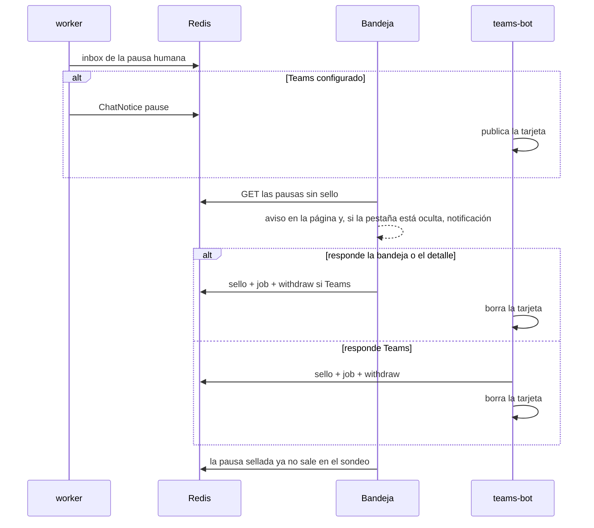

Última modificación: 2026-10-24 | Creado: 2026-10-24

# Bandeja de decisiones en el panel

> **Estado:** implementada
>
> **Entrega:** una sección del panel que muestra y responde las mismas
> interrupciones humanas que la tarjeta de Teams. Si Teams está configurado, la
> pregunta está en los dos sitios y vale la primera respuesta. Si no, solo está
> aquí.

---

## 1. Objetivo

Quien opera el panel tiene que ver cada pausa humana en cuanto aparece, poder
responderla sin abrir Teams y ver cómo desaparece al responder, venga la
respuesta de la web o de Teams.

## 2. No-objetivos

- Sustituir a Teams, al CLI o a la API. Se suman.
- Mostrar los avisos de review publicada ni las pausas de fix. No son preguntas.
- Reimplementar `build_decision` ni dar al panel el token de decisión.
- Notificar en el sistema operativo sin permiso del navegador. Sin permiso queda
  el aviso dentro de la página.

## 3. Decisiones

| # | Decisión | Motivo |
|---|---|---|
| B1 | La fuente es el inbox de pausas humanas sin sello, no la outbox | Sin Teams la outbox no recibe avisos; con Teams, un aviso ya consumido ya no está en la cola |
| B2 | La respuesta pasa por `DecisionSubmitter` | Mismo validador y mismo sello que la tarjeta ([ADR-0030](../../../adr/0030-bandeja-web-de-la-decision.md)) |
| B3 | El formulario del detalle también sella | Si no, responder ahí dejaba la tarjeta y encolaba una segunda reanudación |
| B4 | Al ganar se encola `withdraw` solo con Teams activo, y el bot borra el mensaje | La web no habla con Teams. Sin bot, el aviso no tendría consumidor |
| B5 | Un barrido del bot borra tarjetas cuya pausa ya no está | El CLI, la API y el TTL no encolan `withdraw` |
| B6 | El panel sondea y avisa; la pregunta sigue hasta que se cierra | Es lo que se pidió: verlas hasta responderlas |

## 4. Diseño

`GET /api/bandeja` devuelve las pausas abiertas. `POST /api/bandeja/{review_key}/decision`
acepta `items` o, en una pausa de publicación, `batch`
(`blockers` / `all` / `none`). El actor es el de la sesión. Un lector ve y no
responde.

## 5. Riesgos

- El CLI y la API no sellan. La tarjeta de Teams sigue hasta que la pausa sale
  del inbox y el barrido la borra. La bandeja la deja de listar en ese momento,
  no en el instante del clic.
- Una notificación del navegador exige contexto seguro y permiso. El aviso de la
  página no.
- Dos pestañas pueden avisar las dos la primera vez si el almacenamiento local
  aún no tiene el `pause_id`.

## 6. Criterios de hecho

- Una pausa humana abierta aparece en `/bandeja` y se puede responder con el
  mismo contrato que la tarjeta, incluido el lote de publicación.
- Una pausa de fix no aparece.
- La segunda respuesta no encola otro job y la pregunta deja de listarse.
- Con retirada configurada, la primera respuesta encola `withdraw` y el bot borra
  la tarjeta. Un aviso de pausa que llega cuando ya hay sello no se publica.
- Sin retirada, no se encola `withdraw`.
- La página no inserta el texto del hallazgo con `innerHTML`.

## 7. Preguntas abiertas

Ninguna. El alcance (solo preguntas, no el chat de Teams) queda cerrado en B1.
