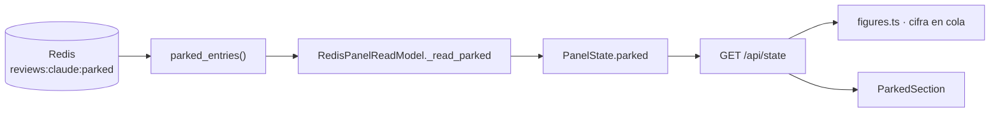

Última modificación: 2026-10-29 | Creado: 2026-10-29

# El panel enseña los jobs aparcados

> **Estado:** implementada
>
> **Aprobada:** 2026-10-29. Se aprueba tal cual, con Q1 y Q2 como están
> propuestas: `quota-wait` no es un estado distinto en la API y el aparcado no
> cuenta en el presupuesto.
>
> **Implementada:** 2026-10-29. `GET /api/state` trae `parked` con su motivo, el
> cuadro de mando tiene la sección «Aparcados» y la cifra de cola los cuenta. El
> motivo se lee con el mismo parseo que el worker (`parse_parked`), así que no hay
> una segunda interpretación del payload.
>
> **Entrega objetivo:** el cuadro de mando responde «¿qué pasa ahora?» también
> cuando un job está esperando en `reviews:claude:parked`. Hoy puede quedarse ahí
> horas sin aparecer en ninguna pantalla ni en ninguna cifra.

---

## 1. Objetivo

El parking del motor `claude` ([025](../025-revisor-claude-cli/spec.md),
`reviews:claude:parked`) guarda los jobs que no pueden ejecutarse: falta de sesión
(`session`), cupo agotado (`quota`), los siguientes en espera del cupo
(`quota-wait`) y el techo de turnos o de tiempo (`ceiling`).

El panel **no lo lee**. `PanelState` (`web/read_model.py`) expone cola, en vuelo,
pausas, descartes y presupuesto; el parking no es ninguna de las cinco. Con
`REVIEW_ENGINE=claude` y sin sesión, un lanzamiento desde el panel desaparece:
`POST /api/launch` devuelve `202`, el job se aparca y `/api/state` sigue vacío.
Los logs lo dicen, pero el panel existe justo para no tener que leer logs.

Se quiere:

1. **`GET /api/state` expone los aparcados** con su motivo y su review.
2. **El cuadro de mando los pinta** en una sección propia, con la acción que
   desatasca cada motivo.
3. **`session` enlaza a `/claude`**, que es lo único que lo resuelve.

## 2. No-objetivos

- **No se cambia la semántica del parking.** Quién aparca, con qué motivo y
  cuándo se suelta es del worker y del panel `ClaudeLogin`; aquí solo se lee.
- **No se gana un comando nuevo.** Desaparcar sigue siendo escribir la sesión
  (`POST /api/claude/session`) o esperar a que caduque el aviso de cupo. No hay
  «desaparcar a mano»: el cupo no se debe poder saltar desde una pantalla.
- **No se toca `release_parked` ni los avisos de Teams.**
- **No se reescribe `queue.parked()`.** Devuelve `list[ReviewRequest]` y sigue
  así; el motivo se lee con una función nueva y pública.

## 3. Contexto y evidencia

`RedisReviewQueue.parked()` descarta el motivo: mapea la entrada con
`_parked_request`, que devuelve solo el `ReviewRequest`. El motivo sí está en el
payload (`{"reason": ..., "request": {...}}`) y sí lo lee `_parse_park`, pero es
privado. Por eso hace falta exponerlo antes de poder pintarlo.

El payload completo, tal como está hoy en Redis:

```json
{"reason": "session", "request": {"repo": "...", "pr_id": 19, "pipeline_id": "panel", "launch": true, ...}}
```

## 4. Decisiones

| # | Decisión | Motivo |
|---|---|---|
| K1 | `PanelState` gana `parked: list[ParkedItem]` con `{review_key, repo, pr_id, pipeline_id, reason, launch}` | Es lo que el cuadro de mando necesita para agrupar y enlazar. No se expone el `ReviewRequest` entero: el panel no lo usa y un campo nuevo del modelo aparecería en la API sin querer |
| K2 | El motivo se lee con `parked_entries()`, una función pública nueva del puerto de cola | `parked()` no puede cambiar de firma sin romper a quien ya lo usa, y el motivo es lo único que distingue un caso del otro |
| K3 | `reason` se tipa como `Literal["session", "quota", "quota-wait", "ceiling"]` | Ya existe `PARK_REASONS`; un valor que no esté ahí es un payload ilegible y se descarta, como hace hoy `_parse_park` |
| K4 | Un aparcado **cuenta en la cifra de «en cola»** | Está esperando, no corriendo ni muerto. Si no cuenta, la primera pantalla sigue diciendo «nada esperando» mientras hay trabajo parado |
| K5 | La sección se pinta **siempre**, vacía incluida, con el recuento en la cabecera | Una sección que aparece y desaparece deja al operador sin saber si el panel la mira |
| K6 | `session` enlaza a `/claude`; `quota` y `quota-wait` se explican y no ofrecen botón; `ceiling` enlaza a `/config` | Es la acción real de cada motivo. Un botón que no desatasca nada es peor que ninguno |

## 5. Diseño o contrato

### 5.1 API

`GET /api/state` añade un campo; el resto no cambia:

```json
"parked": [
  {"review_key": "repo:19:abc:panel", "repo": "pcgarat/agent-review-graph", "pr_id": 19,
   "pipeline_id": "panel", "reason": "session", "launch": true}
]
```

`reason` fuera de `PARK_REASONS` no llega aquí: `_parse_park` descarta la entrada,
igual que hoy.

### 5.2 Lectura



### 5.3 Pantalla

Una sección «Aparcados» en el cuadro de mando, con una fila por job: review,
motivo con su explicación, y la acción de su motivo. En la cifra de «en cola» el
detalle dice cuántos de esos están aparcados.

## 6. Riesgos

| # | Riesgo | Qué lo contiene |
|---|---|---|
| K1 | Un Redis caído tumbaba el panel | `_read_parked` va por `_guard`, como el resto: sección vacía y aviso en el log |
| K2 | El payload cambia y el panel miente | El parse valida `reason` y `ReviewRequest`; una entrada ilegible se descarta con aviso, no se pinta a medias |
| K3 | El operador cree que un botón desaparca cuando no | `quota` y `quota-wait` no llevan botón; el texto dice qué lo resuelve |

## 7. Criterios de hecho

1. `GET /api/state` incluye `parked` con el motivo de cada job.
2. Sin parking, `parked` es `[]` y la sección se pinta vacía.
3. Un Redis caído deja `parked` vacío sin tumbar `/api/state`.
4. El cuadro de mando pinta una fila por aparcado, con su motivo y su acción.
5. `reason: "session"` enlaza a `/claude`; `ceiling` a `/config`; los de cupo no
   ofrecen botón.
6. La cifra de «en cola» cuenta los aparcados y lo dice en el detalle.
7. `make ci` en verde.

## 8. Preguntas abiertas

- **Q1 — ¿`QuotaWait` merece distinción visual?** Es transitorio: sale solo al
  caducar el aviso. Se propone pintarlo igual que `quota` pero con el texto
  «sale solo cuando caduque el aviso», sin ser un estado distinto en la API.
- **Q2 — ¿Cuenta el aparcado en el presupuesto?** No: no ha gastado tokens. Fijado
  como no-objetivo, no hay cambio.
