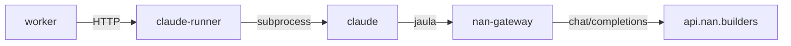

Última modificación: 2026-10-29 | Creado: 2026-10-29

# 032 — La skill con el modelo del clúster

> **Estado:** implementada

## Objetivo

Que `ce-code-review` corra sobre un modelo del clúster (`nan.builders`), sin
cambiar de motor ni de skill: el mismo `REVIEW_ENGINE=claude`, el mismo
binario `claude`, el mismo argv, el mismo artefacto y el mismo grafo. El
destino por defecto sigue siendo Anthropic. El clúster es el otro destino
del mismo CLI.

## No-objetivos

- Un motor nuevo (`cursor`, `opencode`…): un tercer `REVIEW_ENGINE` no entra
  aquí.
- Sustituir la vía `llm` ni tocar su *gold set*. El arnés
  ([ADR-0017](../../../adr/0017-replay-determinista-con-fingerprint.md)) mide
  solo el motor `llm`. Esta iniciativa no añade corridas, baselines ni
  comparaciones al *gold set*.
- Meter el gateway en el worker: el worker publica en el PR y no traduce
  protocolos.
- Cambiar el clasificador de techo y cupo: los emite Claude Code igual
  (`subtype` del evento `result`).
- Un `RunnerSpec` genérico. El binario, el argv y el contrato de salida no
  cambian; generalizarlos sería anticipación.

## Decisiones

1. **Un backend, dos destinos.** `CLAUDE_UPSTREAM` (`anthropic` | `gateway`)
   elige `api.anthropic.com` o el gateway. `anthropic` es el valor por
   defecto: sin declararlo, el argv y el entorno del hijo quedan como hoy.
2. **El gateway es un servicio del despliegue, no un experimento.** Vive en
   el perfil `claude` de Compose, junto a `claude-runner`. Si el spike
   (criterio 3) no sale, se retira la iniciativa; si sale, el servicio se
   queda. No hay una variante «solo para evaluar».
3. **El gateway no habla con nadie salvo el clúster.** Su egress es
   `api.nan.builders`; su ingress, la red interna de Compose. La clave del
   clúster vive solo ahí y no entra en `claude-runner` ni en el worker.
4. **La jaula se declara por Settings, no por YAML.** `allowedDomains` pasa
   de constante a parámetro de `runner_sandbox_settings`. La jaula sigue
   siendo código ([ADR-0033](../../../adr/0033-skill-fuera-del-nucleo.md)); lo
   que cambia es a qué dominio apunta cuando el destino es el gateway.
5. **Sin sesión OAuth no hay parking por `session`.** Con `gateway`,
   `active()` responde por el health del gateway.
   *Enmienda 2026-10-29 ([ADR-0038](../../../adr/0038-el-cluster-se-espera.md)):*
   con el gateway caído el job se aparca como `gateway`, con su propio aviso,
   y vuelve solo cuando el gateway responde.
6. **LiteLLM va pineado a una versión conocida.** 1.82.7 y 1.82.8 están
   descartadas: se publicaron con código de exfiltración de credenciales
   (lo advierte la propia documentación del clúster).
7. **El modelo del gateway no sale de `config/models.yaml`.** Ese registro
   es del motor `llm`. El panel elige `deepseek-v4-flash` o `glm5.3-flash`.
   Si nadie ha elegido y el destino de entorno es el gateway, manda
   `CLAUDE_GATEWAY_MODEL` (por defecto `deepseek-v4-flash`).
8. **`ANTHROPIC_BASE_URL` no apunta al clúster.** `https://api.nan.builders/v1/messages`
   responde 404: el clúster solo habla `/v1/chat/completions`. Hace falta el
   gateway. Comprobado el 2026-10-29.
9. **Un 429 del clúster no es cupo (P4).** El gateway lo reintenta unas pocas
   veces dentro de la misma llamada. Si sigue, el runner lo devuelve como
   fallo transitorio y el worker reencola el job. El parking `quota` queda
   solo para el desenlace de cupo de Claude Code, en el destino Anthropic.
   *Enmienda 2026-10-29 ([ADR-0038](../../../adr/0038-el-cluster-se-espera.md)):*
   reencolar sin espera llevaba la review a la DLQ en tres pasadas. Ahora el
   runner responde `503` y el worker aparca como `cluster-wait` durante 300 s;
   no gasta intentos.
10. **La página `/claude` elige el modelo, no el motor.** Tres opciones:
    `claude` (sesión de Anthropic), `deepseek-v4-flash` y `glm5.3-flash`.
    Las dos últimas son el gateway. `llm` no aparece: `REVIEW_ENGINE` sigue
    en el `.env` y cambiarlo sigue siendo reiniciar el worker a mano. La
    elección se guarda junto a la sesión, en el volumen que ya comparten el
    panel y el runner; si nadie ha elegido, manda `CLAUDE_UPSTREAM`.
    `claude-runner` la lee en cada `POST /run`. No hay botón de reinicio y
    ningún proceso sale. El servicio `web` no recibe el socket de Docker.

## Diseño o contrato

`nan-gateway` traduce Anthropic (`/v1/messages`) a OpenAI
(`/v1/chat/completions`). El núcleo no conoce LiteLLM ni el clúster: solo
`claude-runner` cambia a quién le pide.

Un `localhost` del host no se resuelve dentro de la red de `bwrap`. El
gateway tiene que ser un nombre de la red de Compose
(`http://nan-gateway:4000`), y ese nombre es el único dominio extra de la
jaula cuando `CLAUDE_UPSTREAM=gateway`.

Variables nuevas. Todas vacías o sin declarar = comportamiento actual:

| Variable | Proceso | Efecto |
|---|---|---|
| `CLAUDE_UPSTREAM` | worker, claude-runner | `anthropic` (defecto) o `gateway` |
| `CLAUDE_GATEWAY_URL` | claude-runner | `http://nan-gateway:4000` |
| `CLAUDE_GATEWAY_TOKEN` | claude-runner | override del `master_key`. Vacío: lo genera el arranque del perfil `claude` |
| `CLAUDE_GATEWAY_MODEL` | claude-runner | alias que expone LiteLLM |
| `NAN_API_KEY` | nan-gateway | la clave del clúster; no la ve nadie más |

El hijo las recibe por `extra_env`, no ampliando `CHILD_ENV_ALLOW`. Con
`gateway` no recibe `CLAUDE_CODE_OAUTH_TOKEN`. Sí recibe
`CLAUDE_CODE_DISABLE_NONESSENTIAL_TRAFFIC=1`: sin ella, Claude Code intenta
hablar con dominios que la jaula no permite.

## Riesgos

- **Calidad.** El modelo del clúster tiene que sostener el procedimiento de
  la skill (personas, dispatch, dos hojas) y devolver un objeto `mode:agent`
  que `adapt_agent_mode` acepte. No se mide con el *gold set*: se mide en el
  spike, leyendo una review real.
- **Traducción de herramientas.** Un fallo de LiteLLM al pasar `tools` de
  Anthropic a OpenAI no es un fallo de red: es una review sin lecturas y con
  hallazgos inventados. El spike lo cubre.
- **Techo de razonamiento.** En el motor `llm`, `reasoning_effort` alto deja
  el turno sin contenido (`finish_reason=length`). Bajo Claude Code ese
  dial no existe por modelo: si hace falta, se baja en el gateway.
- **Privacidad.** El diff deja de ir a Anthropic y va al clúster. Es un
  cambio de quién ve el código. Va en `docs/operacion.md` §3 cuando se
  implemente, y en el [ADR-0037](../../../adr/0037-la-skill-con-un-backend-ajeno.md).
- **Telemetría.** Sin `CLAUDE_CODE_DISABLE_NONESSENTIAL_TRAFFIC=1`, el CLI
  intenta salir de la lista estricta y cada `Bash` muere.

## Criterios de hecho

1. `CLAUDE_UPSTREAM` sin declarar deja el argv y el entorno del hijo
   idénticos a hoy (test de paridad).
2. Con `CLAUDE_UPSTREAM=gateway`, el hijo recibe la URL, el token, el modelo
   y `CLAUDE_CODE_DISABLE_NONESSENTIAL_TRAFFIC`, y no recibe
   `CLAUDE_CODE_OAUTH_TOKEN`.
3. **Spike, antes de código de producción.** Una review real de un PR del
   repo, con `mode:agent base:<sha>` contra el gateway, produce un artefacto
   que `adapt_agent_mode` acepta (`status: complete`), y una persona lo lee
   y reconoce la skill (no un resumen suelto del diff). Si no, esta
   iniciativa no se implementa.
4. El *gold set* y `test_eval_harness` no cambian.
5. `make ci` en verde cuando haya código.

## Preguntas abiertas

Ninguna.
